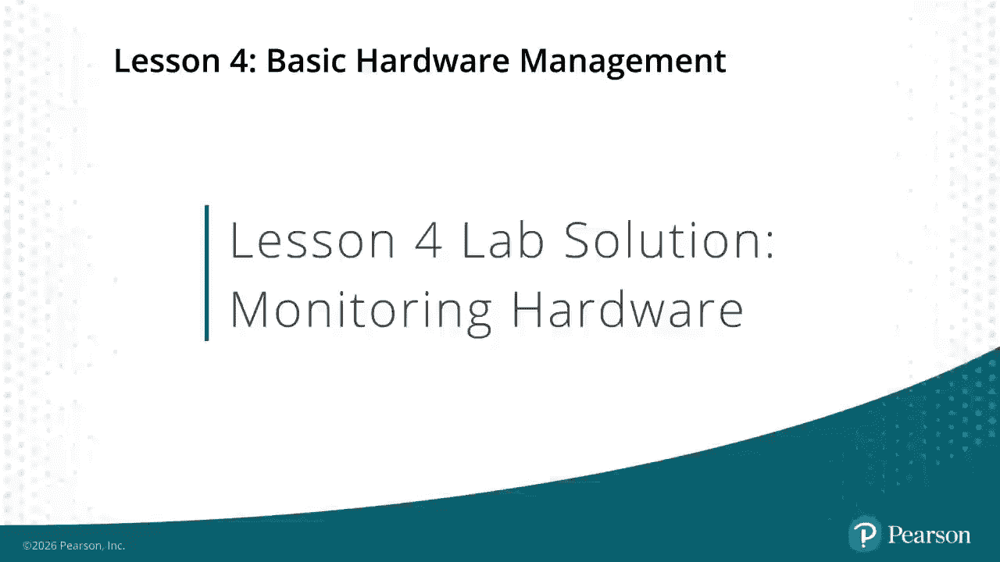
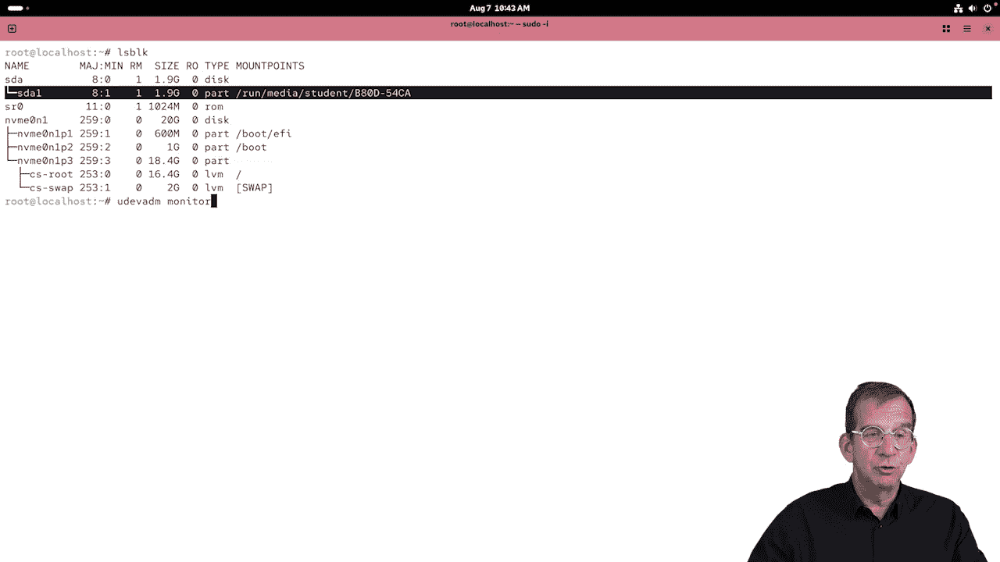

# 🖥️ CompTIA Linux+ V8：Lesson 4：监控硬件实验解答

在本节课中我们将要学习如何在 Linux 系统中监控硬件设备。具体来说，我们会学习如何使用系统自带的工具观察 USB 存储设备的插入和拔出过程，并了解系统内核如何为新设备创建设备文件。课程还会教你如何验证设备是否已经就绪，以及设备被拔出后系统是如何自动清理相关资源的。这些知识是 Linux 系统管理中处理硬件热插拔的基础，掌握之后你就能更好地排查服务器或工作站上的存储设备问题。


首先，我们来看看实验开始时需要执行的操作。讲师提醒你，要想观察硬件事件，首先得启动一个专门的监控工具。在 Linux 中，这个工具用来捕获内核发送的设备事件，这样你插入或者拔出设备时，屏幕上就会显示相关信息。整个过程不需要安装额外的软件，因为大多数发行版都默认包含这个工具。


以下是需要执行的步骤：



- 启动设备监控命令 `udevadm monitor`
- 保持终端窗口打开，等待硬件事件产生

执行 `udevadm monitor` 之后，终端会进入等待状态。此时屏幕上不会立即显示大量内容，因为程序正在监听内核发出的 uevent 信号。只有当你插入或拔出硬件设备时，相关事件才会被打印出来。你可以把它想象成一个专门记录硬件来去的日志本。


接下来，我们插入 USB 闪存盘，看看系统会有什么反应。当你把 U 盘插进电脑的 USB 接口后，刚才那个监控终端会立刻打印出一系列信息。这些内容就是内核和 udev 守护进程为新设备生成的事件记录，每一行都代表一次硬件状态的变化。

以下是你会在屏幕上看到的现象：

- 终端打印出多行文本，每一行代表一个硬件事件
- 系统检测到新的块设备，并分配设备节点
- 出现与 `/sys` 目录相关的文件名信息

这里有一个关键点需要注意。屏幕上显示的那些内容，本质上都是文件名。它们对应的是系统内核在 `/sys` 目录下为设备创建的条目。在 Linux 中，几乎所有硬件信息最终都会体现为文件系统中的文件或目录。通过读取这些文件，你就可以知道系统里现在有哪些硬件设备。

设备在系统中的体现可以用下面这个简单的关系来概括：

```
硬件设备 → /sys 目录下的文件 → 用户可读取的设备信息
```

在这个实验中，你会看到系统识别出了一个名为 `sda1` 的设备。这通常代表 USB 闪存盘上的第一个分区。一旦确认设备已经出现，你不需要继续监控，可以按下 `Ctrl+C` 组合键退出监控程序。

以下是退出监控的操作：

- 在终端中按下 `Ctrl+C`
- 确认程序已停止并返回命令提示符


退出监控程序之后，我们还需要确认 `sda1` 设备是否真的可用。光看到监控输出还不够，最好用一个磁盘列表命令来验证。这样可以保证设备不仅被内核识别，而且已经准备好被挂载和使用。设备能否被正常使用，直接决定了你能否把数据拷贝进去或者从里面读取数据。

以下是验证设备可用性的方法：

- 执行 `lsblk` 命令列出所有块设备
- 在输出结果中查找 `sda1` 条目
- 确认该设备具有对应的大小和挂载点信息

当你在 `lsblk` 的输出中找到 `sda1` 时，就说明 USB 闪存盘已经成功被系统识别。此时你可以放心地对它进行读写操作，或者将其挂载到某个目录下使用。


最后，我们来看看拔出设备时会发生什么。Linux 的设备管理机制不仅在设备插入时会自动创建设备节点，在设备被拔出时，也会自动清理不再需要的资源。这意味着你不需要手动删除设备文件，系统会帮你处理好一切。这点对于避免系统出现孤儿设备条目非常重要。

以下是拔出设备后的表现：

- 从 USB 接口拔出闪存盘
- 观察 `udevadm monitor` 终端（如果保持打开）或系统日志
- 看到 `udev` 正在清理与该设备相关的所有条目



当你拔出 U 盘后，系统会移除 `/sys` 和 `/dev` 下与该设备对应的文件和目录。这个过程由 udev 守护进程自动完成，确保系统不会保留失效的设备引用。这就是 Linux 处理热插拔设备的整洁方式。


本节课中我们一起学习了如何监控 Linux 硬件设备。我们首先启动了 `udevadm monitor` 来监听内核事件，接着插入 USB 闪存盘并观察了系统产生的文件名和设备节点，了解了这些信息与 `/sys` 目录的关系，然后按下 `Ctrl+C` 退出监控，使用 `lsblk` 验证了 `sda1` 设备的可用性，最后拔出设备并观察了 `udev` 自动清理设备资源的过程。通过这个实验，你可以更直观地理解 Linux 是如何管理硬件热插拔的。

