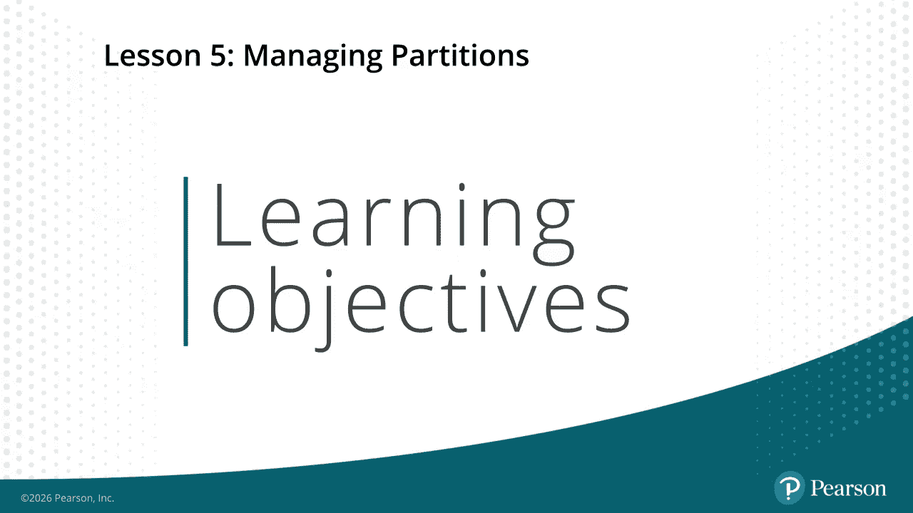

# CompTIA Linux+ V8：284：Linux磁盘分区管理 💾


在本节课中，我们将要学习Linux系统是如何组织硬盘的，重点掌握分区表、设备命名、分区创建以及文件系统配置等基础知识。


欢迎来到分区管理课程，在这一节里我们将探讨一块硬盘在Linux系统中是如何被组织和管理的。硬盘不仅仅是一个存储空间，它需要被切分成若干个部分才能被操作系统识别和使用，这些部分就是我们常说的分区。了解硬盘组织方式是学习Linux系统安装和维护的第一步，因为没有正确的分区，操作系统就无法正常安装和运行。在接下来的内容中，我们会从最基础的分区表类型开始，逐步深入到具体的分区操作和文件系统创建。


本节我们先来看看MBR和GPT两种分区表之间有什么不同。




以下是MBR和GPT分区表的主要区别：

- MBR分区表支持的最大磁盘容量较小，最多只能识别2TB左右的空间。
- GPT分区表没有这个限制，适用于现代大容量硬盘。
- MBR最多只允许创建四个主分区，或者三个主分区加一个扩展分区。
- GPT支持更多的分区数量，通常不需要担心分区数量不够用。


核心概念可以用下面这个简单的公式来描述：

```text
选择分区表 = 磁盘容量小于等于2TB ? MBR : GPT
```


了解完分区表之后，我们需要知道Linux是如何给存储设备命名的。


存储设备名称是系统用来识别硬盘和分区的方式，比如第一块SATA硬盘通常被称为/dev/sda，第二块被称为/dev/sdb。分区则会在设备名称后面加上数字，例如/dev/sda1表示第一块硬盘上的第一个分区。掌握设备命名规则后，你才能在命令行中准确地指定要操作的硬盘或分区，否则很容易把数据写错盘。


以下是常见的Linux存储设备命名示例：

- /dev/sda：第一块硬盘
- /dev/sda1：第一块硬盘上的第一个分区
- /dev/sdb：第二块硬盘
- /dev/nvme0n1：第一块NVMe固态硬盘


设备名称的核心格式可以用代码表示：

```text
/dev/sdXN
```

其中X代表盘符字母，N代表分区编号。


有了设备名称的基础，接下来学习如何使用fdisk工具来创建分区。


fdisk是Linux中用于操作分区表的经典命令行工具。使用fdisk时，你需要先指定目标硬盘，比如输入fdisk后跟设备名称，然后进入交互式界面。在这个界面里，你可以新建分区、删除分区、修改分区类型，最后把更改写入硬盘。创建分区时需要指定分区的起始扇区和结束扇区，或者直接指定分区大小，系统会帮你算出具体位置。


以下是使用fdisk创建分区的基本步骤：

1. 输入命令 `sudo fdisk /dev/sda` 打开目标硬盘的分区表。
2. 按下 `n` 新建一个分区。
3. 选择分区类型，主分区输入 `p`，扩展分区输入 `e`。
4. 指定分区编号和大小，或者直接回车使用默认值。
5. 按下 `w` 保存更改并退出，按下 `q` 不保存直接退出。


fdisk操作的核心命令可以用代码块展示：

```bash
sudo fdisk /dev/sda
# 进入交互界面后：
n   # 新建分区
p   # 主分区
1   # 分区号
    # 默认起始扇区
+20G # 分区大小
w   # 写入并退出
```


掌握普通分区之后，我们需要理解MBR模式下扩展分区和逻辑分区的关系。


在MBR分区表中，主分区的数量有限制，如果需要更多分区，就必须使用扩展分区。扩展分区本身不能直接存放数据，它更像是一个容器，里面可以包含多个逻辑分区。逻辑分区才是真正用来存放文件的分区。这种设计是为了在MBR的四个主分区限制下，仍然能够在一块硬盘上创建更多的分区。


以下是MBR中主分区、扩展分区和逻辑分区的关系说明：

- 主分区：最多4个，可以直接安装操作系统。
- 扩展分区：最多1个，不能直接格式化或存放数据。
- 逻辑分区：创建在扩展分区内部，数量通常没有严格限制。


这个关系可以用简单的公式表达：

```text
主分区数量 + 扩展分区数量 ≤ 4
逻辑分区数量 = 扩展分区内部可创建的分区总数
```


学习完MBR分区后，我们继续看看如何管理GPT分区。


GPT分区表没有主分区和扩展分区的区别，所有的分区在GPT看来都是平等的。这意味着你不需要再为分区数量不足而烦恼，也不用专门去创建扩展分区来容纳更多逻辑分区。GPT还自带分区表备份，更能保护数据安全。管理GPT分区的工具和fdisk类似，但通常推荐使用gdisk或 parted 来操作，因为它们对GPT的支持更完善。


以下是管理GPT分区时需要注意的几点：

- GPT不区分主分区、扩展分区和逻辑分区，所有分区地位相同。
- GPT支持的分区数量远多于MBR，一般足够日常使用。
- GPT分区表自带备份副本，损坏后更容易恢复。


GPT分区操作的核心命令可以用代码表示：

```bash
sudo gdisk /dev/sda
# 或者使用 parted
sudo parted /dev/sda
```


分区创建完成后，还需要把分区格式化成文件系统，并配置交换空间。


仅仅创建分区还不够，操作系统需要知道分区里要存放什么类型的数据。常见的Linux文件系统有ext4、XFS等，格式化分区就是给它安装一个文件系统，这样系统才能读写文件。交换空间（Swap）则是用来在内存不足时临时存放数据的分区，防止系统因为内存耗尽而崩溃。创建交换空间通常需要先建立一个专门的分区，然后用mkswap命令初始化。


以下是创建文件系统和交换空间的常用命令：

- 格式化为ext4文件系统：`mkfs.ext4 /dev/sda1`
- 格式化为XFS文件系统：`mkfs.xfs /dev/sda1`
- 初始化交换空间：`mkswap /dev/sda5`
- 启用交换空间：`swapon /dev/sda5`


文件系统和交换空间的创建可以用代码块概括：

```bash
mkfs.ext4 /dev/sda1
mkswap /dev/sda5
swapon /dev/sda5
```


除了普通分区，本节最后还会介绍LVM卷和软件RAID设备。


LVM（逻辑卷管理）允许你把多个物理硬盘或分区合并成一个大的存储池，然后从中划分出灵活的逻辑卷，方便以后调整大小。软件RAID则是通过软件方式把多块硬盘组合成一个逻辑设备，用来提高性能或提供数据冗余备份。这两项技术在服务器环境中非常常见，能让存储管理更加灵活和安全。


以下是LVM和软件RAID的核心概念说明：

- LVM物理卷（PV）：底层的硬盘或分区。
- LVM卷组（VG）：由多个物理卷组成的存储池。
- LVM逻辑卷（LV）：从卷组中划分出来的可用空间。
- 软件RAID：通过mdadm等工具将多块硬盘组合成虚拟设备。


LVM的基本关系可以用代码表示：

```text
物理卷 (PV) → 卷组 (VG) → 逻辑卷 (LV)
```


和其他课程一样，本节也包含一个实验环节，让你可以动手练习所学的技能。


实验环节非常重要，因为光看理论不够，必须亲自在系统上操作分区、创建文件系统、配置交换空间，才能真正掌握这些命令。实验通常提供一个安全的练习环境，即使操作失误也不会影响真实数据，建议你跟着步骤一步步完成，遇到问题时可以多次尝试。


本节课中，我们一起学习了Linux硬盘的组织方式，重点掌握了MBR和GPT分区表的区别、存储设备命名规则、使用fdisk创建分区、MBR扩展分区与逻辑分区的关系、管理GPT分区、创建文件系统和交换空间，以及LVM卷和软件RAID设备的基础知识。希望这些内容能帮助你建立起对Linux存储管理的整体认识。


