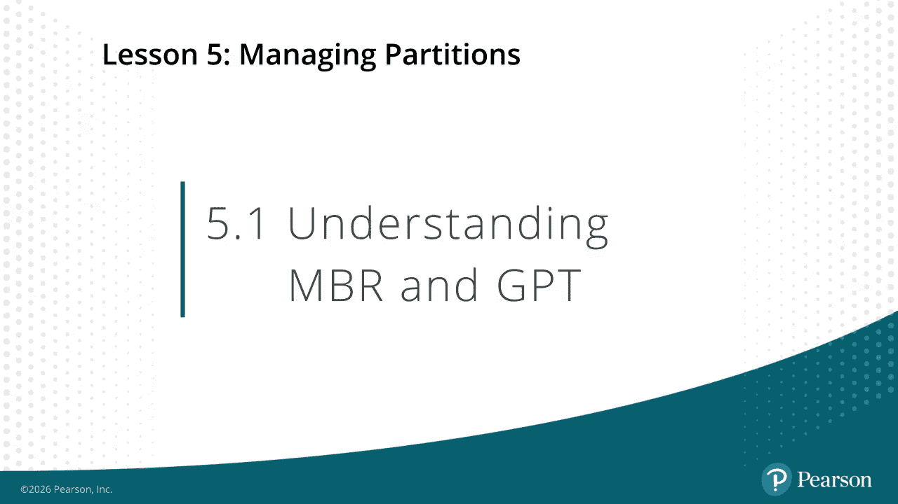
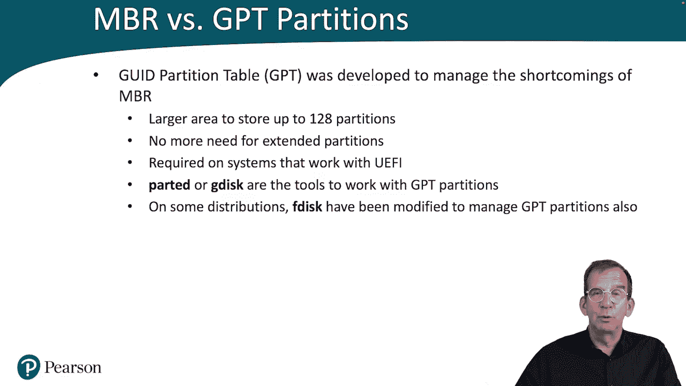

CompTIA Linux+ V8：51：理解 MBR 和 GPT 🖥️


在本节课中我们将要学习 MBR 和 GPT 两种分区表方式。当你需要对磁盘进行分区时，会面临一个选择：是继续使用老旧的 MBR 方式，还是采用全新的 GPT 方式。本节内容会把这两种技术的来龙去脉讲清楚，分别说明它们的工作原理、优缺点以及适用场景。无论是日常运维还是参加认证考试，掌握这些基础知识都非常重要，能帮助你在面对磁盘管理任务时做出正确判断。



上一节我们介绍了分区选择的大背景，本节中我们先来看看老旧的 MBR 是怎么工作的。

MBR 的全称是主引导记录，英文是 Master Boot Record。这项技术诞生于 1981 年，属于比较古老的方案。它和基本输入输出系统，也就是 BIOS 配合使用，把分区信息存放在磁盘上的 512 字节区域里。除了分区信息，这 512 字节区域还存放引导加载程序，也就是 bootstrap loader。引导加载程序的作用是把操作系统加载到内存中，让电脑能够正常启动。

MBR 的存储结构可以用下面的公式来描述：

```
MBR 总大小 = 512 字节
剩余用于分区表的空间 = 64 字节
```

核心概念如下：

- 512 字节磁盘区域用于存放引导和分区信息
- 64 字节专门用于记录分区元数据

有了这些基础，我们继续看 MBR 里最多能划几个分区。

本节中我们来看看 MBR 的分区数量限制。在 MBR 方案里，剩下的 64 字节空间被用来记录分区元数据。每个主分区需要占用 16 字节，所以 64 字节正好可以存放四个主分区的信息。

主分区数量的计算公式如下：

**主分区数量 = 64 字节 ÷ 16 字节/个 = 4 个**

如果你需要超过四个分区，就不能只靠主分区了。这时候需要用到扩展分区和逻辑分区。具体做法是，把其中一个主分区指定为扩展分区，然后在扩展分区内部再创建逻辑分区。这样一来，就可以在一块硬盘上管理更多的分区了，而不需要受限于原来的四个主分区名额。

MBR 还有一个重要的容量限制，公式如下：

**MBR 支持的最大存储容量 = 2 TB**

之所以只有 2 TB，是因为 MBR 的寻址能力有限。原文中提到只有 64 位可用，这导致可用于寻址的空间被限制，结果就是最大只能管理两太字节的存储空间。对于现代的大容量硬盘来说，这个限制显得比较小。

以下是操作 MBR 分区常用的工具。传统上，fdisk 是创建 MBR 分区的推荐工具。它在大多数 Linux 发行版中都有提供，使用起来比较直接，适合处理传统的 MBR 分区表。

上一节我们介绍了 MBR 的工具和限制，本节中我们来看看为了解决这些问题而出现的 GPT。

GPT 的全称是 GUID 分区表，英文是 G Partition Table。它是为了弥补 MBR 的不足而开发的，于 2010 年推出。相比 MBR，GPT 提供了更大的存储区域，总共可以记录多达 128 个分区。

GPT 的核心优势可以用下面的方式描述：

```
GPT 支持的分区总数 = 128 个
```

因为 GPT 可以存储非常多的分区，所以不再需要扩展分区这种复杂的结构。所有的分区都可以直接作为主要分区来使用，管理更加简单，也避免了主分区和逻辑分区之间的区分。

GPT 也是基于统一可扩展固件接口，也就是 UEFI 系统的默认选择。如今 UEFI 已经成为所有实体机系统的默认标准，因此 GPT 在现代电脑中应用非常广泛，几乎成为了新硬件的默认配置。

以下是操作 GPT 分区常用的工具。parted 和 gdisk 是专门用来处理 GPT 分区的工具。当然，现在的 fdisk 也经过修改，可以管理 GPT 分区了，具体能用什么工具取决于你使用的 Linux 发行版。比如如果你使用的是 Red Hat 系发行版，可以使用 fdisk。

如果你准备参加认证考试，建议也要熟悉 parted 工具，因为考试中可能会出现关于 parted 的问题，掌握它的基本用法会对你有帮助。



本节课中我们一起学习了 MBR 和 GPT 两种分区表方式。我们了解到 MBR 是 1981 年发明的老旧方案，配合 BIOS 使用，支持最多四个主分区，最大容量限制为 2 TB，通常使用 fdisk 来管理。随后我们学习了 GPT，它是 2010 年推出的新方案，配合 UEFI 使用，支持多达 128 个分区，不再需要扩展分区，常用工具包括 parted、gdisk 以及修改后的 fdisk。希望这篇内容能帮助你理解两者的区别，并在实际操作中做出正确选择。
