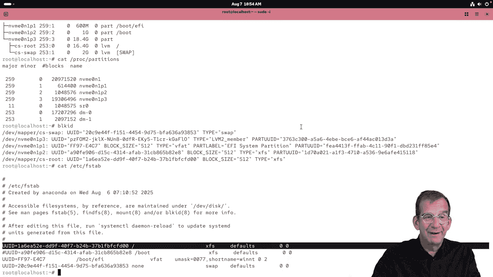

💾 CompTIA Linux+ V8：52：理解存储设备名称

在本节课中，我们将学习 Linux 系统中存储设备名称的基础知识，了解块设备名称如何由系统自动生成，以及为什么这些名称可能会在毫无预兆的情况下发生变化。我们还会介绍 `lsblk` 和 `blkid` 等常用命令，并解释 UUID、标签和 /dev/disk 目录等持久化命名方式。最后，我们会重点说明为什么在 /etc/fstab 配置文件中使用 UUID 可以避免系统无法启动的问题，帮助你建立稳定的磁盘挂载习惯。

### 1. 存储设备名称的基本含义

我们先来讨论存储设备名称。要想在 Linux 系统中操作磁盘，你必须使用正确的块设备名称。块设备名称是系统用来识别磁盘和分区的标识符，常见的例子包括 `/dev/sda` 和 `/dev/nvme0n1`。如果没有正确的设备名称，系统就无法定位到你想要操作的存储设备，也就无法进行读写、挂载或分区等操作。

在了解了什么是块设备名称之后，接下来我们需要了解这些名称是如何产生的，以及为什么它们不稳定。

### 2. 设备名称的自动生成与可能变化

磁盘和分区的名称是根据 Linux 内核模块获取的信息自动生成的。这意味着设备名称并不总是固定不变的，系统会根据实际硬件情况提供不同的命名选项。因为这个命名过程完全是自动化的，所以设备名称可能会突然发生变化。具体来说，如果你的存储拓扑结构发生任何变化，比如新增了磁盘、移除了设备或者改变了连接顺序，某个设备可能会突然获得一个全新的名称。

既然设备名称可能会发生变化，那么我们就需要寻找不会变化的替代方案。

### 3. 使用 UUID 或标签应对名称变化

这就是为什么你可以使用 UUID 或者标签来处理设备名称变化的问题。如果你想查看系统中所有块设备的名称概览，可以使用 `lsblk` 命令，它的全称是 list block devices，即列出块设备。

以下是几种常见的持久化命名方式：

- UUID：文件系统创建时自动生成的唯一标识符
- 标签：文件系统的可选属性，可以手动设置
- /dev/disk 目录：由 systemd udev 自动生成的持久化路径

**持久化命名公式**：`设备标识 = UUID ∨ 标签 ∨ /dev/disk 路径`

以上所有方式都属于持久化命名，它们不会突然改变，因此强烈建议在配置中优先使用这些持久化名称，而不是直接使用可能变化的 `/dev/sda` 这类设备名。

有了持久化命名的概念后，我们可以实际操作一下，看看系统中的块设备长什么样。

### 4. 使用 lsblk 查看块设备

演示的起点是运行 `lsblk` 命令，用于列出系统中的块设备。在我的系统中，你可以看到名为 NVMe0 和 NVMe1 的磁盘设备。之前我们提到过，当插入 USB 拇指驱动器（也就是 U 盘）时，系统会识别出类似 `/dev/sda` 这样的设备。所有这些命名结果都取决于你所使用的存储设备驱动程序，不同的驱动程序可能会为同一种设备分配不同的名称。

lsblk 命令背后其实依赖于系统底层的配置文件，这里介绍一个常见的例子。

### 5. /proc/partitions 配置文件

在 `lsblk` 命令的背后，其实还有一个配置文件，那就是 `/proc/partitions`。你并不需要直接操作这个文件，但了解它的存在还是有好处的，因为它记录了系统当前识别到的所有分区信息，是底层数据来源之一。

除了普通分区，系统中还可能存在逻辑卷设备，我们先简单提及，然后再看如何查看设备的 UUID。

### 6. LVM 逻辑卷设备

在我的系统中，已经存在一些分区，同时我也能看到 `/dev` 目录下的一些设备，这些设备用于 LVM 逻辑卷，我们稍后会专门讨论 LVM。现在我要演示的是 `blkid` 命令，即块 ID 命令。通过它可以看到，例如我的设备 NVMe0 和 1p3 都有对应的 UUID。这些 UUID 是目前主流使用的方案，因为如果存储拓扑结构突然发生变化，当前被称为 `/dev/nvme0n1p3` 的设备，可能会突然变成 `/dev/nvme0n2p3` 这样的名称。

了解设备名称可能变化之后，我们需要讨论这种变化会带来什么实际后果。

### 7. 硬引用与系统启动失败

如果你在 `/etc/fstab` 等配置文件中使用了硬编码的设备名称引用，一旦设备名称发生变化，系统就可能无法正常启动。这是因为系统在引导过程中会尝试按照配置文件中的指示挂载设备，如果指定的设备名已经不存在，挂载就会失败，进而导致启动中断。

为了避免上述启动失败的问题，我们需要查看系统实际如何配置自动挂载，并采用更可靠的标识方式。

### 8. 检查 /etc/fstab 并使用 UUID

这就是为什么如果你查看 `/etc/fstab` 文件的内容，你会发现 UUID 已经成为标准做法。这个文件负责在系统启动时自动挂载存储设备，使用 UUID 可以确保无论设备名称如何变化，系统始终能找到正确的分区。所以请务必记住，如果你想避免不必要的麻烦，就需要找到你设备的 UUID，并在配置中使用它们，而不是直接使用可能会变化的设备名称。

本节课中，我们一起学习了存储设备名称的基本概念，了解了块设备名称如何由 Linux 内核模块自动生成，以及为什么这些名称可能会突然改变。我们还介绍了 `lsblk` 和 `blkid` 等常用命令，并解释了 UUID、标签和 `/dev/disk` 目录等持久化命名方案。最后，我们重点强调了在 `/etc/fstab` 中使用 UUID 的重要性，以防止因设备名称变化而导致系统无法启动。
