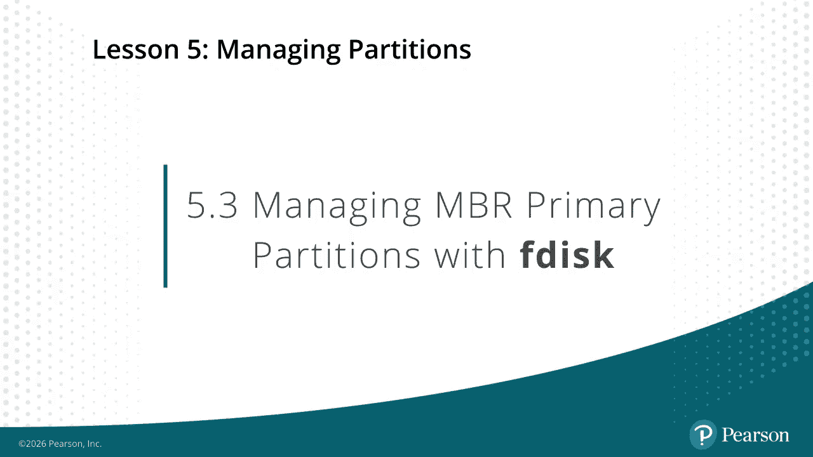
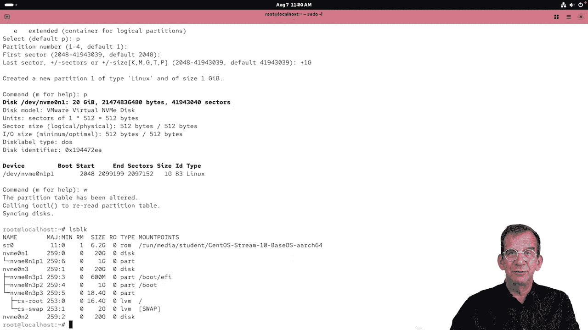

# CompTIA Linux+ V8：53：使用 fdisk 管理 MBR 主分区 🖥️




在本节课中，我们将学习如何使用 fdisk 工具在 Linux 系统中创建和管理 MBR 主分区。MBR 分区表是一种比较传统的分区方式，虽然现在有更现代的替代方案，但在很多系统和认证考试中依然很常见。我们会先说明为什么还要掌握 MBR 分区知识，接着演示如何查看磁盘设备信息，然后启动 fdisk 创建主分区，最后写入分区表并验证结果。整个教程会使用大白话来讲解，确保没有 Linux 基础的学习者也能看懂。


## 为什么还要学习 MBR 分区

有些学习者可能会疑惑，现在是不是都不再使用 MBR 分区了，还有必要花时间学习吗？答案是肯定的。一方面，如果你想通过 CompTIA Linux+ 认证，考试内容中依然包含 MBR 分区的相关知识，这是必须掌握的考点。另一方面，在实际工作环境中，有很多 Linux 系统会运行很长时间，它们在最初安装的时候可能就使用了 MBR 分区表。如果你未来需要负责维护这些老旧系统，没有基本的 MBR 分区管理技能，就会遇到很大的困难。所以，掌握 MBR 分区的操作方法对你的职业发展很有帮助。

MBR 分区表的核心限制可以用公式表示：
```
最大主分区数量 = 4
```

以下是 MBR 分区的几个重要特点：
- MBR 分区表最多只能支持 4 个主分区
- 分区引导信息存储在磁盘的第一个扇区
- 需要在主分区和扩展分区之间进行选择


## 查看存储设备信息

上一节我们介绍了 MBR 分区的基本概念，本节中我们来看看如何查看系统中的存储设备信息。在进行任何分区操作之前，首先要明确要操作的是哪块磁盘。Linux 系统中常用的工具是 lsblk，它可以列出所有块设备及其分区情况，让你知道系统里有哪些磁盘可用。

在本次演示环境中，我已经通过虚拟化层添加了一块新的存储设备。如果你运行 lsblk 命令，就可以查看设备名称和容量等信息。这里有一个细节需要注意，设备名称有时候会发生变化，之前可能叫做 /dev/nvme0n1，现在可能显示为其他名称。不过不需要担心，因为文件系统使用的是 UUID，这些 UUID 是直接写在设备本身上的，所以系统总是能正确识别设备，不会因为设备名称的变化而出错。


lsblk 命令的使用方式如下：
```bash
$ lsblk
```


## 启动 fdisk 分区工具

确定了要操作的目标磁盘之后，我们就可以启动分区工具了。本次演示使用的是 fdisk，目标磁盘是 /dev/nvme0n1，也就是系统中的第一块磁盘。

这里有一个非常重要的原则，请务必牢记：分区工具必须作用于整块磁盘，不能作用于某个已经存在的分区。也就是说，你应该运行 fdisk /dev/nvme0n1，而不能运行 fdisk /dev/nvme0n1p1 这种分区设备。

启动 fdisk 的命令如下：
```bash
$ fdisk /dev/nvme0n1
```

进入 fdisk 交互界面后，系统会提示设备当前不包含分区表，并且已经创建了新的 DOS 或 MBR 磁盘标签。这正是我们想要的结果，因为我们要在一块空磁盘上创建 MBR 分区表。


## 创建新主分区

进入 fdisk 之后，你可以使用 M 键查看帮助菜单。M 代表 menu，菜单中列出了所有可用的命令选项，在不确定下一步该做什么的时候非常有用。

在开始创建分区之前，我通常先使用 P 命令查看当前磁盘信息。P 代表 print，它会打印出磁盘的一些基本参数，包括磁盘总容量、字节数以及扇区大小。在本次演示中，这块磁盘容量为 20 GiB，总字节数和扇区大小也会一并显示，扇区大小为 512 字节。

使用 P 命令查看磁盘信息的示例如下：
```bash
Command (m for help): p

Disk /dev/nvme0n1: 20 GiB, 21474836480 bytes, 41943040 sectors
Units: sectors of 1 * 512 = 512 bytes
Sector size (logical/physical): 512 bytes / 512 bytes
Disklabel type: dos
```

有了磁盘基本信息之后，我们就可以创建新分区了。使用 N 命令来创建一个新分区。在 MBR 分区表中，你需要在主分区和扩展分区之间做出选择。MBR 分区表最多只能寻址 4 个分区，因为这是我们创建的第一个分区，所以选择主分区。

创建主分区的交互过程如下：
```bash
Command (m for help): n
Partition type
   p   primary (0 primary, 0 extended, 4 free)
   e   extended (container for logical partitions)
Select (default p): p
Partition number (1-4, default 1): 1
First sector (2048-41943039, default 2048): 
Last sector, +/-sectors or +/-size{K,M,G,T,P}: +1G
```

这里有几个关键点需要解释。分区编号我们选择 1，起始扇区默认从 2048 开始。你可能会问，为什么不从磁盘的最开始位置就开始呢？这其实很简单，每块磁盘的前 1 MB 都被保留用于存储元数据，也就是关于磁盘的管理信息，所以第一个分区总是会从第 2048 个扇区开始。

关于分区大小，你可以使用 +1G 这种格式来指定大小。注意 Linux 是区分大小写的，必须使用大写的 G，如果你输入小写的 g 是不会生效的。执行完成后，fdisk 会显示新建了一个类型为 Linux、大小为 1 GB 的分区 1。


## 写入分区表并验证

分区创建好之后，不要立即退出，建议先使用 P 命令再次打印分区表，验证一下结果是否符合预期。这时候你应该能看到设备 /dev/nvme0n1p1 已经被添加到了分区表中。

如果确认无误，就可以使用 W 命令将分区表写入磁盘。W 代表 write，它会把你在 fdisk 中所做的所有更改保存到磁盘上。写入完成后，退出 fdisk，然后使用 lsblk 命令验证新分区是否可见。

验证新分区的命令如下：
```bash
$ lsblk
NAME        MAJ:MIN RM  SIZE RO TYPE MOUNTPOINTS
nvme0n1     259:0    0   20G  0 disk
└─nvme0n1p1 259:1    0   1G  0 part
```

从输出中可以看到，新分区 nvme0n1p1 已经正常显示，分区创建任务完成。不过，这个时候分区只是建立好了，上面还没有文件系统，不能直接用来存储数据。如何在这个分区上创建文件系统，我们会在后续的视频中讲解。


## 本节小结



本节课中，我们一起学习了使用 fdisk 管理 MBR 主分区的完整流程。首先解释了为什么在 Linux+ 认证和实际工作中仍然需要掌握 MBR 分区知识，然后演示了如何使用 lsblk 查看存储设备，接着启动 fdisk 对整块磁盘进行分区操作，创建了第一个主分区并设置了大小，最后使用 W 命令写入分区表，并用 lsblk 验证了分区是否可见。希望这篇教程能帮助你建立起对 MBR 分区的直观认识，为后续的文件系统学习打下基础。
