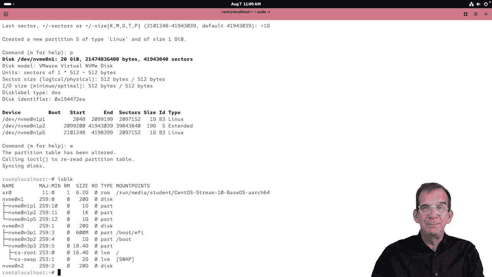

# CompTIA Linux+ V8：1：MBR分区基础与扩展分区概念💿

在本节课中我们将要学习MBR分区表中的主分区、扩展分区和逻辑分区，以及如何使用fdisk工具来创建和管理这些分区。


MBR也就是主引导记录分区表，是比较老旧但仍然广泛使用的分区方式。它的一个核心限制非常简单直接，就是一块硬盘上最多只能创建四个主分区。这个限制可以用公式来表示：

`主分区数量 ≤ 4`

如果你只需要一两个分区，这完全够用。但如果你希望把硬盘切成更多小块，比如说五个或者六个分区，四个主分区的名额就不够了。你可以把每个分区想象成披萨的一块，MBR这个披萨只能切成四块，再切不动了。这时候MBR提供了一个变通的办法，你可以把其中一个主分区设定成扩展分区，然后在扩展分区内部再创建逻辑分区，这样就能突破四个分区的上限。这个关系可以简单理解为：

`扩展分区 ⊇ {逻辑分区1, 逻辑分区2, ..., 逻辑分区N}`

换句话说，扩展分区本身不直接存放数据，它更像是一个容器，容器里面装的是一个个逻辑分区。通过这种方式，你就可以在一块硬盘上拥有超过四个分区了。


# CompTIA Linux+ V8：2：准备工作：查看块设备并启动fdisk🔧

上一节我们介绍了MBR分区的基本限制以及扩展分区和逻辑分区的概念，本节中我们来看看在实际操作前该怎么准备环境。

在开始对硬盘进行分区之前，养成一个好习惯是非常重要的，那就是先查看系统当前识别到了哪些块设备。你可以使用lsblk命令来完成这项工作，列出所有的块设备及其分区情况，这样你才知道接下来要操作的是哪一块盘，避免误操作到错误的设备上。

以下是查看块设备的命令示例：


```bash
lsblk
```


执行完之后，你会看到类似nvme0n1这样的设备名称。在本节演示中，我们将要操作的目标磁盘是/dev/nvme0n1。

接下来，使用fdisk工具进入这个磁盘的分区编辑界面。fdisk是Linux系统中经典的分区表管理工具，它允许你创建、删除、修改分区。启动命令如下：

```bash
fdisk /dev/nvme0n1
```

进入fdisk之后，你会看到一个交互式菜单，常用的操作包括查看当前分区表、创建新分区、写入更改等等。为了让自己清楚接下来在做什么，建议在操作前先按下p键，打印当前的分区表，确认磁盘上的现有分区布局，避免盲目操作。


# CompTIA Linux+ V8：3：创建扩展分区📦

上一节我们完成了块设备的查看并启动了fdisk，本节中我们来看看如何在MBR分区表中创建一个扩展分区。

通常情况下，最佳实践是先用完所有的主分区，再去使用扩展分区。原因也很简单，主分区是直接分区，如果以后磁盘出现问题需要排查，先处理主分区会更加直接方便。等所有主分区都用完了，剩下的磁盘空间才统一交给扩展分区来管理。

不过为了演示方便，本节我们将直接创建扩展分区，不等主分区用完。在fdisk中按下n键开始创建新分区，系统会询问你创建主分区还是扩展分区，这里我们选择创建扩展分区，并将其设为分区号二。

创建扩展分区时，fdisk会先问你起始扇区是多少，直接按回车使用默认值即可；接着问你最后扇区是多少，同样直接按回车，这意味着扩展分区将占据剩余的全部可用空间。特别要注意的是，如果这是你在MBR中创建的第四个分区，那么分区表在创建完这个扩展分区之后就已经满了，没有剩余空间给主分区了，所以在fdisk询问最后扇区时直接回车也是正常的。

以下是创建扩展分区的典型操作流程：

```text
fdisk > n
分区类型：e（扩展分区）
分区号：2
起始扇区：回车（使用默认值）
最后扇区：回车（占用所有剩余空间）
```

执行完成后，你会看到扩展分区已经出现在分区表中，它的起始扇区和结束扇区覆盖了从某个数值一直到磁盘末尾的范围，比如说从22099200到41943039，这表明扩展分区已经成功创建，并且占据了剩下的所有空间。


# CompTIA Linux+ V8：4：创建逻辑分区🧩

上一节我们介绍了如何创建扩展分区，本节中我们来看看如何在扩展分区内部创建逻辑分区。

当MBR分区表中的主分区名额已经用完，或者你已经创建了扩展分区，再次使用n键创建新分区时，fdisk会提示你主分区的空间已用完，并自动开始创建逻辑分区。在MBR体系中，逻辑分区的编号是固定从5开始的，第一个逻辑分区永远是分区号五。

以下是逻辑分区编号的规则：

```text
主分区号：1, 2, 3, 4
第一个逻辑分区号：5
后续逻辑分区号：6, 7, 8, ...
```

在本节演示中，我们继续使用n键创建新分区。系统会询问起始扇区，直接按回车，这个起始位置会落在扩展分区的范围内。接着系统会问你最后扇区，你可以直接回车占用所有剩余空间，也可以指定大小。如果你想创建一个1GB的逻辑分区，可以在最后扇区那里输入+1G，其中G代表GB，大写或小写通常都可以。

逻辑分区的创建是有顺序的，一般来说是按照创建的先后顺序编号的。不过要注意，如果你删除了中间的某个逻辑分区，以后新建逻辑分区时，编号的顺序可能会发生变化，这点在实际维护中需要留心。

在我们的例子中，创建完成后可以看到/dev/nvme0n1p5这个逻辑分区出现在扩展分区的范围之内，这说明分区之间的包含关系已经正确建立。


# CompTIA Linux+ V8：5：写入分区表与验证💾

上一节我们完成了逻辑分区的创建，本节中我们来看看如何把刚才在fdisk里做的更改真正写入磁盘，并验证结果。

在fdisk中创建或修改分区时，所有的操作都只是在内存中暂存，并没有立刻写入到硬盘上。这意味着如果你此时直接退出而不保存，刚才的分区更改就会丢失。为了让更改生效，你需要按下w键，也就是write的缩写，将分区表写入磁盘。

写入操作完成后，建议立即使用lsblk命令再次查看块设备，确认新创建的分区是否已经出现，并且大小和位置是否符合预期。这样可以确保分区表没有写错，也避免在后续格式化时操作到错误的设备上。

以下是写入与验证的命令示例：

```text
fdisk > w
```

```bash
lsblk
```

执行完lsblk之后，你应该能看到nvme0n1p2是扩展分区，nvme0n1p5是逻辑分区，而且p5的范围包含在p2的范围之内。这就说明分区创建成功，分区表也已经正确保存。


# CompTIA Linux+ V8：6：分区之后的下一步与本节总结📚

上一节我们完成了分区表的写入与验证，本节中我们来看看分区完成后还需要做什么，并对本节课程进行总结。

创建完分区之后，你会发现这些分区目前只是对磁盘空间的一个预约或预留，它们还不能用来存放文件。因为分区本身并没有文件系统，没有文件系统的话，操作系统就无法在这个分区上读写数据。因此，下一步的工作就是在分区之上创建文件系统，比如说ext4、xfs等等，这个过程通常会在下一节视频中讲解。

在下一节之前，我们还会先介绍GPT分区表。GPT是比MBR更新、更先进的分区标准，它不再受四个主分区的限制，支持更多的分区和更大的硬盘。了解完GPT之后，再回头学习如何创建文件系统，你就会对Linux磁盘管理有更完整的认识。



本节课中我们一起学习了MBR分区表中主分区、扩展分区和逻辑分区的区别，掌握了使用lsblk查看块设备、使用fdisk创建扩展分区和逻辑分区的方法，也学会了使用w写入分区表并用lsblk验证结果。希望这些内容能帮助你更好地理解Linux磁盘分区的基本原理。
