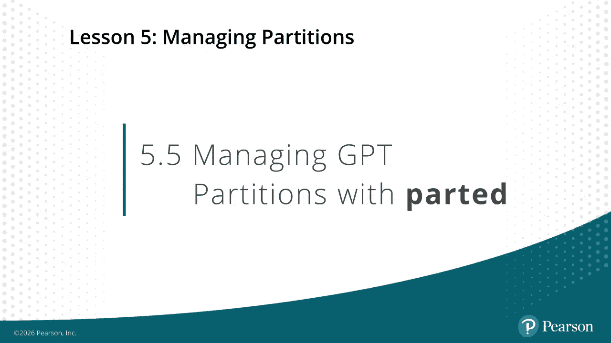
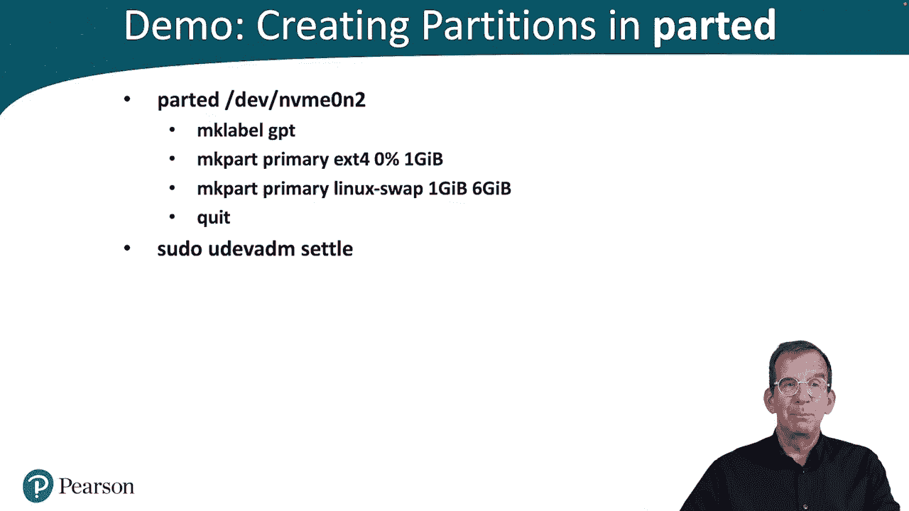
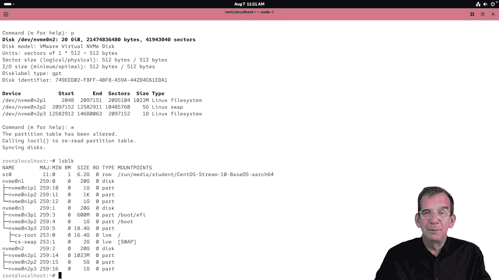

# CompTIA Linux+ V8：第55节：使用 parted 管理 GPT 分区 🖥️




在本节课中，我们将学习如何在 Linux 系统里使用 parted 工具来创建和管理 GPT 分区表。除了 parted 之外，你还会认识到 fdisk 等其他工具也可以完成类似的工作，并且会了解在实际操作中如何验证分区结果，以及分区完成后还需要做什么。


## 1. parted 不是唯一的分区工具

在学习 parted 之前，首先要明确一点：parted 并不是 Linux 中唯一可以用来创建 GPT 分区的实用程序。你同样可以使用 fdisk，或者改用 gdisk 等工具来完成这项工作。根据你之前的使用经验，可能会觉得某些工具更加直观好上手。有时候在 parted 中使用的选项会让人感到有些出乎意料，这也是为什么了解多种工具非常有必要。


## 2. 如何打开 parted 交互界面

要想使用 parted，你需要先进入 parted 的交互式命令行界面。具体做法是在终端中执行 parted 命令，并指定目标设备。例如，针对 SDB 设备，可以使用如下命令：

```bash
parted /dev/sdb
```

执行后，系统会打开 parted 专属的 shell 环境。在这个环境下，你可以输入各种子命令来操作分区表，其中 print 命令用于显示当前的分区表类型和已有分区信息。


## 3. parted 中常用的分区命令



在 parted 交互界面中，有几个核心命令是你需要掌握的。以下是常用命令及其作用：

- print：查看当前磁盘的分区表类型以及已存在的分区情况。
- mklabel：用于设置分区表标签，可选 gpt 或 msdos，其中 msdos 即传统的 MBR 分区标签。
- mkpart：用于创建新分区，系统会提示你输入分区名称、文件系统类型、起始位置和结束位置。

这里需要特别说明 mkpart 命令中的文件系统类型提示。这个提示容易让初学者困惑，因为它并不会真的为你创建文件系统，而只是以适当的方式标记分区类型。真正的文件系统创建仍然需要单独使用 mkfs 等工具来完成。分区结束位置可以用下面这个简单公式来理解：

```text
分区结束位置 = 分区起始位置 + 分区大小
```


## 4. 验证分区并退出 parted

在使用 mkpart 完成分区操作之后，建议再次使用 print 命令来检查目前的分区表状态。如果确认无误，就可以使用 quit 命令退出 parted。quit 执行后，parted 会将分区表的更改写入磁盘，从而完成分区表的更新。


## 5. 使用 parted 创建 GPT 分区的实际示例

接下来，我们通过一个具体的例子来演示如何在实际磁盘上操作。首先使用 lsblk 命令查看系统中的块设备，假设你发现空闲设备为 nvme0n2，那么就可以对这个设备启动 parted：

```bash
parted /dev/nvme0n2
```

进入 parted 界面后，如果你忘记当前可用命令，随时可以输入 help 获取帮助。这在不熟悉该界面时非常有用。

演示的第一步是执行 print 命令。此时你可能会看到分区表显示为 unknown，这说明磁盘还没有有效的分区表标签，属于比较严重的情况。因此需要先执行 mklabel gpt，将分区标签设置为 GPT。

设置好 GPT 标签后，接下来使用 mkpart 创建分区。在 parted 中，即使是 GPT 分区表，创建分区时也需要指定 primary。这看起来有些奇怪，因为 GPT 本身并没有主分区和扩展分区的概念，所有的分区在 GPT 中地位相同。不过 parted 为了与传统的 MBR 分区保持兼容，因此要求你在这里指定 primary。

接着，parted 会询问分区的预期用途，例如你可以输入 ext4。这一点同样容易误解，因为 parted 输入 ext4 之后，并不会自动创建 ext4 文件系统，它仅仅是做一个类型标记，后续你仍然需要手动运行 mkfs 来格式化分区。

随后你需要指定分区的起始位置和大小。例如，输入 0% 表示从磁盘起始位置开始，输入 1 GiB 表示分区大小为 1 吉比特。

如果需要继续添加第二个分区，可以再次使用 mkpart primary，并选择 linux swap 作为分区类型。这是稍后会详细介绍的交换分区类型。在这里你可以直接指定分区类型，然后设定起始位置和结束位置，比如从 1 GiB 开始，到 6 GiB 结束。

在所有分区创建完成之前，不要急着退出。建议先使用 print 命令核对一下当前的分区情况，确认一切正常之后，再使用 quit 命令将所有更改写入磁盘。


## 6. 分区完成后的后续操作

使用 quit 退出 parted 之后，系统可能会提示你需要更新 /etc/fstab 等配置文件。不过在演示环境中，这步并不是强制的，因为你仍然需要使用 mkfs 命令来为每个分区创建真正的文件系统，只有文件系统创建完成后，分区才能被正常挂载和使用。

另外，parted 的官方人员建议使用 udevadm trigger 命令，用于更新 systemd 和 udev，确保新创建的设备节点在整个 Linux 系统中正确生成。在日常工作中，你可能不需要频繁执行这个命令，但如果你正在准备考试，了解这一点可能会派上用场。

执行完成后，你可以看到 parted 已经创建了两个分区，分别是 P1 和 P2。不过有一点需要注意，如果你要求创建 1 GiB 的分区，parted 实际创建的可能是 1023 MB 大小的分区，而不是精确的 1 GiB。这也是部分用户觉得 parted 并不一定是最佳分区工具的原因之一。


## 7. 使用 fdisk 创建 GPT 分区

为了对比，下面展示如何使用 fdisk 完成相同的操作。首先在目标设备上启动 fdisk：

```bash
fdisk /dev/nvme0n2
```

进入 fdisk 后，可以使用 p 命令查看当前已经创建的分区，使用 m 命令查看帮助菜单。这里有一点非常重要：fdisk 本质上是面向 MBR 的工具。如果你想创建 GPT 分区表，必须先使用 g 命令建立一个新的空 GPT 分区表，之后才能进行其他操作。

接下来使用 n 命令创建新分区。fdisk 会提示你创建默认的分区 3，并且最多可以创建到 128 个分区。对于起始扇区，直接接受默认值即可；对于结束扇区，你可以输入 +1G 来指定 1 GiB 的大小。完成后，fdisk 会显示新建的分区 3，其类型为 Linux 文件系统。

再次使用 p 命令查看分区表，你会发现之前在 parted 中创建的分区，以及现在 fdisk 新建的分区，类型都显示为 Linux 文件系统。这说明在 parted 中即使你指定了 ext4，它实际做的也只是将分区类型标记为 Linux 文件系统，并不会特别去处理 ext4。

fdisk 创建的分区大小正好是 1 GiB，完全符合预期。如果你对结果满意，可以使用 w 命令将分区表写入磁盘。

有人可能会问，使用两个不同的工具操作同一块磁盘会不会造成问题。答案是不会，因为 parted 和 fdisk 只是向磁盘写入分区信息的两种不同方式，它们可以互相配合使用。最后可以使用 lsblk 命令确认，你会看到 nvme0n2 上现在已经有三个分区。


## 8. 本节总结



在本节课中，我们一起学习了如何使用 parted 管理 GPT 分区，包括进入 parted 交互界面、使用 mklabel 设置分区表类型、使用 mkpart 创建分区，以及使用 print 和 quit 验证并保存更改。我们还了解到 parted 中输入文件系统类型并不会真正创建文件系统，后续仍需配合 mkfs 使用。此外，我们对比了 fdisk 创建 GPT 分区的方法，掌握了必须先使用 g 命令建立 GPT 分区表这一关键点，并确认了使用多个分区工具操作同一块磁盘是安全的。

