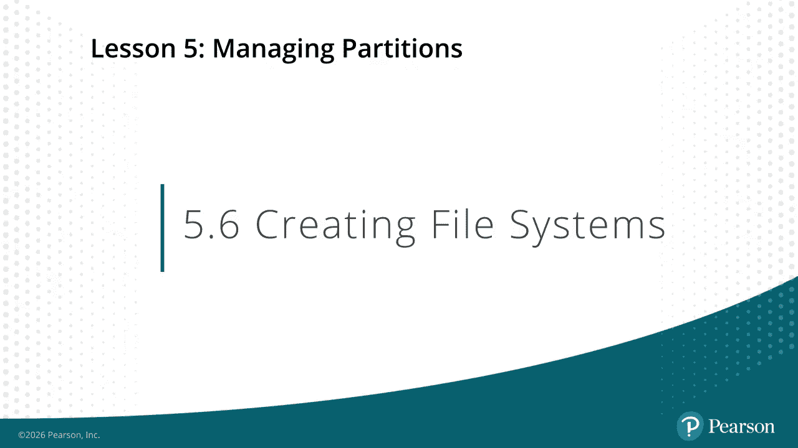
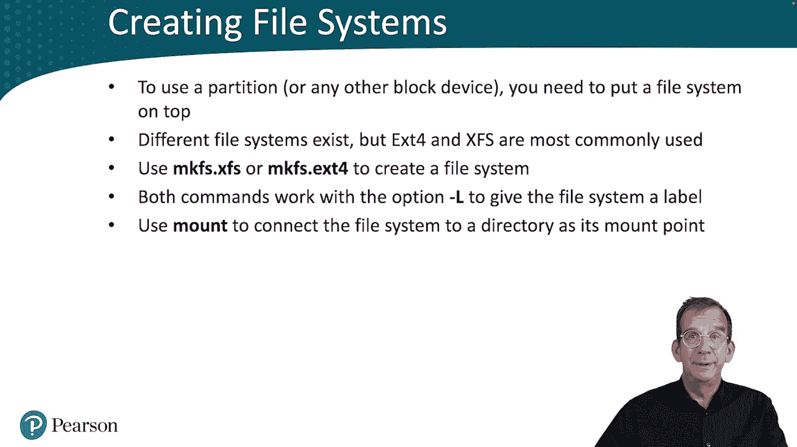

# CompTIA Linux+ V8：01：创建文件系统 📂



在本节课中，我们将要学习关于文件系统的基础知识。主要内容包括什么是文件系统，为什么创建完分区之后还需要在上面建立文件系统，以及 Linux 中最常用的两种文件系统类型是什么。此外，我们还会简单看看如何创建文件系统，并把它挂载到目录上使用。请注意，本节课只做简要介绍，所有细节会在下一节课中完整讲解。


首先，我们来看看文件系统到底有什么作用。当你在硬盘上创建完一个分区，或者准备好任何其他块设备之后，光有这些分区是不够的。分区本质上只是对磁盘空间的一块预留，它相当于在硬盘上划出了一块地盘，但并没有告诉系统怎么在这块地盘上存放文件。如果你不在这个分区上面放一个文件系统，那么这个分区对你来说是没有任何实际用处的，你无法向其中写入数据，也无法从中读取数据。换句话说，只有建立了文件系统，分区才变成一个真正能用的存储空间。


文件系统和分区之间的关系可以用下面这个简单的公式来描述：

```text
可用存储空间 = 分区 + 文件系统
```

也就是说，分区负责划定范围，而文件系统负责在范围内组织数据，两者缺一不可。


接下来，我们看看 Linux 中最常见的文件系统有哪些。虽然存在很多种不同的文件系统，但在日常工作中，你绝大多数时候只会接触到其中两种，那就是 EXT4 和 XFS。以下是这两种文件系统的常见使用场景：

- XFS：通常出现在 RHEL 等企业级环境中。
- EXT4：通常出现在 Ubuntu 等桌面或服务器环境中。


了解了常见的文件系统类型之后，我们来看看如何实际创建它们。Linux 提供了专门的命令来完成这项工作，你可以直接在终端中运行。以下是创建这两种文件系统的命令示例：

- mkfs.xfs：用于创建 XFS 文件系统。
- mkfs.ext4：用于创建 EXT4 文件系统。

这两个命令都支持一个通用的选项，也就是 -L，它的作用是给文件系统设置一个标签，方便你以后识别和管理。使用标签后，你不需要记住复杂的设备名称，就可以通过这个标签来找到对应的文件系统。


文件系统创建完成之后，还不能直接使用，你需要把它连接到系统中的某个目录上，这个过程叫做挂载。你可以使用 mount 命令，把刚才创建好的文件系统挂载到指定的目录，这个目录就称为挂载点。挂载成功之后，你就可以通过访问这个目录来读写文件系统里的数据了。


以上就是本节课的全部内容。更多关于文件系统的细节操作，比如如何格式化、如何查看挂载状态、如何处理文件系统错误等，都会在下一节课中详细讲解，敬请期待。




本节课中我们一起学习了文件系统的基本概念，明确了分区只是磁盘空间预留，必须在其上创建文件系统才能正常使用。我们还认识了最常用的两种文件系统 XFS 和 EXT4，了解了它们在不同环境中的常见场景，并学习了如何使用 mkfs.xfs、mkfs.ext4 以及 mount 命令来创建和挂载文件系统。下一节课我们将继续深入，再见。

