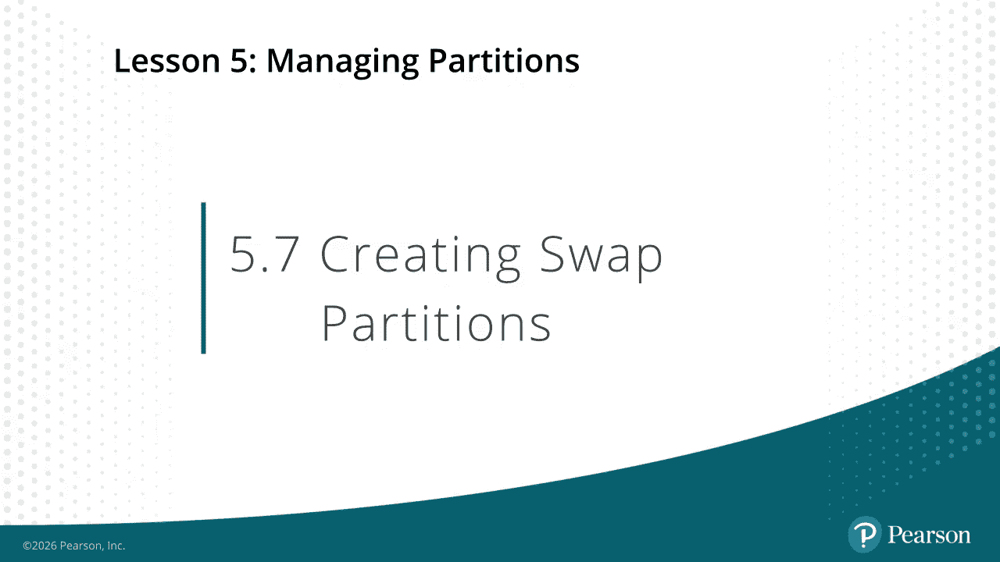
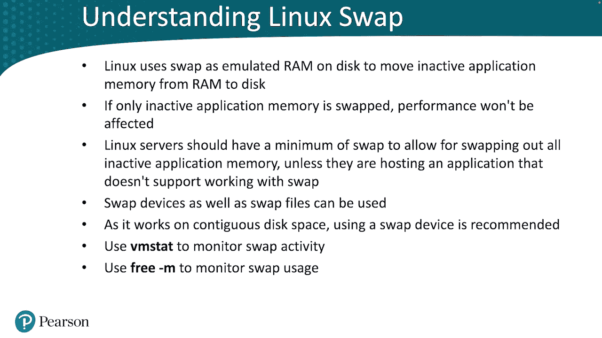
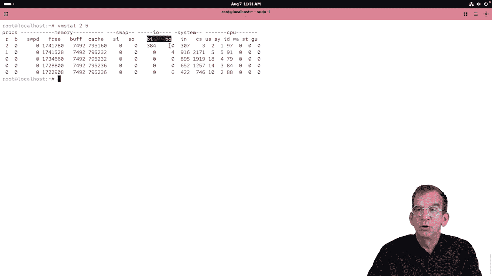

# 💾 CompTIA Linux+ V8：03：创建交换分区




在本节课中我们将要学习关于 Linux 交换分区的相关知识。交换分区是 Linux 系统用来在磁盘上模拟内存的一种机制，它可以把当前不活跃的应用程序内存从物理内存移动到磁盘上，从而释放更多可用的物理内存。很多初学者可能会听说使用交换空间是不好的事情，但实际上只要交换的只是不活跃内存，系统性能就不会受到任何影响。本节课我们还会讲解如何创建和配置交换分区，如何在 /etc/fstab 中写入相关条目，以及如何使用 vmstat 和 free 命令来监控交换活动。无论你是完全没有接触过交换分区，还是想要深入了解 Linux 内存管理的同学，这篇教程都会用大白话把每一个概念讲清楚，让你轻松掌握交换分区的创建与管理方法，并在实际工作中直接应用这些知识。


## 1. 什么是交换分区


在正式开始创建之前，我们先来看看交换分区到底是什么，以及它在系统中扮演什么角色。

Linux 系统会把交换空间当作模拟的内存来使用，也就是说当物理内存不够用时，系统可以把内存中的数据暂时存到磁盘上。具体来说，交换空间的作用是把不活跃的应用程序内存从物理内存移动到磁盘，这样就可以腾出更多的物理内存给当前正在运行的程序使用。你可以用下面这个公式来理解交换空间带来的直接效果：

$$
可用物理内存 = 原始物理内存 - 当前活跃内存占用 + 交换出的不活跃内存
$$

有些人认为使用交换空间是件坏事，但实际上情况并非如此。如果交换出去的只是不活跃的应用程序内存，那么系统性能根本不会受到任何影响，因为那些内存本来就没有在被使用。我们没有必要把不活跃的内存一直占据在宝贵的物理内存里。另一方面，如果正在活跃使用的应用程序内存被交换到了磁盘上，那么你就会感受到性能下降，因为磁盘的读写速度通常远慢于物理内存，这会让系统变得非常迟缓。


## 2. 交换空间的建议大小


了解了交换分区的基本原理后，接下来我们来看看一个 Linux 系统应该配置多大的交换空间比较合适。

一般来说，Linux 系统应该至少保留足够的交换空间，用来交换掉所有不活跃的应用程序内存。当然，如果你运行的某个应用程序明确不支持使用交换空间，那么就需要查阅该应用程序的文档来确认具体情况。对于大多数现代 Linux 服务器来说，一个比较稳妥的建议是确保交换空间大约占物理内存容量的 25%。你可以用下面的简单公式来估算：

$$
推荐交换空间大小 = 物理内存总容量 \times 25\%
$$

不过这只是一个经验法则，实际配置时仍然要根据你的应用程序类型和服务器负载来灵活调整，不要死板地套用这个比例。


## 3. 交换设备与交换文件


在决定交换空间的大小之后，我们还需要知道 Linux 支持两种方式来分配交换空间，这两种方式在性能上有一些区别。

你可以创建交换设备，也可以创建交换文件。由于交换设备使用的是磁盘上的连续空间，所以通常推荐使用交换设备。而交换文件可能会出现磁盘碎片，一旦文件变得碎片化，读写速度就会变慢。以下是两种方式的简要对比：

- 交换设备：使用磁盘连续空间，性能更稳定，推荐优先使用。
- 交换文件：容易产生碎片，碎片严重时会降低交换速度。

在日常维护中，建议你定期使用 vmstat 来监控交换活动，也可以使用 free -m 来查看当前的交换空间使用情况，从而及时发现潜在的性能瓶颈。


## 4. 实操：创建并启用交换分区


理论部分讲完了，接下来我们进入实际操作环节，看看如何在系统中创建并启用一个交换分区。

作为示例，我们将使用在之前视频中已经通过 parted 创建好的交换分区。如果你还没有创建那个分区，可以回去查看上一节视频，学习如何创建交换分区，然后再回到本节继续操作。



首先，我们需要列出当前的分区表，确认要操作的目标分区。使用下面的命令：

```bash
fdisk -l /dev/nvme0n1
```

执行之后，你可以确认自己正在查看的分区是 nvme0n1p2，这就是我们要格式化为交换空间的目标分区，请务必仔细核对分区编号，避免操作错误。

接下来，查看当前系统的内存使用概览。使用下面的命令：

```bash
free -m
```

你会发现系统目前有很多空闲内存，看起来似乎并不需要分配交换空间。但为了演示完整的操作流程，我们还是继续下一步，把整个过程走一遍。

创建交换空间非常简单，只需要使用 mkswap 命令。执行下面的命令来格式化该分区：

```bash
mkswap /dev/nvme0n1p2
```

格式化完成后，我们需要把这个交换分区写入 /etc/fstab 文件，这样系统在启动时才能自动挂载它。在此之前，先复制该分区的 UUID。然后打开 /etc/fstab 文件进行编辑，在文件中添加一行，格式如下：

```text
UUID=你刚才复制的UUID   none   swap   defaults   0   0
```

如果文件中已经有一行类似的 UUID 条目，可以把它删除，避免重复配置导致系统启动出现问题。

这里有一个重要的细节需要注意：交换空间不需要挂载到某个具体的目录，它应该被挂载到 none。这样做会让交换空间成为内核接口。挂载类型设置为 swap，挂载选项使用 defaults，最后的两个 0 分别用于备份和检查顺序，通常保持默认即可。

编辑完成并保存 /etc/fstab 后，使用下面的命令一次性启用所有在 /etc/fstab 中定义的交换空间：

```bash
swapon -a
```

执行完毕后，再次使用 free -m 查看内存情况。你会发现系统现在拥有不少于 7 GB 的交换空间，这说明交换分区已经成功启用，系统可以开始使用它来存放不活跃的内存页面了。


## 5. 监控交换活动


交换分区启用之后，我们还需要知道如何判断交换空间是否真的在被使用，以及使用情况是否会影响系统性能，这样才能在出现问题时及时发现。

如果你想知道交换空间是否被使用，就需要学习 vmstat 命令。这里我们使用 vmstat 2 5，这意味着命令会以 2 秒为间隔，总共采集 5 次数据。在输出结果中，重点关注 si 和 so 两列，它们分别表示交换入和交换出，也就是交换活动情况。

你可以把 si/so 与 bi/bo 进行对比，bi/bo 表示块设备的读入和读出。如果交换活动非常接近块设备的读写活动，那就需要担心系统性能问题了，因为这说明系统频繁在内存和磁盘之间交换数据。但在我们的演示环境中，目前没有任何交换活动发生，所以系统运行良好，无需担心性能下降。


### 总结




在本节课中我们一起学习了 Linux 交换分区的基本概念、配置建议、创建方式以及实际操作步骤。我们了解到交换空间本质上是在磁盘上模拟的内存，适合用来存放不活跃的应用程序内存，一般建议交换空间大小约为物理内存的 25%。我们还掌握了如何使用 mkswap 格式化分区、如何在 /etc/fstab 中添加 UUID 条目、如何使用 swapon -a 启用交换空间，以及如何使用 vmstat 和 free -m 来监控交换使用情况。希望这篇教程能帮助你在实际工作中顺利配置和管理 Linux 系统的交换分区，提升系统的内存管理能力。

