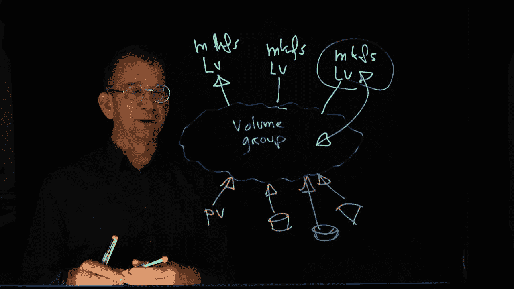
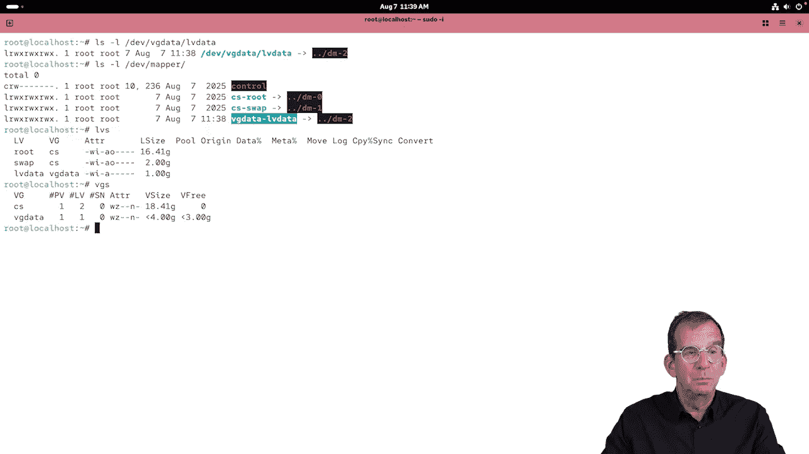

# CompTIA Linux+ V8：292.58：创建LVM卷 💾


在本节课中，我们将一起学习逻辑卷管理器，也就是LVM。这节课的内容主要围绕LVM的不同组成部分展开，你会了解LVM到底是由哪些部分组成的，以及各个部分之间是如何协作的。接着我们会整理出创建LVM的标准步骤，从创建分区开始，一直到标记物理卷、建立卷组、创建逻辑卷，再到最后验证和挂载，整个流程会完整演示一遍。最后还会通过一个实际操作案例，带你在真实的系统上搭建一个简单的LVM环境，让你对LVM的使用有更直观的认识。

LVM的核心是卷组。你可以把卷组理解成一个存储池，它是你打算放入LVM配置中所有存储资源的抽象形式。简单说，卷组把底层的磁盘空间聚合在一起，对外提供统一的存储资源。

要实现这个抽象，需要使用物理卷，也就是PV，全称Physical Volume。物理卷可以是整块硬盘，也可以是硬盘上的一个分区，实际上任何合法的块设备都可以当作物理卷来使用。这样的设计带来了很大的灵活性。如果你发现磁盘空间不够了，或者卷组里需要更多空间，只需要把新的物理卷加入进去，就能轻松扩展存储容量。

有了卷组之后，接下来就可以从里面创建逻辑卷了。逻辑卷是你实际用来放置文件系统的存储设备，格式化的时候也就是在这里运行mkfs命令。逻辑卷从卷组那里获取磁盘空间，但是逻辑卷本身并不感知底层空间的具体分布，而且两者之间没有严格的绑定关系。这意味着，如果逻辑卷的空间用完了，你可以直接从卷组申请更多空间；如果卷组里面也没有剩余空间了，你只需要在这里再添加一个存储设备作为物理卷，这样LVM环境的灵活性就体现出来了。

核心概念可以用下面这个简单的公式来表示：



```
LVM = PV（物理卷） + VG（卷组） + LV（逻辑卷）
```

了解了LVM的组成部分之后，我们来梳理一下创建LVM的标准流程。

创建LVM通常分为下面这些步骤。

以下是创建LVM的主要步骤：
- 首先需要创建一个分区，并且要把分区类型设置成合适的类型。如果你使用的是MBR分区表，对应的类型代码是8E；如果是GPT分区表，对应的类型代码是8E00。如果你使用的是现代工具，也可以直接使用LVM，它本质上是正确分区类型的别名。
- 接下来要在你的设备上使用pvcreate命令，把刚才创建的分区标记为物理卷。
- 然后使用vgcreate命令，给卷组起一个名字，并且把物理卷加入这个卷组。这里的设备名通常是/dev/NNN，NNN代表你刚才创建的那个LVM类型分区。
- 顺便提一句，创建分区并不是强制性的，你也可以把整块磁盘直接放入LVM。不过出于日常管理的方便，建议还是使用分区，因为分区会明确标记为LVM分区类型，看一眼就知道它的用途。
- 拿到卷组之后，就可以从里面创建逻辑卷了。比如运行lvcreate -L 1G -n LV名称 VG名称，这会在指定的卷组中创建一个1GB大小的逻辑卷。
- 创建完成后，你可以使用pvs、vgs、lvs，或者pvdisplay、vgdisplay、lvdisplay来验证创建结果。其中带display的命令会提供更多详细信息，而pvs这类命令只会给出简短的列表。
- 一切就绪之后，你可以使用/dev/VG名称/LV名称来挂载逻辑卷，或者使用设备映射器后面的名称/dev/mapper/VG名称-LV名称来挂载。

下面列出了几个常用的验证命令，你可以根据需要选择使用：

```
pvs
vgs
lvs
pvdisplay
vgdisplay
lvdisplay
```

光看理论可能不够直观，下面我们通过一个实际操作来看看怎么搭建一个简单的LVM环境。

我会先运行lsblk命令，因为在搭建LVM之前，必须要先有一个可用的块设备。我需要先分析一下手头有什么资源，打算使用/dev/nvme0n2，上面有足够的空间可用。接下来我会用我最常用的工具fdisk来操作/dev/nvme0n2。在这个过程中你可能会看到一些提示信息，那些信息主要是为了吓唬不懂行的人，你既然知道自己在做什么，就可以直接忽略它们。

以下是分区操作的关键步骤：
- 按下n来创建新分区，分区号选择4，起始扇区直接接受默认值，结束扇区设置为+4G，这样就创建了一个4GB大小的分区。
- 此时新建的分区类型是Linux文件系统，这不是我们想要的，所以按下t来修改分区类型，针对分区4，将类型设置为LVM。
- 按下p查看分区表，确认分区4已经正确设置为LVM类型。
- 按下w把更改写入磁盘并退出。
- 再次运行lsblk验证，可以看到nvme0n2p4分区已经出现，这就是刚才创建的那个分区。

接下来开始使用LVM命令来配置环境：

```
pvcreate /dev/nvme0n2p4
vgcreate VGdata /dev/nvme0n2p4
lvcreate -L 1G -n LVdata VGdata
```

第一条命令会把分区标记为物理卷，使其可以被LVM使用。第二条命令创建名为VGdata的卷组，并把刚才的设备加入进去。第三条命令在VGdata卷组中创建一个名为LVdata、大小为1GB的逻辑卷。

运行lvs命令，可以看到LVdata已经正确创建，大小为1GB。

这里有一个有趣的地方：逻辑卷实际上有两个不同的名称。当你在/dev/VGdata下使用ls -l时，可以看到有一个名称指向设备dm-2，这是一个指向设备映射器设备的符号链接。设备映射器是LVM背后使用的系统。如果你在/dev/mapper下使用ls -l，也能看到VGdata-LVdata指向同一个设备。无论你使用哪个名称，效果完全一样，二者可以互换使用。

最后验证一下创建结果：

```
lvs
vgs
```

lvs会显示你所有的逻辑卷，vgs会显示你所有的卷组。到这里，我们的LVM逻辑卷就创建完成了。



本节课中，我们一起学习了逻辑卷管理器LVM的基本概念，包括物理卷、卷组和逻辑卷之间的关系，掌握了创建LVM的标准步骤，学会了如何验证和挂载逻辑卷，还通过实际操作演示了如何从分区开始一步步搭建一个简单的LVM环境。希望这些内容能帮助你更好地理解和使用LVM来管理Linux系统的存储空间。
