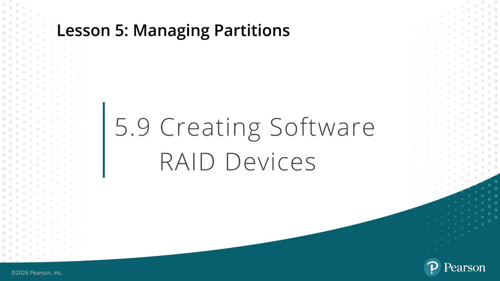
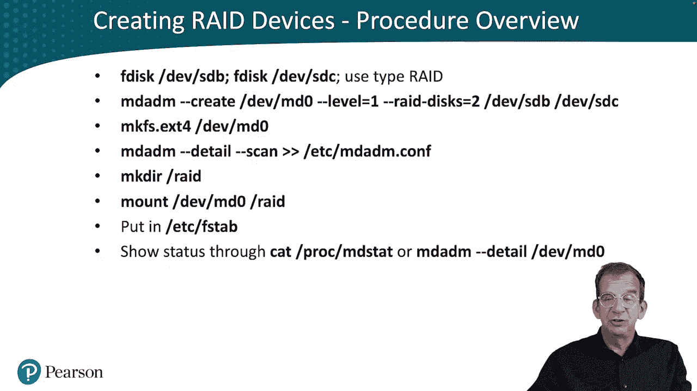
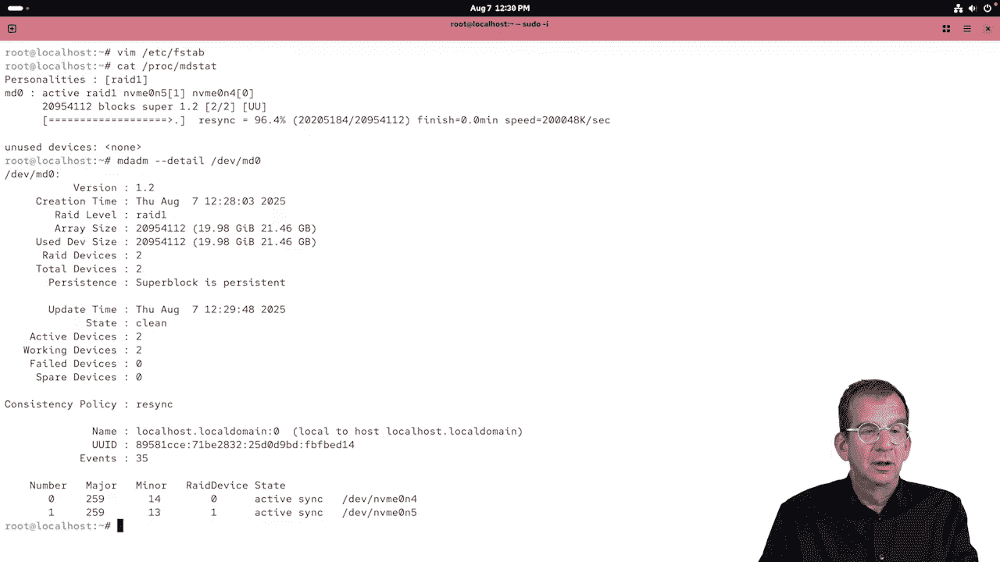
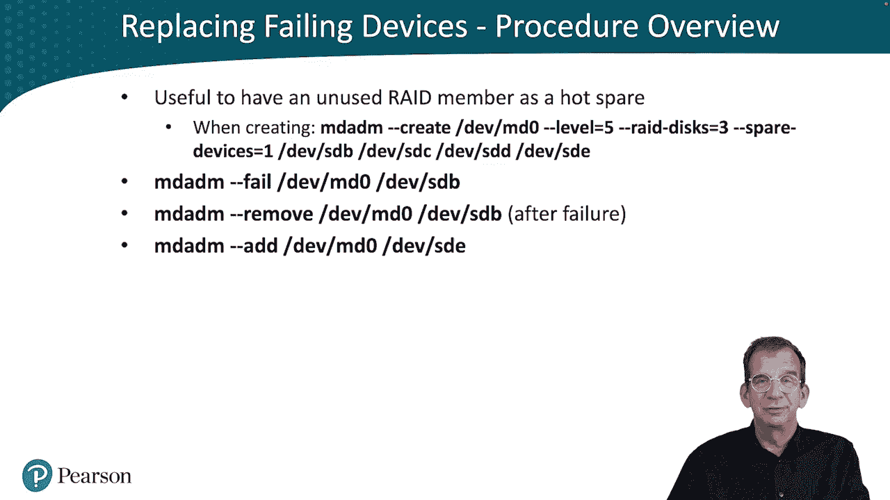

💾 CompTIA Linux+ V8：293.59：创建软件RAID设备




在本节课中我们将要学习如何在Linux系统上创建软件RAID设备。RAID是服务器和企业硬件中非常常见的磁盘阵列技术，它的核心目的是通过多个物理磁盘组成一个逻辑存储设备，以提高数据的安全性或性能。本节课会先解释RAID的基本含义，接着介绍常见的RAID级别，然后演示如何使用mdadm命令创建RAID设备，接着讲解如何让配置持久化并挂载文件系统，最后还会教你如何监控RAID状态以及更换出故障的磁盘。

RAID的全称是独立磁盘冗余阵列。简单来说，就是把多个磁盘组合在一起使用。RAID的核心公式可以这样理解：

RAID = 多个物理磁盘 -> 一个逻辑存储设备

如果其中一块磁盘损坏，系统仍然可以继续工作，具体取决于你选择的RAID级别。

接下来我们来看看Linux中常见的RAID级别都有哪些不同。

以下是常见的RAID级别及其特点：

- RAID 0：条带化。它把多个磁盘合并成一个大磁盘，读写速度快，但没有冗余。只要有一块磁盘损坏，所有数据就会丢失。
- RAID 1：镜像。它把数据同时写入两块磁盘，一块作为另一块的备份。如果一块磁盘坏了，另一块可以立即接管。
- RAID 5：分布式奇偶校验的条带化。它在多个磁盘上分散存储奇偶信息，允许一块磁盘损坏。
- RAID 6：双分布式奇偶校验的条带化。比RAID 5更可靠，允许两块磁盘同时损坏。
- RAID 10：镜像与条带化的组合。先做镜像再做条带化，性能和可靠性都比较好。

了解完这些级别之后，我们就可以动手在Linux中创建软件RAID了。你不需要专门的硬件RAID卡，也可以直接使用操作系统来完成。创建时可以使用整块磁盘，也可以使用磁盘分区，但要记得把分区类型设置为RAID类型。

以下是使用mdadm命令创建RAID设备的示例。mdadm中的MD代表多设备，ADM代表管理员。

```bash
mdadm --create /dev/md0 --level=1 --raid-devices=2 /dev/nvme0n4 /dev/nvme0n5
```

这条命令的意思是创建一个名为/dev/md0的RAID设备，使用RAID 1级别，也就是简单的镜像，需要两块磁盘。一块磁盘用来存数据，另一块用来做备份。执行命令后，系统可能会提示这个设备不太适合用于启动，如果你不打算从它启动系统，直接继续即可。

创建好RAID设备之后，你需要在上面建立文件系统，然后把配置保存下来，这样重启后设备仍然可用。



首先在RAID设备上创建文件系统，比如ext4：

```bash
mkfs.ext4 /dev/md0
```

接着查看RAID设备的详细信息，并将其写入配置文件，确保配置持久化：

```bash
mdadm --detail --scan --verbose >> /etc/mdadm/mdadm.conf
```

然后创建挂载点并挂载设备：

```bash
mkdir -p /raid
mount /dev/md0 /raid
```

现在你可以把文件复制到/raid目录，数据就会存储在RAID设备上了。如果你希望开机自动挂载，还需要把它添加到/etc/fstab文件中。因为RAID设备是根据磁盘上的元数据自动识别的，所以设备名写/dev/md0即可：

/dev/md0 /raid ext4 defaults 0 0

配置完成后，你可能想知道RAID设备现在运行得怎么样。可以查看内核提供的同步信息文件：

```bash
cat /proc/mdstat
```

或者使用mdadm命令查看更详细的当前状态：

```bash
mdadm --detail /dev/md0
```

这会显示RAID设备的当前健康状况、同步进度以及各个成员磁盘的信息。

在使用RAID设备的过程中，磁盘损坏是难免的。为了高效处理这种情况，建议在创建RAID时预留一个备用磁盘，也就是热备设备。



以下是创建带热备的RAID示例：

```bash
mdadm --create /dev/md0 --level=1 --raid-devices=2 --spare-devices=1 /dev/nvme0n4 /dev/nvme0n5 /dev/nvme0n6
```

当某块磁盘故障时，你可以手动标记它为失败，然后移除它，接着把之前标记为备用的磁盘加入数组，完成替换。具体的操作流程是：先标记故障设备，再移除故障设备，最后添加备用设备替补上位。



本节课中我们一起学习了RAID的基本概念、常见RAID级别的区别，以及如何在Linux中使用mdadm命令创建软件RAID设备。我们还讲解了如何格式化文件系统、通过mdadm.conf和fstab让配置持久化、如何用/proc/mdstat和mdadm --detail监控状态，最后还介绍了如何利用热备设备更换故障磁盘。希望这些内容能帮助你掌握软件RAID的部署与维护。
