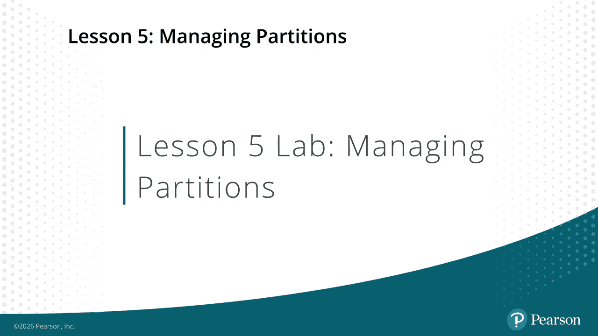
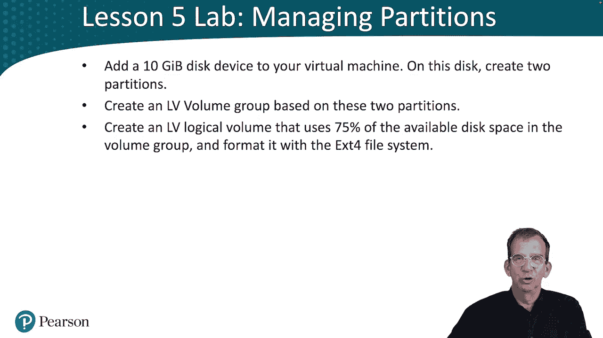

# 🐧 CompTIA Linux+实验教程：第5节：管理分区与LVM卷组

在本节课中，我们将一起学习如何在Linux系统中管理磁盘分区，并了解如何基于分区创建LVM卷组和逻辑卷。本节内容适合初学者，会用大白话把每个步骤讲清楚，让你即使没有太多Linux经验也能跟上操作，慢慢掌握磁盘管理的基本思路。


## 📋 实验环境准备

上一节我们介绍了Linux基础分区概念，本节中我们来看看如何进行实际的磁盘分区和LVM配置。

在开始动手之前，首先需要确认你的系统中有足够的磁盘空间可用。具体来说，你需要准备至少10GB的未使用磁盘空间。如果你现在的硬盘空间不够，也可以添加一块新硬盘，或者直接在现有的硬盘上进行操作，这两种方式都是可以接受的，不必过于纠结。


以下是磁盘空间检查的核心要求：

- 可用磁盘空间不少于10GB
- 可以使用新磁盘，也可以使用现有磁盘




## 🔧 创建磁盘分区

接下来我们进入分区创建阶段。在LVM配置之前，必须先在磁盘上划分出分区，因为LVM是建立在分区之上的，没有分区就无法创建卷组。

本实验要求你创建两个分区。这两个分区将作为后续创建卷组的基础，所以请务必确保分区创建成功，否则后面的步骤无法继续进行，可能需要重新来过。

以下是分区创建的关键步骤：

- 在磁盘上创建第一个分区
- 在磁盘上创建第二个分区
- 确认两个分区都已正常建立

创建分区的核心命令可以表示为：

```bash
fdisk /dev/sdb
# 或者使用 parted /dev/sdb
# 创建分区 1
# 创建分区 2
```


## 💾 创建LVM卷组

有了两个分区之后，下一步就是把它们组合成一个LVM卷组。你可以把卷组理解为一个存储池，里面包含了一个或多个物理分区，之后可以从中灵活划分出逻辑卷。

根据任务要求，我们需要基于刚才创建的两个分区，建立一个LVM卷组。卷组创建完成后，它就成为了一个整体存储资源池，后续可以从中划分出逻辑卷，而不需要再关心具体的物理分区位置。

以下是卷组创建的主要操作：

- 将两个分区标记为LVM物理卷
- 基于这两个物理卷创建卷组
- 确认卷组创建成功

LVM卷组的核心命令流程如下：

```bash
pvcreate /dev/sdb1 /dev/sdb2
vgcreate my_vg /dev/sdb1 /dev/sdb2
vgs
```


## 📂 创建逻辑卷并格式化

卷组准备好之后，最后一步是从卷组中划分出逻辑卷，并对其进行格式化。逻辑卷就像是一个可以灵活调整大小的虚拟分区，使用起来比普通分区更方便。

任务要求创建的逻辑卷需要使用卷组中75%的可用磁盘空间，并使用EXT4文件系统进行格式化。EXT4是Linux中常用的日志文件系统，稳定性好，兼容性强，适合大多数场景。

以下是逻辑卷创建和格式化的步骤：

- 计算卷组总空间的75%
- 基于该比例创建逻辑卷
- 使用EXT4文件系统格式化逻辑卷
- 挂载并验证文件系统

逻辑卷创建与格式化的核心命令如下：

```bash
lvcreate -l 75%VG -n my_lv my_vg
mkfs.ext4 /dev/my_vg/my_lv
mount /dev/my_vg/my_lv /mnt
df -h
```




## 📝 课程总结

本节课中我们一起学习了如何检查磁盘可用空间，如何创建两个分区，如何基于这两个分区建立LVM卷组，以及如何创建占用卷组75%空间的逻辑卷并用EXT4格式化。希望这些内容能帮助你掌握Linux分区和LVM的基础管理技能，祝你实验顺利。

