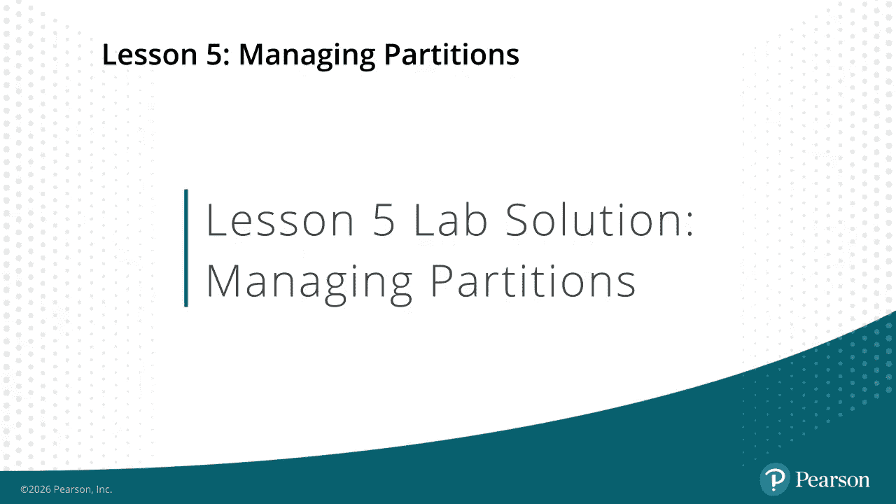
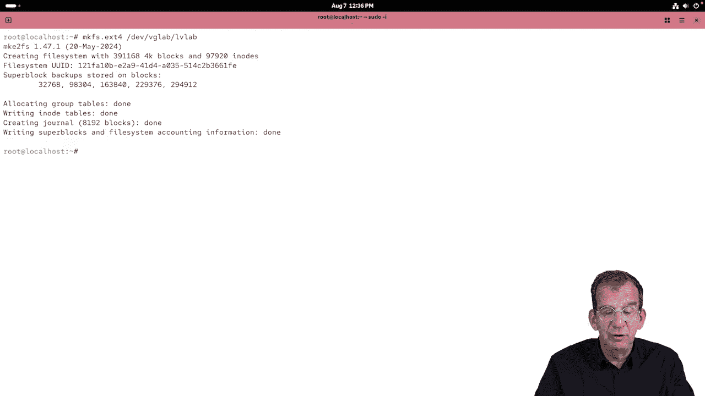

# CompTIA Linux+ 存储与分区管理：Lesson 5：LVM分区管理实验 💾

在本节课中，我们将学习如何在 Linux 系统中管理磁盘分区，并搭建基于 LVM 的存储环境。具体内容包括检查当前的存储拓扑，使用 fdisk 工具创建新分区，为分区设置 LVM 类型，将分区写入磁盘，创建 LVM 卷组，从卷组中划分逻辑卷，验证逻辑卷大小，最后格式化文件系统。这些步骤构成了 Linux 存储管理的基础流程，适合初学者从零开始理解分区和逻辑卷的工作方式。

## 检查存储拓扑 🔍

在开始动手操作之前，我们需要先搞清楚系统里到底有哪些存储设备可以使用，这样才能决定在哪块磁盘上创建分区。通过观察可以发现，NVMe0 和 NVMe2 是比较合适的选项，因此我们决定在 /dev/nvme0n2 上进行后续操作。为了让输出信息更清晰，可以使用控制加 L 将终端输出置顶，方便后续查看分区表的变化情况。

## 创建新分区 🔪

确认好目标存储设备之后，接下来就可以开始在磁盘上划分新的分区了。我们需要创建两个分区，分别编号为 5 和 6，每个分区大小设为 1 GB，因为实验并没有对分区大小提出特定要求。

以下是创建分区的具体操作步骤：

- 使用 fdisk 命令打开 /dev/nvme0n2 设备
- 输入 n 创建新分区，指定分区编号为 5
- 设置分区大小为 1 GB
- 再次输入 n 创建第 6 个分区，同样分配 1 GB 空间

## 设置分区类型为 LVM 🗂️

分区创建完成之后，还需要告诉系统这些分区打算用来做什么。因为我们后续要把这些分区用于 LVM，所以必须把分区类型改为 LVM，否则系统可能无法正确识别它们的用途。

以下是设置分区类型的操作方法：

- 输入 t 命令来修改分区类型
- 针对第 5 个分区，将类型别名设置为 LVM
- 针对第 6 个分区，类型别名同样设置为 LVM

## 验证并写入分区表 ✅

所有分区设置都完成之后，不能直接进入下一步，需要先检查一遍分区表是否正确，确认没有遗漏或错误，然后再把这些变更真正写入磁盘。写入之后，分区才会被系统正式识别。

以下是验证和保存分区表的操作步骤：

- 输入 p 查看当前分区表，确认分区 5 和分区 6 已经出现
- 输入 w 将分区表写入磁盘
- 使用 lsblk 命令验证分区 5 和分区 6 是否如预期显示

## 创建 LVM 卷组 📦

分区已经成功创建并写入磁盘，接下来的任务是把这些分区整合到 LVM 卷组中，以便统一管理存储空间。卷组相当于一个存储池，我们可以从中划分出一个或多个逻辑卷。

使用 vgcreate 命令创建一个名为 VG_La 的卷组，并把 /dev/nvme0n2p5 以及 /dev/nvme0n2p6 加入其中。这里有一个比较重要的细节，通常在使用 LVM 之前，需要先用 pvcreate 命令把分区初始化为物理卷，但 LVM 工具本身相当智能。即使你没有单独执行 pvcreate，vgcreate 也会自动发现这些分区还不是物理卷，并自动向分区写入物理卷元数据，最终结果是卷组依然能够成功创建，这让操作变得更加简单。

## 创建逻辑卷 📊

卷组建好之后，接下来就要从卷组里面切出逻辑卷来，这样才能把存储空间格式化并挂载使用。逻辑卷的大小可以根据需要灵活调整，不需要一次性占用全部空间。

以下是创建逻辑卷的具体命令说明：

- 使用 lvcreate 命令创建逻辑卷
- 参数 -l 75%FREE 表示使用卷组中 75% 的可用空间
- 参数 -n LV_La 给逻辑卷指定名称为 LV_La
- 指定所属卷组名称为 VG_La

## 验证逻辑卷大小 🔎

逻辑卷创建完成之后，需要确认它的实际大小是否符合预期，避免出现空间分配错误的情况。只有确认大小正确，才能放心地进行后续的文件系统格式化。

以下是验证逻辑卷的操作命令：

- 使用 lvs 命令查看逻辑卷的详细信息
- 可以看到 LV_La 的大小为 1.5 GB，这正好符合实验需求

## 格式化文件系统 💿

逻辑卷有了大小，最后一步就是把它格式化成操作系统可以识别的文件系统，这样才能存放文件。我们选择 ext4 文件系统，因为它是 Linux 中最常用且稳定的文件系统之一。

使用 mkfs.ext4 命令在 /dev/VG_La/LV_La 上创建 ext4 文件系统。至此，本节实验要求的所有操作步骤都已经完成。

本节课中我们一起学习了如何检查存储拓扑、使用 fdisk 创建分区、设置 LVM 分区类型、写入分区表、创建 LVM 卷组和逻辑卷、验证逻辑卷大小，以及格式化 ext4 文件系统。

