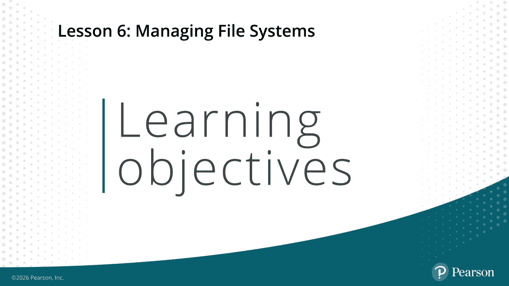
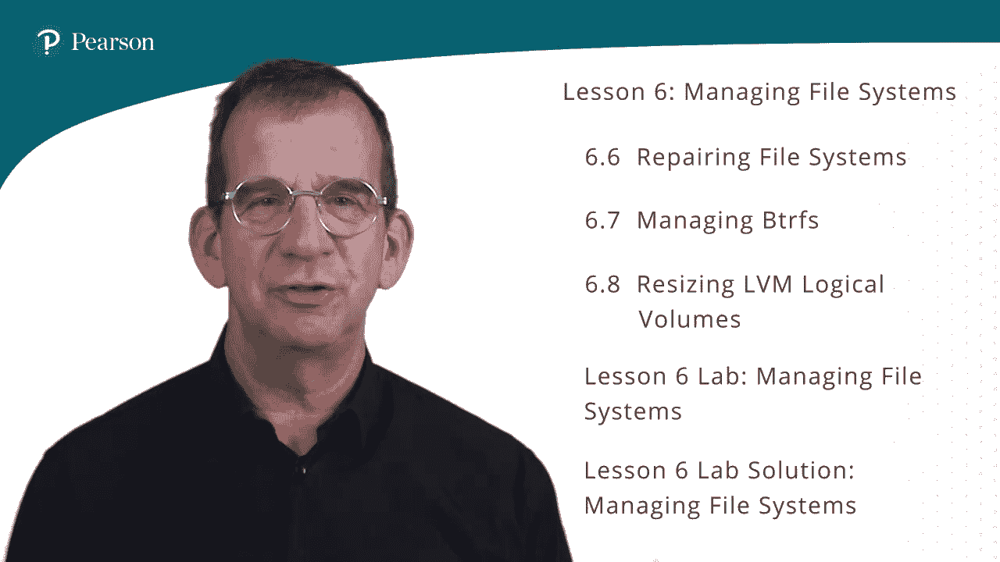

# CompTIA Linux+ V8：03：文件系统挂载与管理基础 📁

本节课中我们将要学习如何在 Linux 系统中操作文件系统。老师会先带你了解不同文件系统之间的区别，接着讲解什么是文件系统挂载，以及如何通过配置文件实现挂载的自动化。之后还会介绍标签和 UUID 的使用方法，并展示如何监控磁盘空间、修复文件系统和管理网络文件系统。最后会简要提及下一节内容，包括 betterFS 文件系统和 LVM 逻辑卷的大小调整。这些内容是 Linux 系统管理中非常基础又重要的一部分，掌握之后你就能更好地掌控服务器上的存储设备了。


上一节我们简单了解了 Linux 的基本命令操作，本节中我们来看看文件系统是怎么工作的，以及如何让系统自动挂载存储设备。如果你是第一次接触这些概念，不用担心，老师会用最直白的方式把原理讲清楚。



以下是本节课前半部分的主要知识点：

- 文件系统之间存在差异，不同类型的文件系统适用于不同的场景。
- 文件系统挂载是将存储设备连接到系统目录树的过程。
- 使用 /etc/fstab 配置文件可以实现开机自动挂载，无需每次手动操作。

在实际操作中，挂载命令通常长这样，你可以把它理解为把一个存储设备"接"到系统的某个文件夹下面：

```bash
mount /dev/sda1 /mnt/data
```

而 /etc/fstab 文件中的一行记录示例如下，这一行告诉系统开机时该怎么挂载：

```text
UUID=1234-5678 /mnt/data ext4 defaults 0 2
```


学完了基础的挂载方法，本节中我们继续来看看标签和 UUID 这两个更稳定的标识方式。为什么需要它们呢？因为设备名称比如 /dev/sda1 有时候会变，而标签和 UUID 不会随便变化，用起来更保险。

以下是关于标签和 UUID 的要点：

- 标签（Label）是给分区起的人类可读名称，方便识别。
- UUID 是全球唯一标识符，每个文件系统都有自己独一无二的 UUID。
- 在 /etc/fstab 中使用 UUID 或标签，比直接使用设备名称（如 /dev/sda1）更可靠，因为设备名称可能会变化。

查看文件系统 UUID 的命令示例如下，运行之后你就能看到每个分区对应的 UUID 字符串：

```bash
blkid
```


掌握了标签和 UUID 之后，本节中我们来看看一些更高级的文件系统管理任务。这些任务在日常运维中非常常见，尤其是当磁盘快满了或者文件系统出错的时候，你需要用到它们。

以下是高级任务的具体内容：

- 监控可用磁盘空间，了解哪些分区快满了，避免系统出问题。
- 检查和修复文件系统错误，确保数据的完整性。
- 管理网络文件系统，让多台机器可以共享同一份存储资源。

查看磁盘空间使用情况的常用命令如下，df -h 会以人类易读的方式显示各个分区的使用率：

```bash
df -h
```

修复文件系统的命令示例如下，fsck 可以检查并修复文件系统上的错误：

```bash
fsck /dev/sda1
```


完成本节的核心内容后，本节中我们来看看课程后续还会涉及哪些相关主题。虽然这些内容不在这一节的重点里，但老师会提前告诉你下一节学什么，方便你有个心理准备。

以下是后续视频会讲到的内容：

- 下一个视频将讲解如何管理 betterFS 文件系统。
- 在实验和实验解答之前的最后一个视频，会教你如何调整 LVM 逻辑卷的大小。
- LVM 逻辑卷大小调整通常使用 lvextend 或 resize2fs 等工具完成。

调整 LVM 逻辑卷大小的命令示例如下，lvextend 用来增加空间，resize2fs 用来更新文件系统大小：



```bash
lvextend -L +5G /dev/vg0/lv0
resize2fs /dev/vg0/lv0
```


本节课中我们一起学习了 Linux 文件系统的基础知识，包括不同文件系统的差异、挂载操作、使用 /etc/fstab 实现自动挂载、标签和 UUID 的应用，以及监控磁盘空间、修复文件系统和管理网络文件系统等高级任务。同时也预告了后续关于 betterFS 和 LVM 逻辑卷大小调整的内容。希望这些知识能帮助你更好地理解和管理 Linux 系统中的存储设备，打好后续学习的基础。

