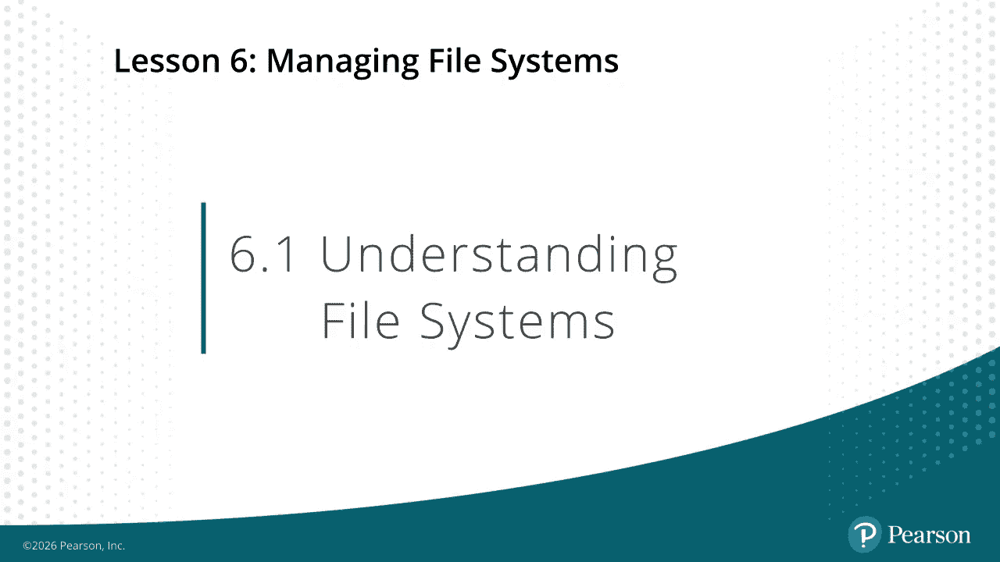
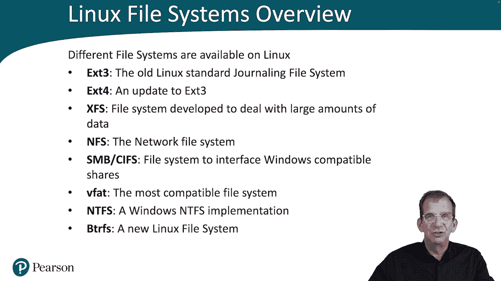

# CompTIA Linux+ V8：61：理解文件系统 📂




## 课程概述

在本节课中，我们将学习Linux中的文件系统，看看可以安装在存储设备之上的不同类型，并了解每种文件系统适合什么样的使用场景。

---

在上一节课中，你已经学习了存储设备，并且创建了分区、LVM逻辑卷以及阵列设备。本节课中，我们将把视角进一步聚焦到可以放在这些设备之上的文件系统。

Linux中有多种文件系统可供选择。有时候，某个文件系统是否可用，取决于你正在使用的Linux发行版。

下面是本节课将要介绍的几种最重要的文件系统。

## ext3（第三扩展文件系统）

ext3是Linux的旧标准。它是一个日志文件系统，这意味着它拥有一个事务日志。如果你的服务器崩溃，并且你需要修复那些打开的文件，这个日志可以帮助系统恢复。

## ext4（第四扩展文件系统）

ext4是对ext3的更新，已经存在将近二十年了，所以ext3确实比较老旧。ext4是一个非常稳定的文件系统，正因为如此，许多Linux发行版至今仍在使用它。

## XFS

XFS是专门为处理大量数据而开发的文件系统。Red Hat使用它，并且对它进行了大量调优，以确保它能够处理最大规模环境中的数据。

## NFS

NFS有点不同，它是一个网络文件系统，允许你挂载来自不同服务器的共享。

## SMB/CIFS

SMB或CIFS也是一种基于网络的文件系统。它是Windows兼容共享的接口，因此你可以用它在Linux机器上挂载Windows共享。

## VFAT

VFAT是兼容性最好的文件系统。这意味着你可以在Linux、MacOS以及Windows上使用VFAT。如果你有一个USB拇指驱动器，并且希望在所有这些操作系统之间共享这个驱动器，VFAT基本上是你唯一的选择。

## NTFS

NTFS是Windows NTFS的实现。但是，像Red Hat这样的企业级发行版不支持它。说实话，没有理由使用NTFS，因为NTFS属于Windows。Linux有自己的文件系统，能够相当不错地处理文件存储。

## Btrfs

最后要提到的文件系统是Btrfs，读作“Butter FS”。这是一个相对较新的Linux文件系统，提供了许多高级功能。但是，并非所有这些功能都非常稳定，正因为如此，你不会在较大的Linux发行版中发现它作为默认文件系统。

## 核心概念

文件系统选择可以用如下伪代码表示：

```text
if 需要最大兼容性:
    选择 VFAT
elif 需要处理大量数据:
    选择 XFS
elif 需要网络共享:
    选择 NFS 或 SMB/CIFS
else:
    选择 ext4
```

让我们继续接下来的几节课，你将在那里学习如何使用这些文件系统。

## 课程总结



本节课中，我们一起学习了Linux中可用的各种文件系统，包括ext3、ext4、XFS、NFS、SMB/CIFS、VFAT、NTFS以及Btrfs。我们了解了每种文件系统的特点、适用场景以及稳定性。
