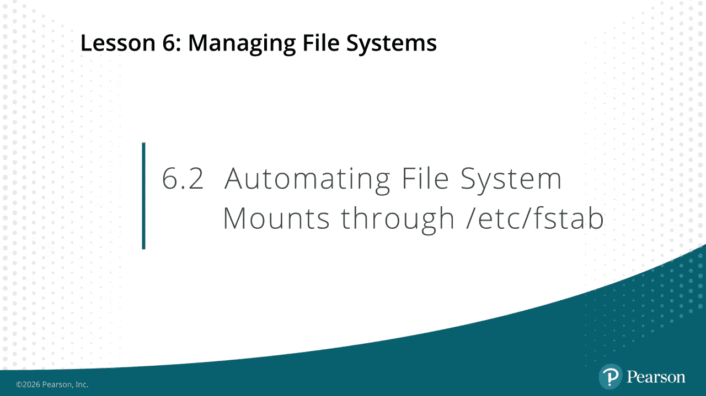
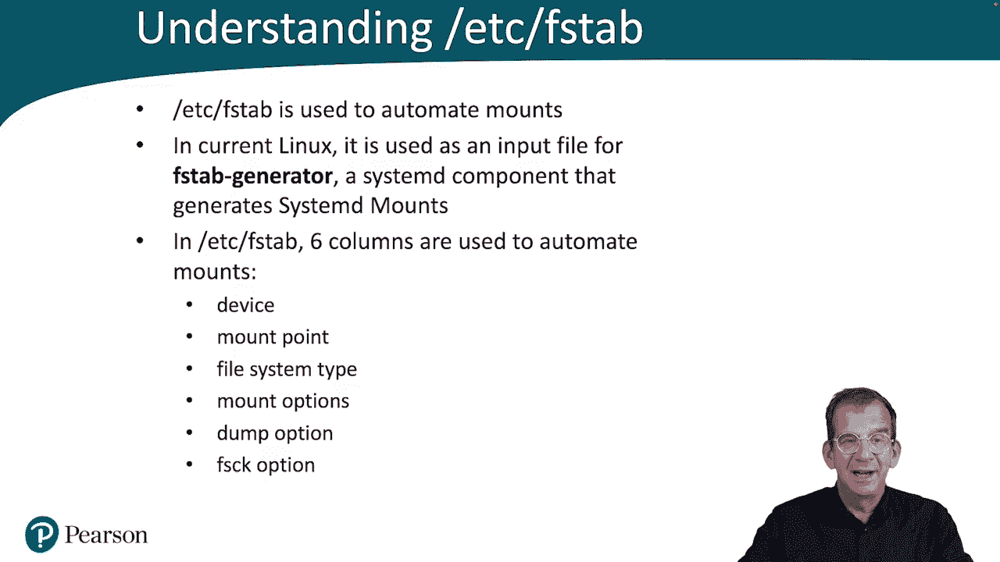
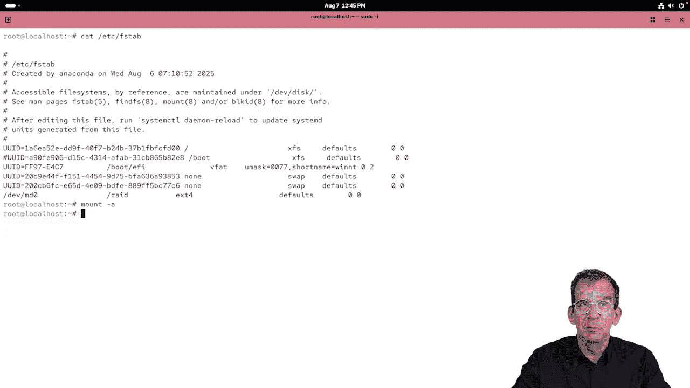

# 📚 Oreilly - CompTIA Linux+ V8：62：通过 /etc/fstab 自动化文件系统挂载

在本节课中我们将要学习 Linux 系统中用于自动化挂载文件系统的核心配置文件 /etc/fstab。很多初学者在刚接触 Linux 的时候，总是觉得挂载文件系统这件事很抽象，其实它就像是给系统写一份"挂载清单"，让开机时系统能自动把磁盘分区挂载到指定的目录下，而不需要每次都手动输入挂载命令。我们会先解释这个文件存在的意义，然后逐列拆解它的格式，最后通过实际示例看看怎么修改和验证，确保你改完配置之后系统还能正常启动。

文件系统在被使用之前，必须先挂载到系统的目录树中才能访问。即使现在的 Linux 发行版已经有了一些自动化的机制，/etc/fstab 依然是行业标准，也是绝大多数系统管理员在处理磁盘挂载时首先想到的配置文件。这一节我们先来看看这个文件到底是做什么的，以及系统是如何利用它来完成自动挂载的工作。

/etc/fstab 的作用是在当前的 Linux 系统中实现挂载自动化。它作为 systemd 挂载生成器的输入文件，而 systemd 是系统初始化和服务管理的核心组件，会读取这个文件并生成相应的 systemd 挂载单元，从而在开机或服务启动时自动完成文件系统的挂载。我们在之前的课程中已经接触过 /etc/fstab 的基础内容，现在我们要更系统地把它梳理一遍。

/etc/fstab 文件使用六列来定义一个文件系统的自动挂载规则，每一列都有明确的含义，缺一不可。以下是 /etc/fstab 的六列结构：

1. 设备标识：可以是设备名称，也可以是 UUID 或文件系统标签，用于告诉系统挂载哪个磁盘分区。
2. 挂载点：文件系统将被挂载到的目录路径，例如 /mnt/data 或 /home。
3. 文件系统类型：比如 ext4、xfs、vfat 等，告知系统使用哪种驱动来解析磁盘数据。
4. 挂载选项：控制挂载行为的参数，例如 defaults、noexec、nofail 等，多个选项之间用逗号分隔。
5. dump 选项：用于老旧的 dump 备份工具，现代系统中通常设置为 0。
6. fs 检查顺序：决定开机时文件系统检查的先后顺序，0 表示不检查，1 表示最先检查，2 表示在标记为 1 的文件系统检查完成后再检查。

在实际的配置文件中，你经常会看到设备不是通过 /dev/sda1 这样的设备名来指定，而是使用 UUID 或标签。这是因为设备名称可能会在重启后发生变化，而 UUID 和标签通常保持不变，因此通过 UUID 或标签挂载是更稳妥的标准做法。以下是一行典型的 /etc/fstab 配置示例：

UUID=550e8400-e29b-41d4-a716-446655440000 /mnt/data ext4 defaults 0 0

这行配置的意思是，将 UUID 为 550e8400-e29b-41d4-a716-446655440000 的分区挂载到 /mnt/data，文件系统类型是 ext4，使用默认挂载选项，dump 和 fs 检查都设为 0。

除了基本的设备名和挂载点，第四列的挂载选项是很多新手容易忽略的部分，但它实际上决定了文件系统在挂载后的行为。以下是几个常用的挂载选项及其含义：

- defaults：使用系统默认的一组挂载选项，适合大多数常规场景。
- noexec：禁止在该文件系统上执行任何二进制文件或脚本，常用于提高安全性。
- nofail：如果在启动时无法挂载该文件系统，系统不会因此中断启动流程，适用于非关键的外部磁盘。
- umask：设置文件和目录的默认权限掩码，控制谁可以读写挂载后的内容。

你可以把所有想要的选项写在第四列，并根据需要把 defaults 替换成你喜欢的任意选项组合。

修改完 /etc/fstab 之后，不要立刻重启电脑来测试，因为如果配置写错了，可能会导致系统无法正常启动。我们建议先使用 mount -a 命令来挂载当前尚未挂载的所有文件系统，这样可以快速发现语法错误或路径问题。mount -a 的作用是读取 /etc/fstab 中的所有条目，把还没有挂载的文件系统都挂载上去。如果执行这个命令没有报错，说明配置在当前运行的系统中是有效的。

即使 mount -a 执行成功，在实际的生产环境中我们仍然强烈建议重启系统一次，亲自验证开机自动挂载是否正常工作。只有这样才能确定你没有在 /etc/fstab 中犯下任何会导致系统无法引导的严重错误，毕竟修改挂载配置是一件需要谨慎对待的事情。

本节课中我们一起学习了 /etc/fstab 配置文件的作用、六列结构的具体含义、常见挂载选项以及修改后的验证方法。你现在应该知道如何通过 UUID 或标签来稳定地挂载磁盘分区，如何在第四列中设置合适的挂载选项，以及如何使用 mount -a 和重启来确认配置没有问题。掌握这些内容之后，你就可以安全地在 Linux 系统中管理文件系统的自动挂载了。
