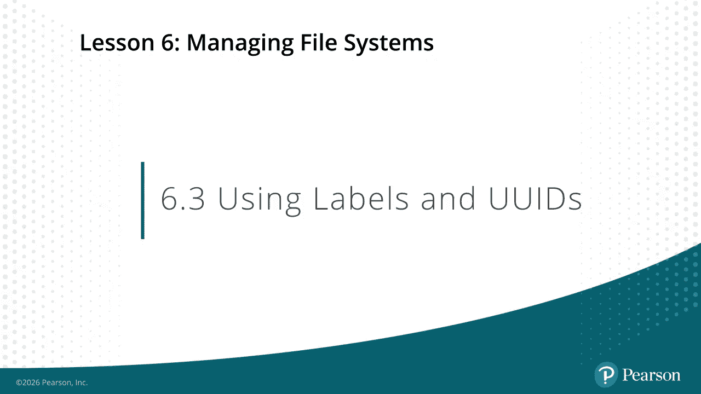
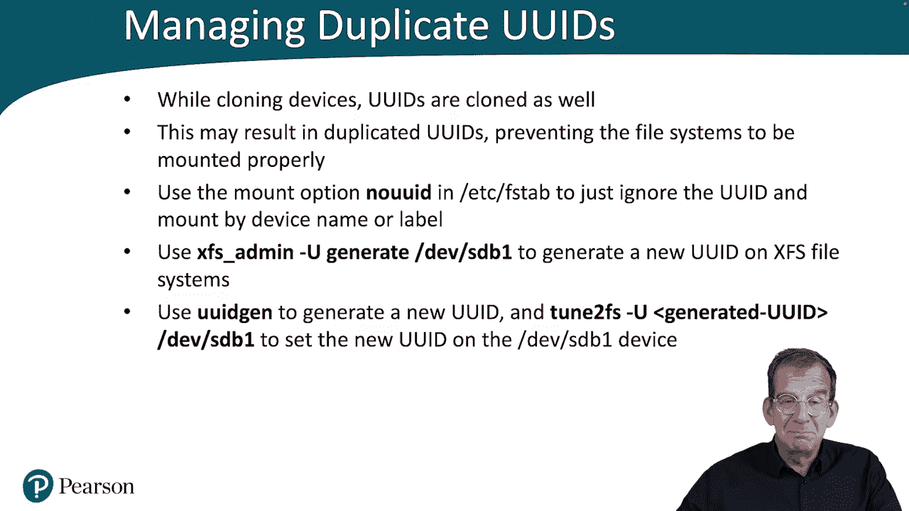

CompTIA Linux+ V8：99：使用标签和UUID 📋




在本节课中我们将要学习Linux系统中设备命名的问题，以及标签和UUID的作用。很多初学者在配置系统时，喜欢直接在配置文件里写死设备名称，比如/dev/sda1或者/dev/nvme0n1。这种做法看起来很简单，但实际上非常危险，因为硬件变动之后设备名称可能会发生变化，导致系统无法正常启动或者分区无法挂载。为了避免这种情况，我们需要了解UUID和标签这两种更稳定的文件系统标识方式。

首先，我们先来看看设备名称是怎么产生的，以及为什么它们不可靠。

设备名称是由systemd udev在系统引导时生成的。当计算机启动时，内核会检测连接的硬件，udev会根据检测到的硬件顺序分配设备名。这个过程在每次启动时并不一定完全一样，所以设备名并不是固定不变的。

以下是设备名称发生变化的典型场景：
- 系统启动时硬件检测顺序可能不同。
- 新增硬件设备后，原有设备名称可能会发生偏移。
- 例如，你之前的NVME硬盘是NVME0和NVME1，加入新设备重启之后，可能变成了NVME0和NVME3。

如果你在/etc/fstab文件中硬编码了设备名称，系统启动时可能找不到对应的设备，挂载操作就会失败，你需要手动排查故障，这显然不是一个好主意。

下面是一个错误的配置示例：
```bash
/dev/nvme0n1  /mnt/data  ext4  defaults  0  0
```

为了解决这个问题，我们可以使用UUID和标签来代替设备名称。

UUID是Universally Unique Identifier的缩写，中文叫通用唯一标识符。标签则是人类可以读懂的文本标识。这两者都写入文件系统本身，而不是依赖于内核分配的设备名称，所以即使设备名称变了，系统仍然能够找到正确的分区。

UUID是在创建文件系统的时候自动分配的。如果你在某个设备上找不到UUID，最简单的原因通常是这个设备上还没有创建文件系统。

你可以使用以下命令来查看块设备当前的UUID：
```bash
blkid
```
blkid的全称是块设备标识符，它会列出系统中所有块设备的UUID、文件系统类型和标签信息。

标签是人类可理解的标签，写入文件系统。你需要自己创建它们，使用的工具取决于你要使用的文件系统类型。

以下是不同文件系统设置标签的方法：
- 在创建文件系统时使用mkfs命令，加上大写的-L选项，可以为任何文件系统设置标签。
- 对于已有的ext系列文件系统，使用tune2fs命令加上大写的-L选项来设置标签。
- 对于已有的XFS文件系统，使用xfs_admin命令加上大写的-L选项来设置标签。

示例代码：
```bash
# 创建ext4文件系统并设置标签
mkfs.ext4 -L mydata /dev/sdb1

# 为现有ext4文件系统设置标签
tune2fs -L mydata /dev/sdb1

# 为现有XFS文件系统设置标签
xfs_admin -L mydata /dev/sdb1
```

现在我们来聊聊XFS文件系统。在使用XFS时，你可能会遇到重复UUID的情况。

重复UUID通常发生在克隆设备的时候。如果你克隆一个设备，就会对设备内容进行逐块的完整拷贝，UUID也会被一起复制。结果就是两个设备拥有相同的UUID，这会导致文件系统无法正常挂载。

以下是处理重复UUID的临时方法：
- 使用mount命令的nouuid选项挂载文件系统。
- 或者直接忽略UUID，通过设备名称或标签来挂载。

但是，这些方法只是临时方案，不能从根本上解决问题。

更好的解决方案是，对于XFS文件系统，你可以使用xfs_admin命令加上-U generate选项，在文件系统上生成新的UUID。这样就可以避免冲突。

示例代码：
```bash
# 为XFS文件系统生成新UUID
xfs_admin -U generate /dev/sdb1
```

另外，你还可以使用uuidgen命令生成一个全新的UUID，然后用tune2fs命令加上-U选项将其应用到ext文件系统上，之后就可以将这个新UUID设置到设备中。

示例代码：
```bash
# 生成新UUID
uuidgen

# 为ext文件系统设置新生成的UUID
tune2fs -U 新生成的UUID /dev/sdb1
```

UUID通常是自动生成的，但在某些特殊情况下，手动生成UUID也非常有用，比如处理克隆磁盘后的UUID冲突，或者需要自定义UUID的时候。



本节课中我们一起学习了为什么不能在/etc/fstab中硬编码设备名称，学习了systemd udev如何生成设备名以及硬件变化可能导致设备名改变的原因。我们还介绍了UUID和标签这两种更可靠的文件系统标识方法，学习了如何使用blkid查看UUID，如何使用mkfs、tune2fs和xfs_admin设置标签。最后，我们讨论了XFS文件系统中重复UUID的问题，以及如何使用xfs_admin和uuidgen来生成新UUID并解决冲突。
