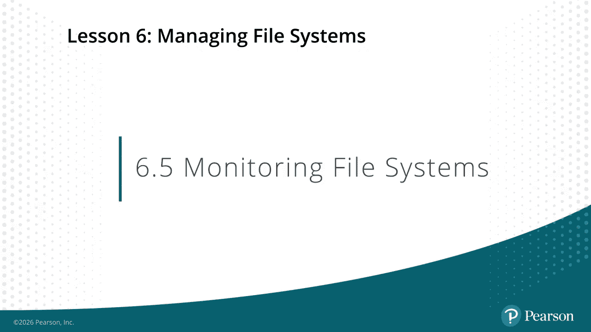
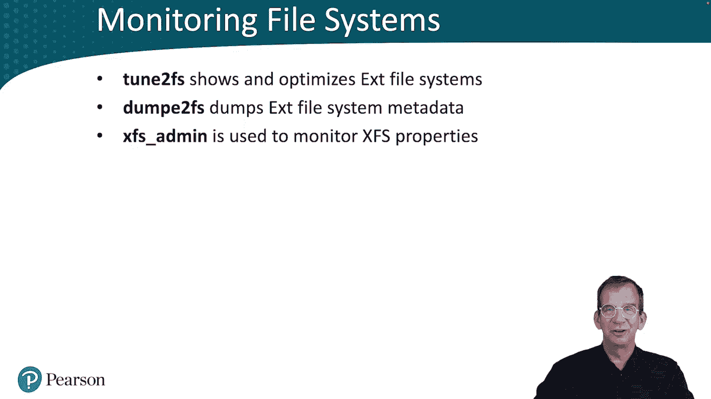
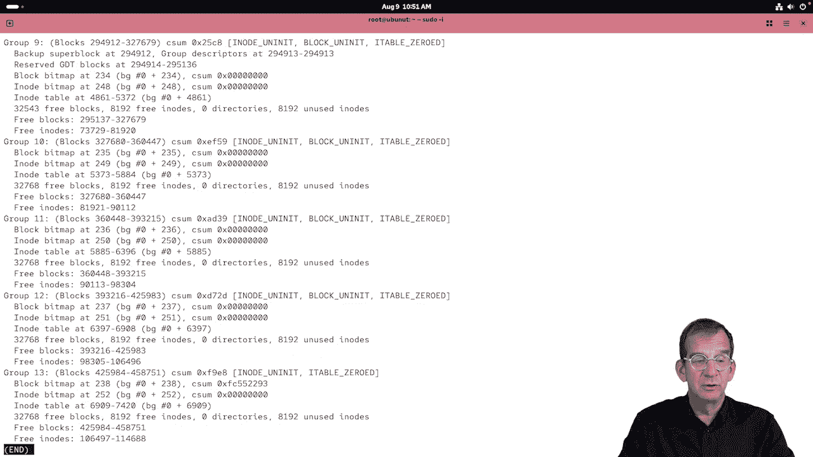

# CompTIA Linux+ V8：第4章：监控文件系统 📂


## 概述



在本节课中，我们将要学习如何监控 Linux 文件系统的运行情况。课程会介绍几种专门用于查看文件系统内部工作原理的技术工具，让你能够深入了解磁盘上数据是如何组织存储的。这些工具会根据不同的文件系统类型来选择，常见的有 EXT4 和 XFS 等。我们还会通过一台 Ubuntu 服务器进行实际演示，展示如何使用命令行工具查看文件系统的详细元数据信息。无论你是初学者还是有一定 Linux 基础，跟着本节的步骤操作，都能掌握文件系统监控的基本方法。


## 一、常见文件系统监控工具

文件系统监控的核心目标，是帮助管理员掌握文件系统当前的状态和底层结构。由于不同类型的文件系统采用不同的存储组织方式，因此需要使用对应的专用工具来进行检查和优化。

以下是针对不同文件系统类型的监控工具及其用途：

- EXT4 文件系统：使用 `tune2fs` 命令来显示和优化文件系统参数
- EXT 文件系统元数据：使用 `debugfs` 命令来查看文件系统元数据信息
- XFS 文件系统：使用 `xfs_admin` 命令来监控文件系统属性

工具选择与文件系统类型的对应关系可以用公式表示：

```
监控工具 = f(文件系统类型)
```

举个例子，当你的文件系统是 EXT4 时，通常优先选择 `tune2fs`；如果是 XFS 文件系统，则应该使用 `xfs_admin` 来查看属性。了解这些对应关系后，你就能在实际工作中快速找到合适的检查命令。


## 二、准备演示环境



在开始实际操作之前，我们需要准备好演示所用的服务器环境。本节演示将连接到一台 Ubuntu 服务器，之所以选择 Ubuntu，是因为它默认安装时使用的是 EXT4 文件系统，而 Red Hat 等发行版默认则使用 XFS 文件系统。

要想执行后面的文件系统检查命令，必须拥有超级用户权限，因为这些命令需要直接读取磁盘设备的底层信息。因此，第一步是打开一个具有 root 权限的 Shell 会话。

以下是进入超级用户模式的常见方法：

```bash
sudo -i
```

或者直接切换到 root 用户：

```bash
su -
```

完成这一步之后，你就拥有了运行文件系统监控命令所需的权限，可以继续进行后续的设备检查和参数查询。


## 三、查看磁盘设备与逻辑卷

在运行具体的文件系统检查命令之前，我们需要先确认系统中有哪些磁盘设备和逻辑卷可用，这样才能确定要检查的目标设备路径。

使用 `lsblk` 命令可以列出系统中的块设备信息。在演示系统中，你可以看到根逻辑卷，也就是系统安装所在的主分区，同时还能看到一个名为 `/dev/sda2` 的存储设备分区。

以下是查看块设备的常用命令：

```bash
lsblk
```

执行这个命令后，屏幕上会显示类似下面的信息：

- 根逻辑卷：操作系统安装所在的主要分区
- `/dev/sda2`：一个独立的存储设备分区，后续将作为检查目标

确认好目标设备路径之后，我们就可以开始针对该设备进行文件系统的详细检查了。


## 四、使用 tune2fs 检查 EXT4 文件系统

有了目标设备路径之后，就可以使用 `tune2fs` 命令来查看 EXT4 文件系统的详细信息了。这个命令不仅能显示文件系统的各种参数，还可以用于优化某些文件系统的运行行为。

在演示中，我们针对设备 `/dev/sda2` 执行以下命令：

```bash
tune2fs -l /dev/sda2
```

这里的 `-l` 参数表示列出文件系统超级块中的信息。命令输出会包含大量技术细节，这些信息在日常运维工作中不一定每天都会用到，但在排查特定问题或需要了解文件系统底层状态时非常有价值。

以下是命令输出中可能包含的关键信息项目：

- 文件系统卷名：用于标识该文件系统的名称
- 最后挂载时间：文件系统最近一次被挂载的时间点
- 文件系统状态：当前文件系统是否干净或存在错误
- 默认挂载选项：系统挂载该文件系统时使用的默认参数

除了查看基本信息，`tune2fs` 的输出还能帮助你确认扩展属性和 ACL 支持情况。扩展属性是 EXT4 文件系统中的一个重要功能，用于存储文件的附加信息。如果你尝试使用 `chattr` 命令设置文件属性，或者使用 `setfacl` 命令设置文件系统访问控制列表，却发现操作没有生效，这时候就需要检查文件系统是否支持扩展属性和 ACL。你可以通过 `tune2fs` 的输出来查看默认挂载选项中是否包含 `acl` 或 `user_xattr` 等支持项，如果这些选项缺失，就需要重新挂载文件系统并添加相应的支持选项。


## 五、inode 数量与静态分配机制

EXT4 文件系统有一个比较特殊的设计，就是 inode 数量是静态分配的，在文件系统创建时就已经确定。inode 是用来记录文件元数据的数据结构，每个文件在文件系统中都需要占用一个 inode。

由于 inode 数量在创建文件系统时就固定下来了，之后不会自动增加。这意味着，如果文件系统中的 inode 全部被用完，即使磁盘空间还有剩余，也无法创建新文件。

inode 可用性的判断可以用下面的公式表示：

```
可用 inode 数 = 总 inode 数 - 已使用 inode 数
```

如果计算结果为 0，系统就会提示 inode 耗尽。

在演示系统中，我们可以看到总共有 114688 个 inode，而当前还有大量可用 inode，距离耗尽还非常远。不过，如果你在实际工作中遇到类似“no inodes available”这样的错误消息，使用 `tune2fs` 或 `dumpe2fs` 查看文件系统信息就会很有帮助，这样可以确认是不是真的没有可用 inode 了。


## 六、使用 dumpe2fs 深入查看块组信息

如果你需要比 `tune2fs` 更详细的技术信息，可以使用 `dumpe2fs` 命令。这个工具会深入到文件系统的底层结构，显示块组等细节信息，许多系统管理员在日常工作中可能从未接触过这个层次的细节。

针对 `/dev/sda2` 设备执行命令：

```bash
dumpe2fs /dev/sda2
```

输出的开头部分与 `tune2fs -l` 显示的信息相似，但随后会进入更深入的块组详情。

EXT4 文件系统将存储空间组织成多个块组，目的是为了更合理地逻辑存储文件。每个块组包含一定数量的数据块和 inode。如果你想了解这些块组的具体划分情况，`dumpe2fs` 的输出就能提供所需信息。

以下是块组相关的关键概念：

- 块组：文件系统中逻辑划分的存储单元
- 块组描述符：记录每个块组的元数据信息
- 数据块：实际存储文件内容的磁盘区域

通过块组信息，你可以更好地理解文件系统在磁盘上的物理分布情况，从而在需要时进行更深入的故障排查或性能优化。


## 总结



本节课中我们一起学习了如何监控 Linux 文件系统的运行状态。首先介绍了针对不同文件系统类型的专用工具，包括 EXT4 的 `tune2fs`、`debugfs` 以及 XFS 的 `xfs_admin`。接着在 Ubuntu 服务器上演示了如何获取超级用户权限，并使用 `lsblk` 查看块设备。然后重点讲解了如何使用 `tune2fs -l` 检查 EXT4 文件系统的超级块信息，确认扩展属性和 ACL 支持情况，并解释了 inode 数量静态分配的机制及耗尽时的表现。最后介绍了使用 `dumpe2fs` 深入查看块组详细信息的方法。希望这些内容能帮助你掌握文件系统监控的基本技能。

