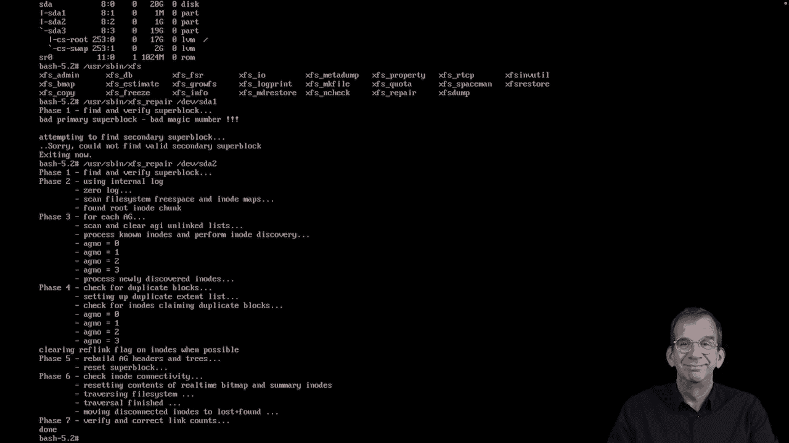

🛠️ CompTIA Linux+ V8：302.66：修复文件系统

在本节课中，我们将一起学习 Linux 系统中文件系统修复的基本知识。你会了解到哪些文件系统问题可以在启动时自动修复，哪些情况下需要管理员手动介入，以及如何进入紧急模式来使用相关工具。我们还会演示实际操作步骤，重点讲解 XFS 和 EXT 文件系统的修复方法，并说明为什么必须选择正确的文件系统工具，避免误操作导致更严重的问题。

---

### 文件系统的自动修复机制

在 Linux 启动过程中，很多文件系统问题其实不需要人工处理，系统会自动修复好。这是因为 XFS 等文件系统使用了日志机制，也称为事务日志。简单来说，日志会记录文件系统即将进行的操作，如果系统意外断电或崩溃，下次启动时系统会根据日志回滚到出错前的状态，从而实现自动修复。

核心概念可以用下面这个公式来理解：

文件系统状态 = 上一次正确状态 + 日志中未完成的操作

当系统启动时，它会检查日志，把未完成的操作回滚或重做，让文件系统恢复到一致的状态。

EXT 文件系统也可以手动检查和修复，最常用的工具是 fsck。fsck 是一个工具集，不仅能检查文件系统错误，还能在某些情况下修复这些错误。对于 XFS 文件系统，手动修复的情况更少见，但系统也提供了专门的 xfs_repair 工具供你使用。

---

### 进入紧急模式

如果你决定使用这些文件系统修复工具，有一个非常重要的前提条件：你必须进入紧急模式。这是因为大多数修复工具要求文件系统完全没有被挂载，也就是不能被任何进程正在使用。

要进入紧急模式，具体的操作步骤如下：


1. 重启计算机。
2. 在引导界面出现时，按下 Esc 键进入 GRUB 引导提示符。
3. 找到默认内核启动项，按下 E 键进入编辑模式。
4. 找到以 linux 开头的那一行，在行尾添加 init=/bin/bash 参数。
5. 按下 Ctrl+X 或 F10 启动系统。

使用 init=/bin/bash 的好处是，这是最小化的故障排除模式。在这种模式下，文件系统尚未以可读写方式挂载，而且你也不需要输入 root 密码，就可以直接获得一个 root shell。

---

### 查看块设备状态

进入 root shell 之后，你需要先确认系统中有哪些块设备，以及它们当前的挂载状态。以下是常用的查看命令：

```bash
lsblk
```

执行 lsblk 后，你会看到系统中所有的块设备列表。在教程演示中，这些块设备目前都没有被挂载，这正是我们进行修复操作所需要的状态。

---

### 选择正确的修复工具

不同的文件系统需要使用不同的修复工具，不能混用。所有的 XFS 工具通常位于 /usr/sbin 目录下，其中包括 xfs_repair 工具。

如果你想修复启动分区，可能会针对 /dev/sda1 这样的设备进行操作。但这里有一个关键点：文件系统修复工具是针对特定文件系统类型的，也就是说，你必须确认目标分区的文件系统类型，然后再选择对应的工具。

---

### 修复操作的常见错误

在实际操作中，如果你用错了工具，就会遇到错误。例如，如果你在一个 FAT 文件系统上运行 xfs_repair，工具会报错，提示找不到主超级块。

出现这个错误的原因很简单：你使用了 XFS 专用的修复工具，但目标分区并不是 XFS 文件系统，而是 FAT 文件系统。XFS 修复工具无法识别 FAT 的结构，因此会认为主超级块损坏。

所以在使用任何修复工具之前，请务必确认你正在处理的文件系统类型，并使用对应的工具。

---



本节课中，我们一起学习了 Linux 文件系统修复的基本原理和实际操作。我们了解到 XFS 和 EXT 文件系统的自动修复机制，掌握了如何通过 GRUB 进入紧急模式，学会了使用 lsblk 查看块设备，并明确了不同文件系统必须使用对应修复工具的重要性。希望这些内容能帮助你在日常系统维护中更好地处理文件系统问题。
