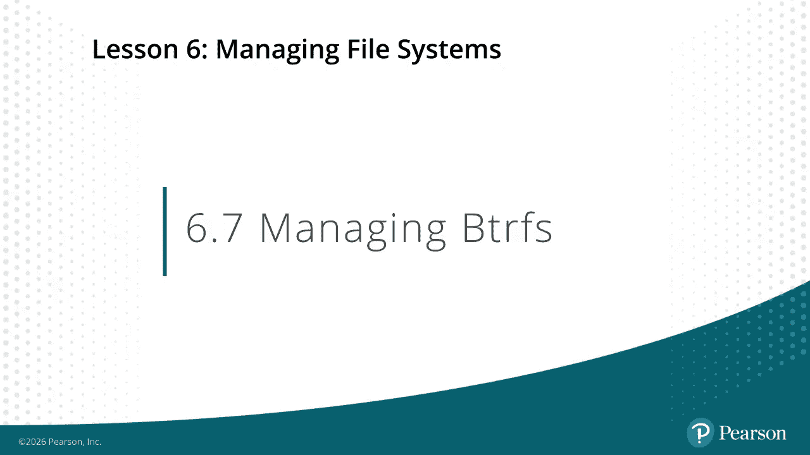
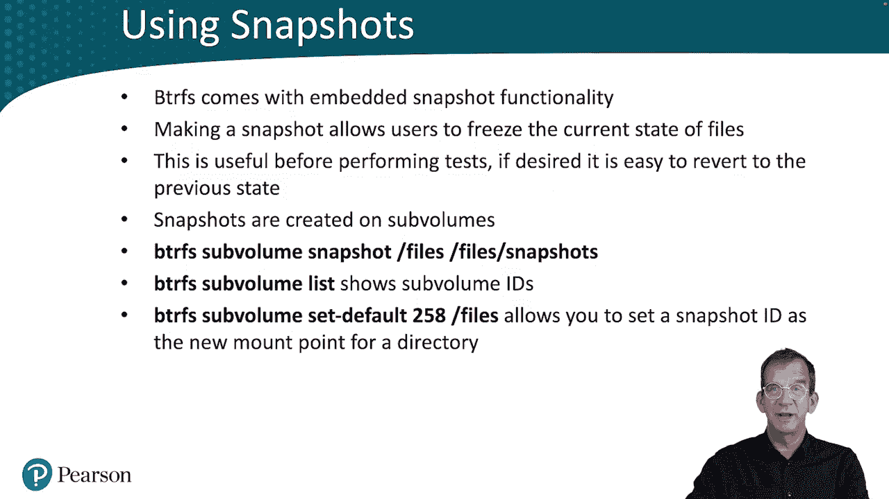

CompTIA Linux+ V8：第 4 章：Btrfs 文件系统管理 🐧

在本节课中，我们将一起学习 Btrfs 文件系统的基础知识，了解它的读音、核心机制、适用场景以及常用命令操作。无论你是初次接触 Btrfs，还是准备参加 Linux+ 考试，这节内容都会用最直白的方式帮你把相关概念讲清楚。

上一节我们介绍了文件系统的基本概念，本节中我们来看看 Btrfs 是什么，以及它为什么会被开发出来。

什么是 Btrfs 📂

在这节视频中，我会跟你聊聊 Btrfs 文件系统。Btrfs 的读音是 “But FS”，这里的 “But” 来自于 “B-cow”，这是主开发者开的一个玩笑，所以不要读成 “beat the RFS” 或者 “better FS”，尽管也有人习惯那样叫。

Btrfs 中的 C 代表 Copy on Write，也就是写时复制。写时复制是 Btrfs 用来保证文件完整性的核心策略。

```
写时复制流程：
原始文件 -> 复制到新位置 -> 在新位置修改 -> 原始文件保持不变
```

Btrfs 同时也是一种 B 树文件系统。B 树是文件系统背后使用的数据库结构，用于以最高效的方式存储你的文件。它提供了卷管理和写时复制等高级功能。

写时复制的意思是，当你要修改一个文件时，系统会先把原始文件复制到另一个位置，然后再在新位置进行修改。如果修改过程中出了问题，你随时可以轻松恢复回原始文件。就像刚才提到的，因为 B 来自于 “B-cow”，所以我们称它为 But FS，而不是 “beat the RFS” 或 “better FS”，尽管也有人喜欢这样称呼。

Btrfs 的应用背景与替代方案 🔄

上一节我们介绍了 Btrfs 是什么，以及它的读音和写时复制机制。本节中我们来看看 Btrfs 在主流 Linux 发行版中的应用现状，以及它为什么会出现。

目前 Btrfs 已经是 Fedora Linux 的默认文件系统，你也能在其他一些 Linux 发行版上找到它。不过在我们本课程主要使用的发行版中，也就是 SUSE 和 Ubuntu 上，它并不是默认选择。因此我不会在这里做演示，但在 Linux+ 考试中，你需要对它有一定了解。

那么我们开始了解它。Btrfs 被开发出来的原因之一，是因为存在 ZFS 文件系统。ZFS 来自 BSD UNIX，提供了灵活的功能，但它的许可证与 Linux 内核的许可证不兼容。正因为如此，你绝对不会在主流 Linux 发行版中看到 ZFS 的官方支持，而这也是 Btrfs 被开发作为替代方案的原因。

提供类似功能的另一种选择是 Stratis。Stratis 用于 Red Hat 环境，它是一个可以运行在 XFS 文件系统之下的卷管理器。所以 Stratis 不是文件系统，它是位于 XFS 文件系统之下的卷管理器。

子卷（Subvolume）与目录属性 📁

上一节我们了解了 Btrfs 的默认发行版情况，以及它与 ZFS 和 Stratis 的关系。本节中我们进入具体功能，先来看看子卷的概念。

Btrfs 的一个重要功能是子卷。子卷允许你给目录添加一些属性，而这些属性通常只能在存储设备上设置。

以 noexec 属性为例，这个属性会阻止从某个目录运行任何可执行文件。如果你想在 XFS 上使用 noexec，就需要创建一个 XFS 文件系统；但在 Btrfs 上，你可以直接在某个目录上实现，方法就是把这个目录变成子卷。

Btrfs 提供了多种实用工具，比如 `btrfs filesystem show`、`btrfs filesystem label`，以及 `btrfs subvolume list` 或 `btrfs subvolume create`。在支持 Btrfs 的发行版上，你还可以在 `useradd` 命令中使用 Btrfs 子卷 home 选项，这样用户就能获得基于 Btrfs 的家目录。

以下是 Btrfs 中常用的子卷相关命令。

- `btrfs filesystem show`：显示 Btrfs 文件系统信息
- `btrfs filesystem label`：设置或查看文件系统标签
- `btrfs subvolume list`：列出子卷
- `btrfs subvolume create`：创建子卷

快照（Snapshot）功能 📸

上一节我们学习了子卷的概念和常用命令。本节中我们继续了解 Btrfs 中另一个非常实用的功能，也就是快照。

Btrfs 一个有趣的功能是快照。它自带快照功能。创建快照可以让用户冻结文件当前的状态，这在执行测试之前非常有用，如果需要，可以轻松恢复到之前的状态。

快照是在子卷层面创建的。使用的命令是 `btrfs subvolume snapshot`，后面跟上你的子卷名称，然后是你想要给快照起的名字。

```
btrfs subvolume snapshot <子卷名称> <快照名称>
```

要查看是否有任何快照，可以使用 `btrfs subvolume list`。当你想要恢复到某个快照时，可以使用 `btrfs subvolume set default` 命令，后面跟上快照 ID 和挂载点路径，这样就把快照 ID 设置为目录的新挂载点，立即就能回到原来的状态。

```
btrfs subvolume set default <快照 ID> <挂载点路径>
```

以下是快照相关的常用操作命令。

- `btrfs subvolume snapshot <源子卷> <快照名>`：创建快照
- `btrfs subvolume list <路径>`：列出子卷和快照
- `btrfs subvolume set default <ID> <路径>`：将指定快照设为默认子卷，实现回滚



本节课中，我们一起学习了 Btrfs 文件系统的基础概念，包括它的读音、写时复制机制、B 树存储结构，以及它在不同 Linux 发行版中的应用现状。我们还了解了 Btrfs 作为 ZFS 替代方案的背景，学习了子卷的概念与常用命令，并掌握了如何创建、列出和恢复快照。希望这些内容能帮助你在 Linux+ 考试中顺利掌握 Btrfs 的相关知识点。

