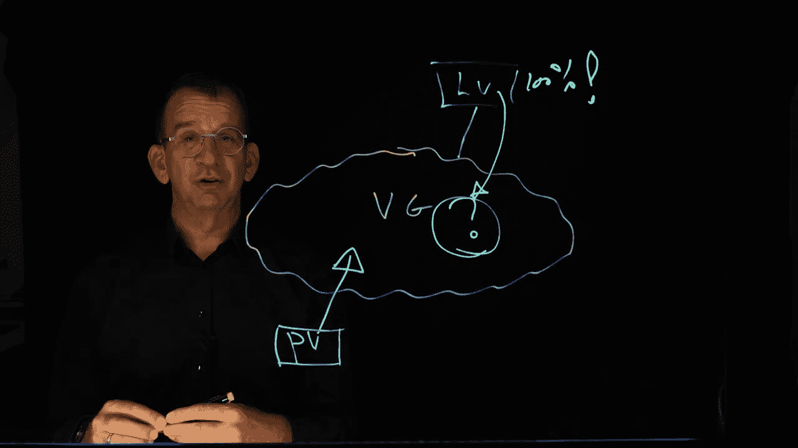
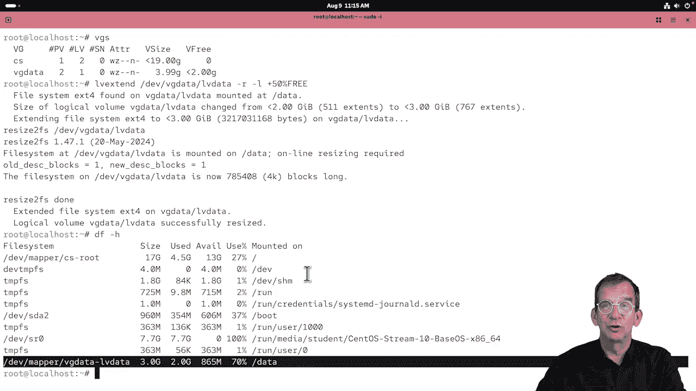

# 💾 CompTIA Linux+ V8：304.68：扩容 LVM 逻辑卷


## 课程概述

在本节课中，我们将学习如何扩容 LVM 逻辑卷。很多学习者在学习完 LVM 基础之后，往往会遇到一个实际问题：当文件系统空间不足时，该如何安全地增加磁盘空间。本节课将从 LVM 的整体结构说起，演示如何检查卷组剩余空间、如何添加新存储设备，以及如何扩展逻辑卷和文件系统。你将了解到，扩容不仅仅是调大逻辑卷，还需要同步调整文件系统，否则新增的空间无法被系统使用。

## LVM 的基本结构

接下来，我们先来看看 LVM 的工作原理，这样你就能明白扩容操作的底层逻辑。

LVM 的结构可以简单理解为三层嵌套关系。最底层是物理卷，中间是卷组，最上面是逻辑卷和文件系统。



```text
物理卷 → 卷组 → 逻辑卷 → 文件系统
```

以下是各层的作用说明：
- 物理卷：实际的硬盘或分区，提供底层存储空间
- 卷组：多个物理卷组成的存储池，管理可用空间
- 逻辑卷：从卷组中划分出来的虚拟磁盘，格式化后挂载使用
- 文件系统：安装在逻辑卷之上的数据组织方式，用于存储文件

## 检查文件系统状态

理解了 LVM 结构之后，我们进入实际操作演示。下面我将展示如何检查当前文件系统的使用状况。

以下是检查步骤：
首先使用 df -h 查看文件系统挂载情况。如果发现逻辑卷尚未挂载，需要先执行 mount -a 进行挂载。接着可以看到挂载点为 /data 的文件系统，它位于名为 devmapper VG data 的逻辑卷上，设备名通常显示为 /dev/VG_data/Lv_data。

## 模拟磁盘空间耗尽

为了了解扩容的必要性，我们需要模拟磁盘空间耗尽的场景。

以下命令会快速填满文件系统：
```bash
dd if=/dev/zero of=/data/big_file bs=1M count=2048
```
这条命令的意思是从 /dev/zero 读取数据，写入到 /data 目录下的 big_file 文件中。执行一段时间后，系统会提示没有空间剩余，文件系统被占满。

## 分析扩容需求

当文件系统满了之后，我们需要分析问题出在哪里。以下是问题分析的逻辑链条：
想要更多文件系统空间 → 需要更多逻辑卷空间 → 需要卷组有可用空间 → 如果卷组没空间，需要添加新物理卷。

## 检查卷组可用空间

接下来检查卷组是否还有可用空间。以下是操作命令：
```bash
vgs
```
输出中你会看到 VG data 相关信息，如果 VFree 显示为 0，说明卷组已经没有可用空间，无法直接扩展逻辑卷。

## 扩展卷组容量

既然卷组没有空间，我们需要从底层开始添加新存储设备。以下是具体步骤：
使用 lsblk 查看块设备，找到新硬盘，例如 /dev/sdb。
使用 fdisk 分区：
```bash
fdisk /dev/sdb
```
在交互界面中，依次输入 n 新建分区，选择分区号 2，起始扇区直接回车，结束扇区输入 +2G，分配 2GB 空间。
分区完成后，不要忘记设置分区类型。输入 t，选择分区号 2，将类型设置为 LVM。最后输入 w 保存并退出。

现在可以扩展卷组了。以下是命令：
```bash
vgextend VG_data /dev/sdb2
```
这条命令的作用是把 /dev/sdb2 加入到名为 VG_data 的卷组中。执行完成后，再次运行 vgs，你应该能看到大约 2GB 的可用空间。

## 扩展逻辑卷和文件系统

卷组有了空闲空间，接下来就可以扩展逻辑卷和文件系统了。以下是核心命令：
```bash
lvextend -r -l +50%FREE /dev/VG_data/Lv_data
```
命令解析如下：
- lvextend：扩展逻辑卷的工具
- -r：同时调整文件系统大小，这是非常重要的选项
- -l +50%FREE：使用卷组中 50% 的剩余空间，不需要精确计算字节数
- /dev/VG_data/Lv_data：目标逻辑卷路径

这里还要提一下文件系统调整工具。如果文件系统是 ext4，系统会自动调用 resize2fs；如果是 XFS，会调用 xfs_growfs。需要注意，XFS 文件系统只能扩大不能缩小，而 ext4 既可以扩大也可以缩小。在绝大多数情况下，我们只需要扩容，所以 -r 选项非常实用。

## 验证扩容结果

扩容操作完成后，需要验证空间是否真的增加了。以下是验证命令：
```bash
df -h
```
输出中你会看到 /data 文件系统现在有大约 865MB 的可用空间，说明扩容成功，系统可以正常使用新增空间。

## 本节总结



本节课中，我们一起学习了 LVM 逻辑卷的扩容方法。我们先了解了 LVM 的三层结构，再演示了如何检查磁盘使用状况，接着讲解了当卷组空间不足时如何添加新物理卷，最后使用 lvextend -r 命令同时扩展逻辑卷和文件系统，并通过 df -h 验证了结果。希望这节课能帮助你掌握 LVM 扩容的实操技巧。

