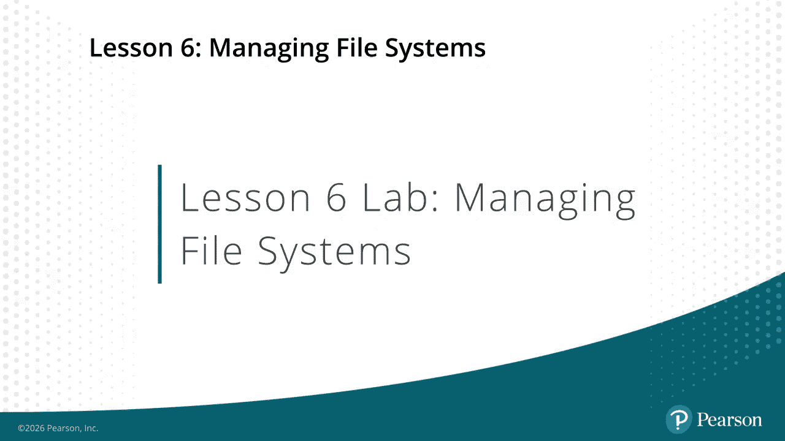
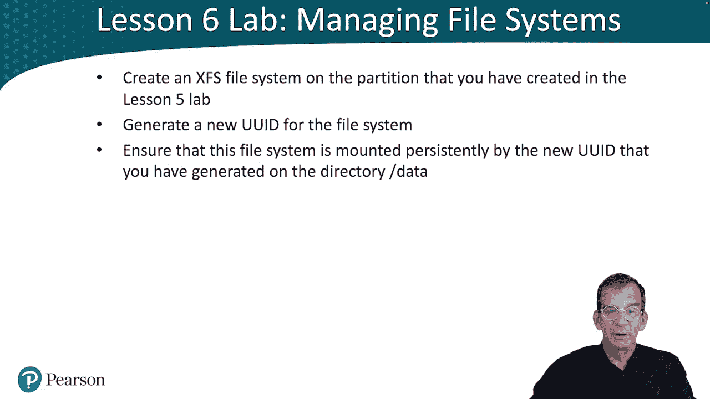

CompTIA Linux+ V8：第6课：实验 - 管理文件系统 📁

在本节课中，我们将学习如何管理 Linux 系统中的文件系统。本节属于第6课的实验环节，重点围绕三个操作展开，分别是创建文件系统、生成唯一标识符以及配置持久化挂载。无论你是刚开始接触 Linux 的新手，还是希望复习基础知识的学习者，本节内容都会用大白话把每个步骤讲清楚，让你能够独立动手完成实验，掌握文件系统管理的基本流程。


上一节课我们介绍了如何在磁盘上创建分区，本节中我们来看看如何在这些分区上创建和管理文件系统。

实验任务详情



以下是本节实验需要完成的具体任务：

- 在你在第5课实验中创建的分区上，创建一个 XFF 文件系统。
- 为这个新建的文件系统生成一个全新的 UUID。
- 确保该文件系统能够通过新生成的 UUID 在 /data 目录下持久化挂载。

核心概念与命令

文件系统可以理解为操作系统用来组织和存储数据的方式，你可以把它想象成硬盘上的储物柜，每个柜子有编号，方便系统快速找到想要的文件。在 Linux 中，创建文件系统通常使用 mkfs 系列命令，而 UUID 则是文件系统的唯一身份证，挂载时系统会依靠它来精确识别设备，而不是依赖可能会变化的设备名称。

以下是实验中会用到的核心命令：

```bash
# 创建文件系统，设备名请替换为你实际的分区
sudo mkfs.xfs /dev/sdX1

# 查看分区的 UUID
sudo blkid /dev/sdX1

# 编辑挂载配置文件，实现持久化挂载
sudo nano /etc/fstab
```

在 /etc/fstab 文件中，你需要添加类似下面的一行记录：

```text
UUID=你的实际UUID /data xfs defaults 0 0
```

持久化挂载的意思是，即使系统重新启动，这个文件系统也会自动挂载到指定目录，而不会因为重启而丢失配置。这里的 /data 就是挂载的目标目录，相当于给文件系统分配一个固定的家。

操作步骤说明

接下来我们把这些任务拆解成具体的操作步骤，帮助你逐一完成：

首先，确认第5课实验中创建的分区设备名称，比如 /dev/sdb1 或 /dev/sdc1，具体名称取决于你的实际环境，请根据情况替换命令中的设备路径。

然后，在该分区上执行格式化操作，创建 XFF 文件系统。格式化会清除分区上的旧数据，所以在执行之前请务必确认该分区中没有重要文件，以免造成数据丢失。

接着，使用 blkid 命令获取新创建文件系统的 UUID。这串字符是文件系统的唯一标识，后续挂载将依赖它，因为设备名称在重启后可能会发生变化，而 UUID 不会。



最后，修改 /etc/fstab 配置文件，添加一行记录，指定使用该 UUID 在 /data 目录下挂载文件系统。保存文件后，系统在每次启动时都会自动完成挂载操作，无需手动干预。

本节课中我们一起学习了如何在指定分区上创建 XFF 文件系统、为其生成 UUID，并通过配置实现基于 UUID 的持久化挂载。希望这些内容能帮助你掌握 Linux 文件系统管理的基础技能，为后续学习打下坚实基础。

