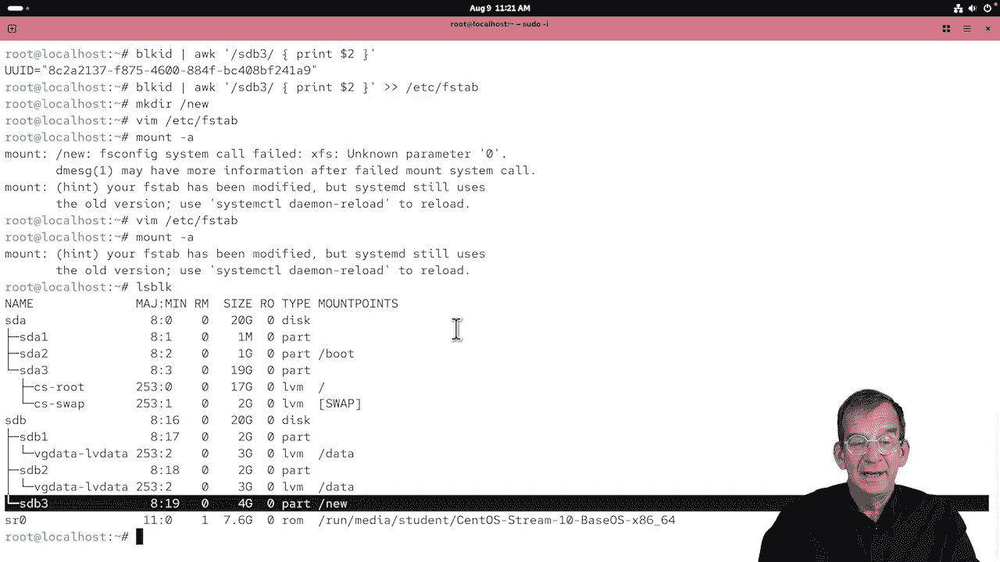

# 文件系统管理：第6课：实验解决方案 - 管理文件系统 📁

在本节课中，我们将学习如何在 Linux 系统中从零开始创建分区、制作 XFS 文件系统、生成 UUID，并把文件系统挂载到指定目录。我们会以 SDB 设备为例，演示完整的分区和挂载流程，同时解释如何修改 `/etc/fstab` 文件，使系统在启动时自动挂载。内容适合初学者，所有命令都会用大白话说明。

## 一、创建新分区

上一节我们介绍了文件系统的基本概念，本节中我们先来看看如何创建新分区。如果系统中没有可用的分区，就必须手动创建一个，否则无法继续后续的文件系统操作。在本实验中，我们需要在 SDB 设备上创建第三个分区，大小设定为 4 GiB。

以下是分区创建的具体步骤：

- 使用分区工具打开 SDB 设备，执行 `fdisk /dev/sdb`。
- 新建一个主分区，并将分区编号设置为 3。
- 指定分区大小为 4 GiB。
- 输入 `W` 将分区表写入磁盘，保存所做更改。

完成这些步骤后，系统会在 `/dev/sdb3` 下生成一个新的分区设备文件，为接下来创建文件系统打下基础。

## 二、创建 XFS 文件系统

分区准备好之后，下一步就是在该分区上建立文件系统。本实验中我们选择 XFS 文件系统，因为它支持大容量存储，在实际生产环境中应用广泛。

以下是格式化命令的说明：

- 执行 `mkfs.xfs /dev/sdb3`。
- 系统会在 `/dev/sdb3` 上初始化 XFS 文件系统。
- 格式化完成后，该分区即可用于存储文件。

此时我们已经拥有一个可用的 XFS 文件系统，但实验还要求我们为其生成一个全新的 UUID。

## 三、生成新的 UUID

UUID 是文件系统的唯一标识符，使用 UUID 进行挂载可以避免设备名称变化带来的问题。本实验明确要求我们为当前文件系统生成一个新的 UUID。

以下是生成和查看 UUID 的方法：

- 使用 `xfs_admin -U generate /dev/sdb3` 命令生成新 UUID。
- 执行 `blkid /dev/sdb3` 查看当前 UUID 值。
- 观察输出末尾的字符，确认 UUID 已经发生变化。

通过 `blkid` 命令，我们可以清楚地看到分区当前对应的 UUID，这为后续通过命令行提取 UUID 做好准备。

## 四、从命令行提取 UUID

除了直接查看，我们还可以通过命令行组合工具，从 `blkid` 的输出中提取出 UUID 字符串，方便写入配置文件而无需手动复制。

以下是提取过程的拆解：

- 执行 `blkid` 查看所有块设备的 UUID 信息。
- 使用管道符 `|` 将输出传递给 `grep`，过滤出包含 `/dev/sdb3` 的行。
- 再用 `awk '{print $2}'` 打印第二个字段，即提取出的 UUID 值。
- 得到类似 `UUID="xxxx-xxxx-xxxx"` 的字符串。

这样一来，我们就从命令行输出中精确地分离出了需要的 UUID，操作更加自动化。

## 五、将 UUID 写入 /etc/fstab

有了 UUID 之后，我们需要把挂载信息写入 `/etc/fstab` 文件，这样系统才能在开机时自动挂载。这里要特别注意使用双重定向符号，避免意外覆盖原有内容。

以下是写入 `/etc/fstab` 的关键点：

- 使用命令行重定向，将提取出的 UUID 写入 `/etc/fstab`。
- 必须使用双重定向符 `>>`，而不是单重定向符 `>`，以免清空原有文件内容。
- 挂载点目录命名为 `/new`。
- 文件系统类型指定为 `xfs`。
- 挂载选项写入 `0 0`，这两个字段分别对应 dump 和 fsck 的设置。

写入完成后，`/etc/fstab` 中就会有一行包含 UUID 信息的条目，等待系统读取并执行挂载。

## 六、挂载文件系统并进行测试

配置文件写好之后，我们需要手动挂载一次，验证配置是否正确。在图形界面中可以用鼠标点击挂载，但在命令行环境下，我们需要用相应的命令来完成。

以下是挂载和测试的操作步骤：

- 创建挂载点目录，执行 `mkdir /new`。
- 执行 `mount -a` 命令，根据 `/etc/fstab` 中的配置挂载所有文件系统。
- 观察命令输出，检查是否有错误提示。
- 如果出现“未知参数”错误，通常是因为缺少 `defaults` 挂载选项。

经过排查，我们发现 `/etc/fstab` 中缺少 `defaults` 选项，导致挂载时出现未知参数错误。这是一个常见问题，使用 `mount -a` 进行测试正好可以在重启前发现它，避免系统重启后进入故障排除模式。

## 七、验证挂载结果

修正 `/etc/fstab` 中的错误后，我们再次执行挂载测试，并确认文件系统是否已经成功挂载到指定目录。

以下是验证挂载状态的方法：

- 再次执行 `mount -a`，此时应该不再报错。
- 系统可能会提示执行 `systemctl daemon-reload`，本实验中我们可以暂时忽略该提示。
- 使用 `lsblk` 命令查看块设备和挂载点情况。
- 确认 `/dev/sdb3` 已经挂载到 `/new` 目录。

至此，我们可以清楚地看到 `/dev/sdb3` 正常挂载在 `/new` 目录下，说明整个文件系统管理流程已经完成。

## 八、总结

本节课中，我们一起学习了如何在 Linux 系统中创建新分区、在分区上格式化 XFS 文件系统、生成新的 UUID、从命令行提取 UUID、将挂载信息写入 `/etc/fstab`，以及通过 `mount -a` 和 `lsblk` 验证挂载结果。我们也了解到，编辑 `/etc/fstab` 时必须使用双重定向符，并且挂载选项中不能缺少 `defaults`，否则可能导致挂载失败或系统启动问题。希望这些内容能帮助你掌握文件系统管理的基本操作。
