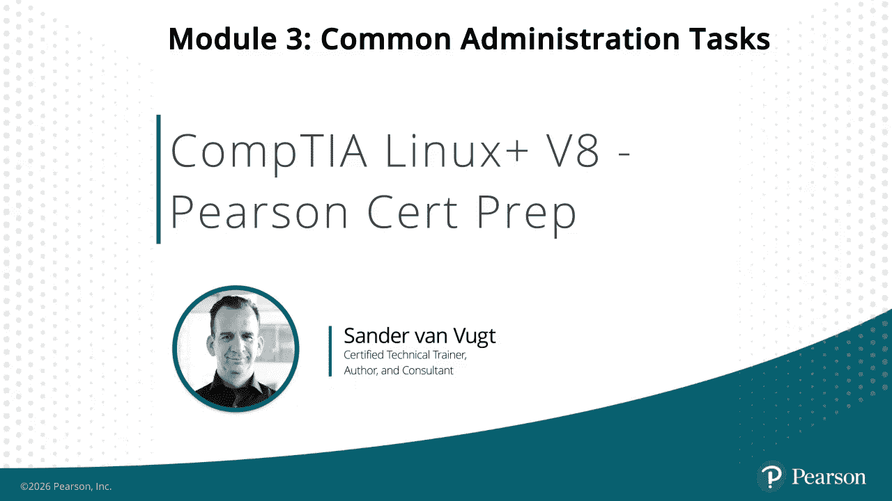
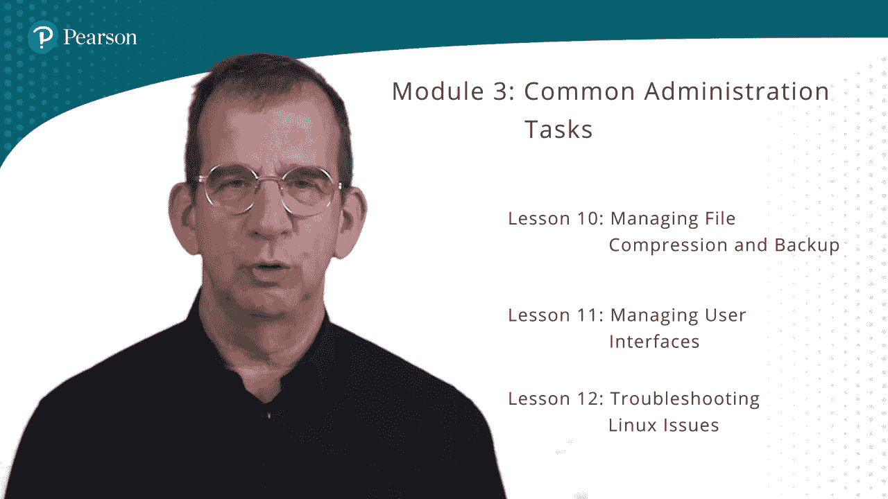

# 🖧 CompTIA Linux+ V8：第3模块：常见Linux管理任务模块介绍

在本节课中，我们将要学习CompTIA Linux+ V8课程第3模块的内容。这个模块的主要目的是讲解一些Linux系统管理中比较常见的日常工作任务。无论你是刚开始接触Linux的新手，还是希望系统性复习相关知识点的学习者，这里都会把每一节课的重点用大白话讲清楚，帮助你快速理解并掌握这些基础技能。

接下来，我们先来看看这个模块总共有多少节课，以及每一节课具体会讲些什么内容。

以下是本模块包含的课程列表：

- 第一课：学习如何配置日志记录
- 第二课：学习系统性能监控的基础知识
- 第三课：学习Linux系统启动流程
- 第四课：学习文件压缩与备份的管理方法
- 第五课：学习如何管理用户界面
- 第六课：学习如何排查通用的Linux系统问题

现在我们逐一来看每一课的具体内容。在第一节课中，我们会重点讲解日志配置。

**日志配置** = 记录系统运行过程中产生的各种事件信息

日志配置的作用，简单来说就是让系统把运行时发生的事情写下来，方便出问题时查找原因。你可以把它理解为系统的日记本，里面记录了用户登录、服务启动、错误报警等关键信息。配置好日志后，管理员就能更容易地知道服务器在某个时间点发生了什么，从而更快地定位故障。

完成日志配置的学习之后，我们进入下一课，来看看系统性能监控的内容。

在第二节课中，你将了解系统性能监控的相关介绍。

**系统性能监控** = 观察CPU、内存、磁盘和网络等资源的使用情况

系统性能监控指的是实时查看服务器各项硬件资源的使用状态，比如CPU是不是太忙、内存是不是不够、磁盘读写是否缓慢，以及网络流量大小等。通过监控这些指标，管理员可以提前发现性能瓶颈，避免系统变得卡顿甚至崩溃。这对于保持服务器稳定运行非常重要。

了解完性能监控之后，接下来我们继续学习Linux启动流程。

第三节课将会讲解Linux启动流程。

**Linux启动流程** = 电源开机 → 加载内核 → 初始化系统 → 启动服务 → 系统准备就绪

Linux启动流程就是计算机从按下电源按钮，到最终可以正常使用桌面或命令行的完整过程。这其中包括硬件自检、引导加载程序运行、内核加载、系统服务启动等步骤。了解启动流程有助于你在系统无法正常开机时，快速定位到底是哪个环节出了问题。

搞清楚启动流程后，我们进入第四课，学习文件压缩和备份管理。

第四节课的内容是管理文件压缩与备份。

**文件压缩与备份** = 把文件体积变小 + 把重要数据复制到安全位置

文件压缩是指把一个或多个文件打包成更小的体积，节省存储空间并方便传输；备份则是把重要数据复制到其他地方，防止数据丢失。这两项技能是Linux管理员日常维护工作中非常基本也非常重要的部分，建议多加练习。

掌握压缩和备份之后，第五课会教你如何管理用户界面。

第五节课讲解如何管理用户界面。

**用户界面管理** = 配置图形界面或命令行界面的显示与行为

用户界面管理指的是设置用户与系统交互的方式，包括图形桌面环境、终端显示、语言设置等。合理配置用户界面，可以让不同的使用者根据自己的习惯更舒适地操作Linux系统，提高工作效率。

学完用户界面管理之后，最后一课将介绍如何排查通用的Linux问题。

第六节课将会教你如何排查通用的Linux系统问题。

**通用Linux故障排查** = 发现系统异常 → 查看日志 → 检查服务 → 修复配置

通用故障排查是指当Linux系统出现运行不正常的情况时，采用一套标准步骤来找出问题根源并解决它。通常的思路是先查看系统日志，再检查相关服务是否运行，最后修正错误的配置项，使系统恢复正常。这是一项需要长期积累经验的实践技能。

以上就是本模块中六节课的全部内容介绍。

本节课中，我们一起学习了CompTIA Linux+ V8第3模块的课程概览，包括日志配置、系统性能监控、Linux启动流程、文件压缩与备份、用户界面管理以及通用Linux故障排查这六个主题。希望这些内容能帮助你对Linux系统管理有初步的整体认识。

