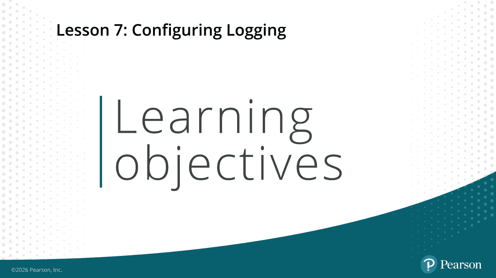

# CompTIA Linux+ V8：第08节：配置 Linux 日志 🪵

在本节课中，我们将一起学习如何在 Linux 系统中配置日志。课程会先带你查看日志配置文件，接着讲解日志滚动功能，然后介绍 systemd-journald 以及 logger 命令的使用方式。课程末尾还会安排一个关于日志配置的实验环节，帮助你把所学知识付诸实践。


## 第一部分：探索日志配置



上一节我们介绍了系统基础设置，本节我们先来看看日志的配置文件。以下是本部分的主要内容：

- 查看系统日志配置文件的位置与格式
- 理解日志服务如何记录系统事件
- 确认日志配置是否生效

日志配置决定了系统哪些信息会被记录下来，记录到哪个文件中，以及记录的详细程度。你可以把它想象成系统的日记本，管理员可以决定日记本里写什么，写多少，以及保留多久。


## 第二部分：管理日志滚动

在了解完日志配置之后，我们继续来看日志滚动。以下是日志滚动的核心知识点：

- 日志滚动会定期压缩或归档旧日志
- 系统会自动创建新的日志文件接替旧文件
- 删除或归档超期的日志，防止磁盘空间被占满

日志滚动是一个非常有用的功能，它可以确保系统存储空间不会被海量的日志消息完全填满。如果不进行滚动，日志文件会越来越大，最终可能占满整个硬盘，导致系统无法正常运行。可用磁盘空间的计算方式如下：

```
可用磁盘空间 = 总磁盘空间 - 已用空间 - 日志占用空间
```

当日志占用空间过大时，可用磁盘空间就会不足，这就是日志滚动需要解决的问题。


## 第三部分：使用 systemd-journald 与 logger 命令

在最后一部分，我们将学习如何使用 systemd-journald 以及 logger 命令。以下是你需要掌握的操作：

- 使用 systemd-journald 查看和管理系统日志
- 使用 logger 命令手动向日志中写入信息
- 理解 journald 与传统日志文件的区别

systemd-journald 是 Linux 系统中较新的日志管理组件，它会将日志以二进制格式保存，方便查询和过滤。logger 命令则允许你从终端直接向系统日志发送自定义消息，常用于脚本调试或测试日志功能。你可以通过下面的命令体验一下：

```
logger "这是一条测试日志消息"
```

执行这条命令后，系统会把这条消息记录到日志中，你可以配合 journald 查看刚刚写入的内容。


## 实验环节：日志配置实践

在本节课结束时，你会遇到一个关于日志配置的实验环节。这个实验会引导你动手配置日志系统，巩固本节课所学的所有知识点。


## 总结

本节课中我们一起学习了如何在 Linux 上配置日志，包括探索日志配置文件、管理日志滚动、使用 systemd-journald 和 logger 命令，最后还预览了课程末尾的实验内容。希望这些知识能帮助你更好地掌握 Linux 日志管理。

