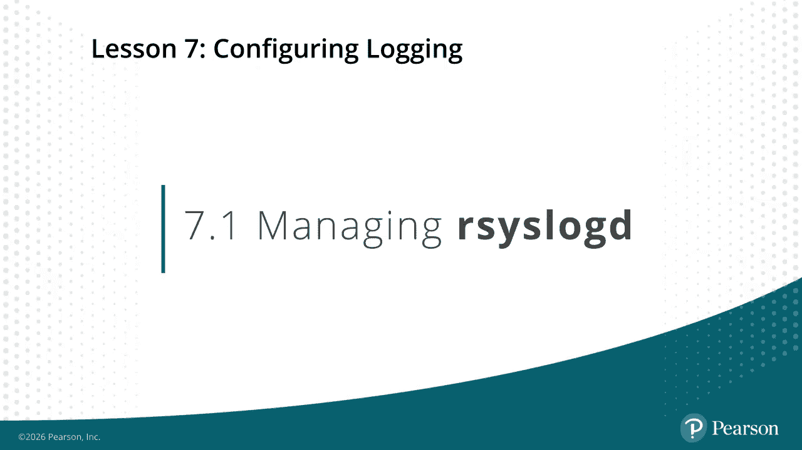
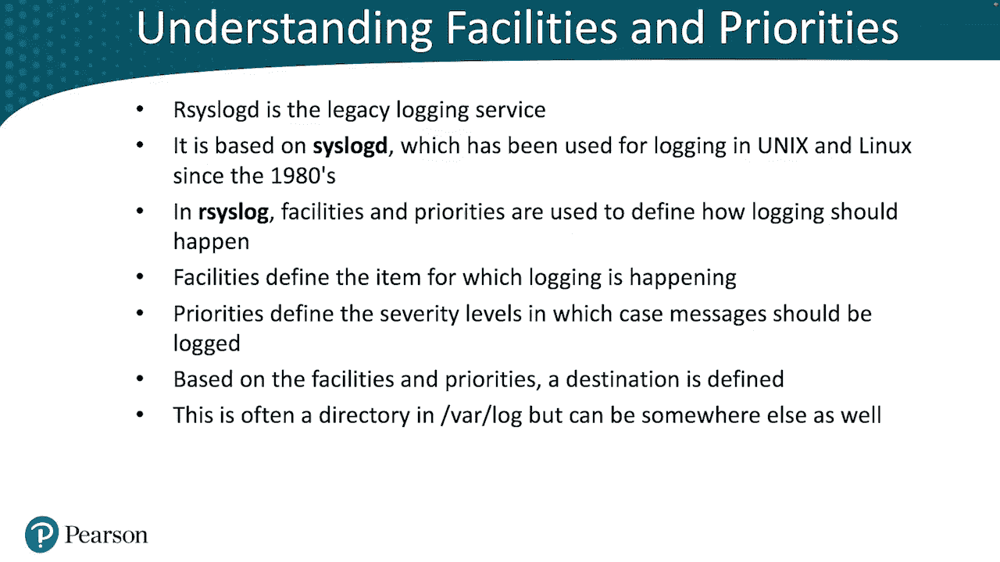
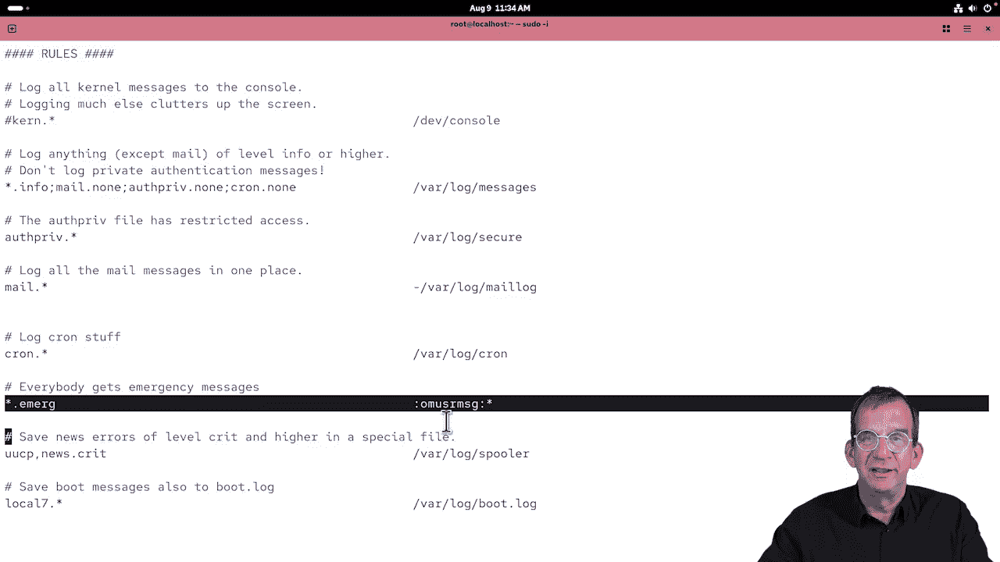

# CompTIA Linux+ V8：09：管理 rsyslogd 日志服务 📋




在本节课中，我们将学习 Linux 系统中传统的日志服务 rsyslogd 的基本原理和配置方法。虽然现在很多发行版已经开始使用 systemd-journald，但 rsyslogd 依然广泛存在于大多数 Linux 系统中，理解它的工作方式对系统管理员来说非常重要。我们会先介绍 rsyslogd 的背景，然后讲解它的核心概念，接着看看实际的配置文件和日志规则，最后总结如何处理紧急日志通知。

---

## 09.1 rsyslogd 是什么 📜

上一节我们简单了解了 Linux 日志的大致分类，本节中我们来看看 rsyslogd 这个传统日志服务到底是做什么的。

rsyslogd 是一种在 Linux 系统里使用了很长时间的旧式日志服务，它的前身 syslog 从 1980 年代就开始用于 Unix 和 Linux 系统的日志记录，历史非常悠久。虽然现在 systemd-journald 已经出现，但大多数发行版并没有完全放弃旧的日志系统，所以你在大多数 Linux 发行版上依然能找到 rsyslogd，并且它通常还在正常运行。

rsyslogd 处理日志的核心逻辑，可以用下面这个简单的公式来表示：

```text
facility + priority → destination
```

这句话的意思是，日志系统先根据产生日志的来源（facility）和日志的严重程度（priority），来决定把日志信息发送到哪里（destination）。

在早期的 syslog 设计中，facilities 的数量是有限的。这会带来一个实际问题：当系统中引入新的服务时，很难为它们添加新的日志分类。priorities 则用来定义消息的严重等级，决定在什么情况下应该把日志记录下来。

以下是 rsyslogd 处理日志的几个关键要点：

- facilities：定义哪个程序或内核模块在产生日志，比如内核、邮件系统、认证服务等。
- priorities：定义日志的严重等级，例如 debug、info、warning、emergency 等。
- destination：日志最终被写入的位置，通常是 `/var/log` 目录下的某个文件，也可以是远程服务器或数据库。

rsyslogd 采用模块化设计，这意味着你可以加载不同的模块来扩展功能。比如，通过模块可以把日志发送到远程服务器，或者存入数据库，而不仅仅是本地文件。

---

## 09.2 为什么系统里还在运行 rsyslogd 🔍



刚才我们介绍了 rsyslogd 的基本概念，本节中我们来看看为什么很多系统里它依然在运行。

你可以根据自己的发行版，检查 `rsyslog` 服务或者 `rsyslogd` 服务是否正在运行。之所以还能看到它，是因为有些管理员依赖 rsyslogd 的模块功能，把日志发送到数据库或者集中式日志服务器。systemd-journald 在设计之初并没有把集中化日志作为主要考虑点，所以在这些场景下，rsyslogd 仍然有用。

以下是 rsyslogd 继续保留的主要原因：

- 很多老旧的应用程序和脚本仍然依赖传统的 syslog 接口。
- 部分企业需要把日志集中发送到远程日志服务器，rsyslogd 的模块支持这一点。
- 某些发行版的升级路径比较保守，没有完全切换到 systemd-journald。

---

## 09.3 rsyslogd 的配置文件位置 📁

在了解了 rsyslogd 的作用之后，本节我们来看看它的配置文件在哪里，长什么样。

所有的配置都集中在 `/etc/rsyslog` 目录下，最主要的文件是 `rsyslog.conf`。这里采用了一种常见的配置策略：有一个通用的主配置文件，旁边还有一个 drop-in 目录，你可以把自己的自定义配置放进去，不需要直接修改主文件。

在主配置文件中，你会看到 global directives（全局指令），用来定义加载哪些模块。例如，`imjournal` 模块会被加载，`im` 代表 input（输入），这个输入模块让 rsyslogd 能够从 systemd journal 接收消息。

下面是配置文件中常见的几个部分：

- 全局指令：指定加载的输入模块和输出模块。
- 模块参数：有些选项被注释掉了，如果你想把 rsyslogd 配置成集中式日志服务器，就需要启用这些选项。
- 监听协议和端口：支持 TCP 和 UDP，默认端口是 `514`，去掉注释符号 `#` 就可以开启。

---

## 09.4 日志规则的核心语法 ✍️

上一节我们介绍了配置文件的位置，本节中我们来看看最重要的日志规则是怎么写的。

规则（rules）定义了 facility、priority 和 destination 三者的对应关系。这是 rsyslogd 配置的灵魂部分，决定了每条日志最终会被送到哪里。

日志规则的基本格式如下：

```text
facility.priority   /path/to/log/file
```

或者更直白地理解为：

```text
来源.级别   目的地
```

以下是几个典型的规则示例：

- `cron.* /dev/console`：表示 cron 服务产生的所有优先级日志，都显示在当前操作的控制台上。
- `*.info /var/log/messages`：星号代表所有 facilities，如果任何来源记录了 info 及以上级别的日志，就会写入 `/var/log/messages`，这是很多系统的默认日志文件。
- 分号 `;` 允许在同一行里指定多个 facility-priority 对，这样可以把不同来源的日志合并处理，避免写太多重复的规则。

还有些特殊的处理方式，比如认证相关的日志会被写入 `/var/log/secure`，所以在主规则里通常会把它们排除，避免在普通日志文件中重复记录敏感信息。

---

## 09.5 紧急日志与用户通知 🚨

刚才我们学习了普通的日志规则，本节中我们来看看 rsyslogd 如何处理最高级别的紧急情况。

当日志达到最高优先级 `emergency` 时，通常意味着系统出了严重问题，所有用户肯定会注意到。这时管理员希望通知当前登录的每一个人。rsyslogd 可以调用 `omusrmsg` 输出模块，把消息广播给所有正在登录的用户。

这个规则的写法大致如下：

```text
*.emerg   :omusrmsg:*
```

这意味着：所有来源的 emergency 级别日志，都通过用户消息模块发出广播，让在线用户知道系统出了大问题。

---

## 09.6 本节小结 📚

在本节课中，我们一起学习了 rsyslogd 这个传统 Linux 日志服务的基本原理。我们了解了它的历史背景，掌握了 facilities 和 priorities 如何共同决定日志去向，看到了配置文件 `/etc/rsyslog/rsyslog.conf` 的结构，还学习了如何编写日志规则以及如何处理紧急日志通知。



尽管 systemd-journald 现在是许多发行版的默认选择，但 rsyslogd 依然在大量系统中运行，掌握它的配置方法对 Linux 管理员来说仍然很有价值。
