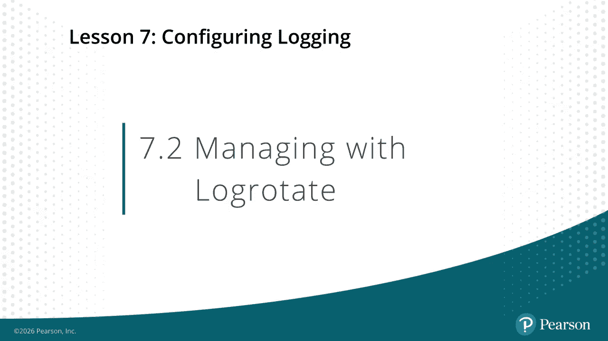
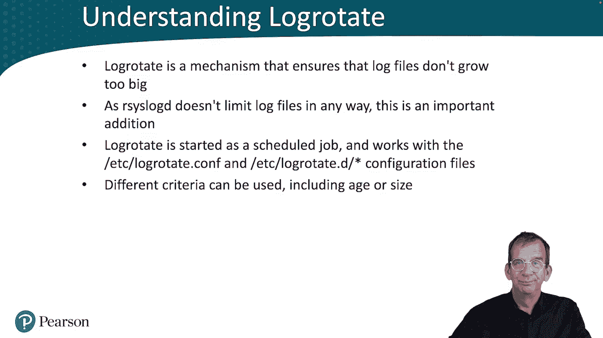
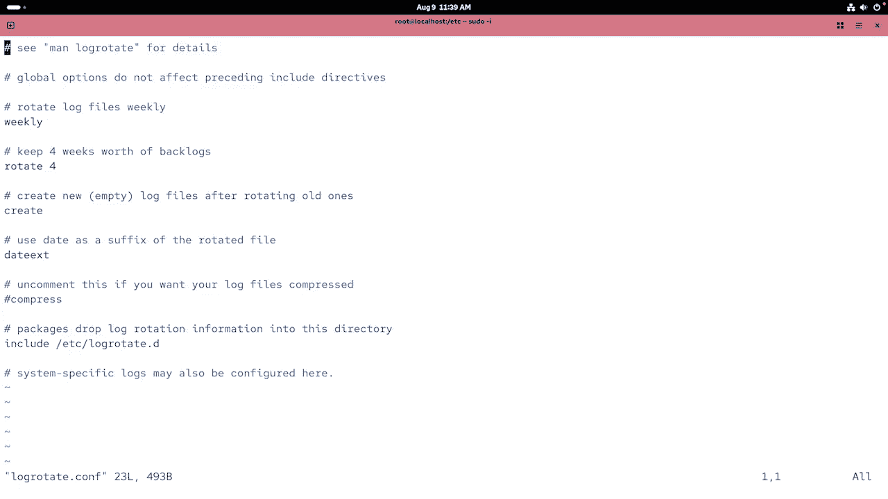

CompTIA Linux+ V8：10：🪵 日志轮转管理（Logrotate）

在本节课中，我们将一起学习 Linux 系统中非常实用的日志轮转机制，也就是 logrotate。我们会聊聊为什么系统需要日志轮转，如果不处理日志文件会发生什么，logrotate 是怎么通过计划任务自动运行的，以及它的主配置文件和常用参数是如何工作的。通过本节内容，你会明白如何让日志文件保持在合理的大小，避免磁盘空间被撑爆，同时也要知道日志轮转之后旧日志会去哪里，以免误删重要信息。

为什么需要 logrotate

在日常使用 Linux 系统时，各种服务都会把运行状态、错误信息和访问记录写进日志文件。这本身没问题，但如果某个服务出了故障或者陷入疯狂循环，它可能会非常频繁地产生大量日志数据。日志文件就会不停地变大，变大，再变大。如果没有任何限制，最终磁盘空间就会被占满，系统可能因此无法正常运行。这就是为什么我们需要 logrotate。logrotate 的作用就是确保日志文件不会长得过大，保持在可控范围内。另外，rsyslogd 这类日志守护进程本身并不按文件大小来限制日志，所以 logrotate 成了一个很重要的补充机制。

这里可以用一个简单的公式来理解磁盘压力：

磁盘空间占用 ≈ 日志生成速率 × 保留时间

logrotate 的运行方式与计划任务

logrotate 不是一直在后台运行的程序，而是由系统的计划任务定时触发的。在不同的系统上，这个定时任务可能通过 cron 或者 systemd 定时器来实现。无论使用哪种方式，logrotate 都会读取配置文件，检查需要监控的日志文件，并在满足特定条件时执行轮转操作。它主要协作的两个配置位置是主配置文件 /etc/logrotate.conf 和存放额外规则的目录 /etc/logrotate.d/。这些配置文件共同决定了系统应该监控哪些文件，以及在什么情况下该对日志做什么处理。

主配置文件 /etc/logrotate.conf

logrotate 最核心的配置文件是 /etc/logrotate.conf。在这个文件里，你可以定义全局的日志轮转标准。你也可以把针对特定服务的规则放到 /etc/logrotate.d/ 目录中，这样就不需要在主文件里重复定义那些通用标准，子目录里的配置会从主配置文件继承设定。

以下是主配置文件中最常见的几个参数说明。

- `weekly`：表示默认每周对日志文件进行一次轮转。
- `rotate 4`：表示保留最近四周的日志文件。
- `create`：表示在轮转旧日志后，创建一个新的空日志文件供服务继续写入。

你需要意识到一件事，这个配置组合的最终结果是，你会拥有当前正在写入的日志文件，加上过去四周的日志备份。更早的日志会被自动轮转删除，不会再保留在系统中。

日志保留的风险与注意事项

上面的配置看起来很方便，但这里有一个必须考虑的问题。如果你想分析六周前系统发生了什么，很遗憾，那时候的日志信息可能已经不存在了。如果你没有针对这些旧日志文件做过备份，那么它们就会永远丢失，没有任何办法找回。所以 logrotate 确实非常有用，能帮我们管理日志体积，但使用时也要明白，轮转意味着旧数据会被清理，重要的日志最好提前备份。

本节总结

在本节课中，我们一起学习了 logrotate 的基本概念和使用方法。我们知道了为什么需要日志轮转，了解了 logrotate 如何通过 cron 或 systemd 定时器自动运行，学习了主配置文件 /etc/logrotate.conf 和辅助目录 /etc/logrotate.d/ 的作用，还掌握了 `weekly`、`rotate 4` 和 `create` 等核心参数的含义。最后我们也讨论了日志轮转带来的数据丢失风险，提醒你在需要长期保留日志时要做好备份。
