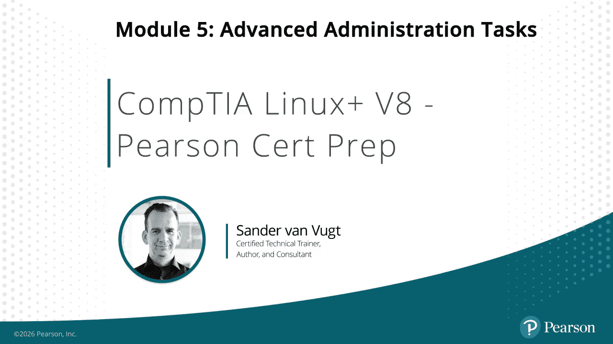
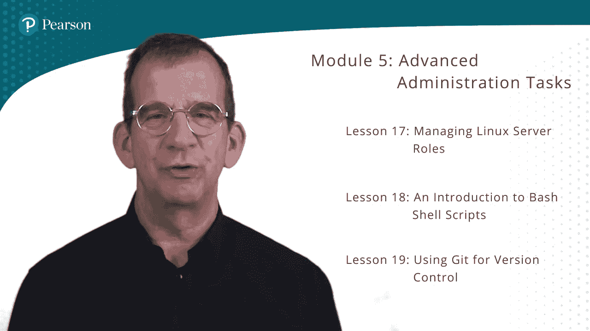

# 🖥️ CompTIA Linux+ V8：Mod5：模块介绍

在本节课中我们将要学习 CompTIA Linux+ V8 课程中的第 5 模块，也就是模块介绍这一章的内容。本节课的主要目的是帮助你了解高级管理任务包括哪些部分，以及接下来的第 17、18、19 三节课分别会讲解什么知识。通过这一节的过渡，你可以对后续的学习路径有一个整体的认识，知道自己即将要接触的技术范围和学习重点在哪里。



Welcome to Mod5。😡，本模块讲的是高级管理任务。这里所说的高级管理任务，指的是比日常基础操作更复杂的系统管理工作，通常涉及服务器配置、容器使用以及虚拟化环境等内容，需要你具备一定的 Linux 基础才能更好地理解。

在完成前面基础模块的学习之后，本节中我们来看看第 5 模块的具体课程安排，以下是模块中包含的课程列表：

- 第 17 课：你将学习如何管理 Co Linux 服务器。
- 第 18 课：这是使用容器的入门介绍。
- 第 19 课：这是虚拟化的入门介绍。

**核心概念公式**：
```text
模块5高级管理任务 = 第17课(Co Linux服务器管理) + 第18课(容器入门) + 第19课(虚拟化入门)
```

学习完这些课程之后，你就能够掌握 Co Linux 服务器的管理方法，理解容器的基本使用方式，并初步认识虚拟化技术的核心概念。这些内容构成了高级系统管理的基础框架，为后续更深入的运维工作打下基础。

😊。



本节课中我们一起学习了模块 5 的介绍内容，明确了这一模块聚焦于高级管理任务，并且了解了第 17 课管理 Co Linux 服务器、第 18 课容器入门、第 19 课虚拟化入门这三个具体主题，希望你能够带着这个整体印象继续往下学习。

