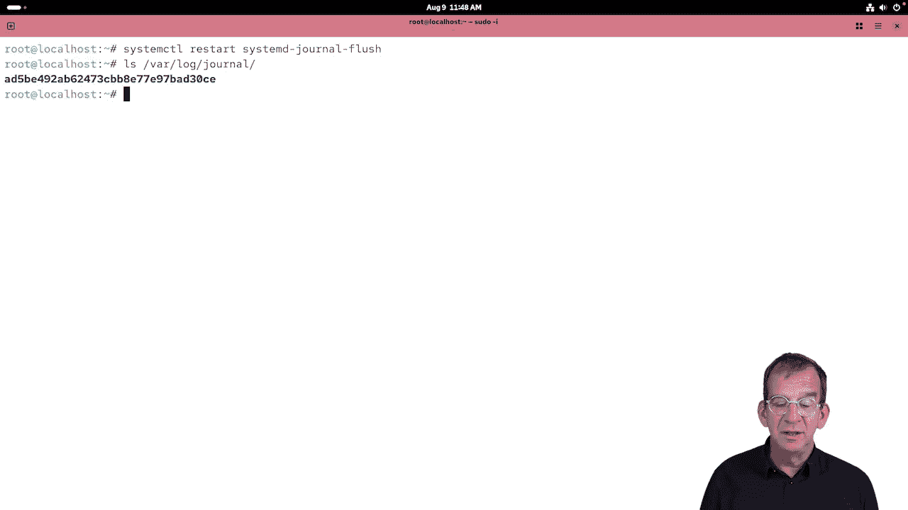

🐧 CompTIA Linux+ V8：311.73：使用 systemd-journald 管理系统日志

在本节课中，我们将会学习 systemd-journald 是什么，以及它在 Linux 系统中扮演的角色。我们会看看怎么用 systemctl 命令查看服务状态，怎么用 journalctl 命令读取完整的系统日志，还会学习怎么按时间或服务单元来过滤日志。最后，我们会把默认只存在内存里的日志变成重启后仍然保留的持久日志。

systemd-journald 是 systemd 家族里负责日志的一个组件。你可以把它理解成系统的日志收集员。任何一个 systemd 单元（比如网络服务、定时任务、硬件驱动等）在运行时产生的日志消息，都会被 systemd-journald 接收到。因为 systemd 本身负责管理系统上的几乎所有东西，所以它自然也能看到所有服务和程序发出的消息。基于这个原因，systemd-journald 被引入成为一套通用的日志服务，统一处理系统里的日志信息。

systemd-journald = 收集所有 systemd 单元产生的日志消息

有了这个总体印象之后，我们先来看看怎么查看某个服务当前的运行状态和最近日志。

以下是查看服务状态的常用方法：
- 使用 `systemctl status <单元名称>` 命令，就能看到该服务最近记录的日志消息。
- 例如，输入 `systemctl status sshd.service`，系统会显示 sshd 服务的当前状态，以及它最近输出的几条日志。

如果你不仅想看某个服务，而是想查看系统中所有服务和组件产生的完整日志，那么就需要使用 journalctl 命令了。

以下是 journalctl 的常见用法：
- `journalctl`：打印完整的系统日志，输出会交给类似 less 的分页器显示，你可以按空格键向下翻页，按大写字母 G 跳到最后。
- `journalctl -f`：跟踪日志，新消息产生时会实时显示在屏幕上。
- `journalctl -p err`：只显示优先级为 error 或更高的事件，适合快速定位错误。
- `journalctl -S <开始时间> --until <结束时间>`：只查找特定时间段内的消息，方便定位问题发生的时段。
- `journalctl --all`：显示更多细节信息，适合深入排查。
- `journalctl -u <单元名称>`：只打印某个特定单元产生的事件。

除了上面这些通用的过滤方式，你还可以进一步把目光聚焦到某个具体的服务单元，或者只看系统启动以来的日志。

以下是几个实用的过滤示例：
- `journalctl --unit sshd`：只显示 sshd 这个单元的日志，内容比较精简。
- `journalctl -xu sshd`：加上 -x 参数后，会为每条日志提供更多解释信息，虽然解释不一定非常详细，但在排查问题时往往能派上用场。
- `journalctl -xb`：显示系统启动以来记录的所有消息，也就是启动日志，适合查看开机过程中发生了什么。

系统服务的日志之外，内核本身也会产生大量日志，这些信息对于理解硬件和底层运行非常重要。

以下是查看内核日志的方式：
- `journalctl -k`（或者传统的 `dmesg` 命令，依然有效）：读取内核日志。
- 内核日志被写入内存中的特定区域，journalctl 会把这些日志以带颜色的形式展示，并且在每条消息开头显示一个时间偏移，这个数字表示消息产生时距离系统启动经过了多少秒。

到这里，我们已经知道怎么读取日志了。不过还有一个重要的默认行为需要注意，那就是 journal 默认并不是持久化的。

以下是说明默认行为的几点：
- systemd-journald 默认不把日志永久保存在磁盘上，系统重启之后，之前的日志就会丢失。
- 如果你希望日志在重启后依然保留，可以设置持久化，其实操作并不复杂。
- 在 `/etc/systemd/journald.conf` 配置文件中，`storage` 选项默认是 `auto`。当你手动创建一个名为 `/var/log/journal` 的目录后，系统就会创建持久化日志。
- 不过光创建目录还不够，你还需要执行 `systemctl restart systemd-journald` 命令，让 systemd 重新加载配置。在这个命令执行之前，日志还不会真正持久化。

以下是让日志持久化的操作步骤：
1. 使用 `find / -name journald.conf` 查找配置文件，因为不同发行版上的文件路径可能不一样，常见路径是 `/usr/lib/systemd/journald.conf`。
2. 打开配置文件，确认 `storage=auto` 已经存在，通常不需要修改。
3. 执行 `mkdir /var/log/journal` 创建日志目录。
4. 此时运行 `ls /var/log/journal` 目录可能还是空的，因为修改还没有生效。
5. 执行 `systemctl restart systemd-journald` 触发 systemd 重新加载配置。
6. 再次运行 `ls /var/log/journal`，你就会看到目录里出现了日志文件，这意味着从现在开始，journal 中的所有内容都会持久写入磁盘，并遵守 `journald.conf` 文件中设定的限制。

如果你担心磁盘空间被日志占满，或者旧消息被过早删除，可以查看 `journald.conf` 文件中的相关限制设置。

本节课中，我们一起学习了 systemd-journald 的基本概念，掌握了使用 systemctl status 查看服务状态，学习了使用 journalctl 查看完整日志并按优先级、时间段和服务单元进行过滤，了解了如何查看启动日志和内核日志，最后还学会了如何将默认不持久的 journal 日志设置为重启后仍然保留的持久日志。
