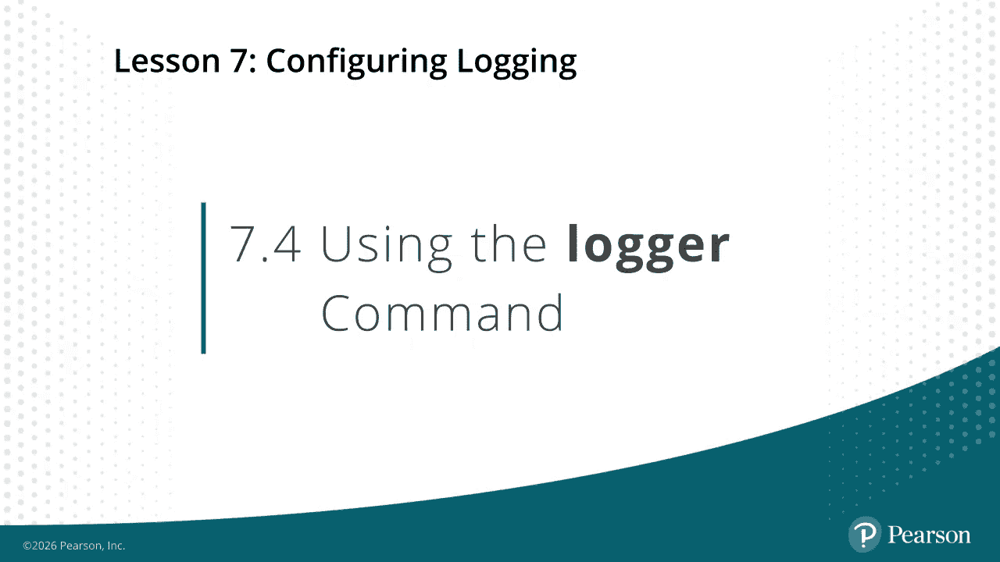
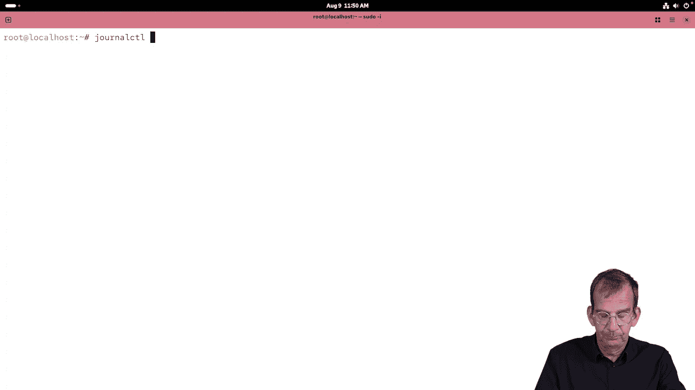

# CompTIA Linux+ V8：第312.74节：使用 logger 命令 📝

## 课程概述 🎯




在本节课中，我们将要学习 Linux 系统里的 logger 命令。这个命令的主要作用是向系统的日志记录服务写入消息，无论你是想记录普通的提示信息，还是想记录带有特定优先级的错误记录，都可以使用它来完成。如果你正在编写脚本，并且希望脚本运行过程中产生的错误或状态信息能够被系统自动保存下来，那么 logger 命令就是一个非常实用的工具。我们会先解释这个命令的基本概念，接着演示如何在终端中使用它，最后再介绍如何查看已经写入的日志内容，帮助你从头到尾掌握整个流程。

## logger 命令的基本作用 🤔

logger 是一条可以让你把消息写入标准日志解决方案的命令。这里的标准日志解决方案，指的是系统用来保存运行记录的机制，常见的例子包括 systemd 所使用的 journald，以及传统的 rsyslog 服务。简单来说，当你执行 logger 命令并提供一段文本时，这段文字就会被发送到这些日志系统中，并以日志条目的形式被保存下来。

这个命令在编写脚本的时候特别方便。假设你有一个自动化脚本，在执行过程中遇到了某种错误情况，你希望这个错误被系统记录，以便日后排查问题。这时候你就不需要手动去操作日志文件，只需要在脚本里调用 logger 命令，把错误信息传给它，系统就会自动把这些信息写进日志里。

logger 命令的基本使用形式如下所示：

```bash
logger -p <优先级> <消息>
```

在这个命令格式中，`-p` 选项用于指定日志的优先级，后面紧跟的参数就是你希望记录的具体消息内容。

## 如何使用 logger 发送消息 📤

在了解了 logger 命令的基本作用之后，我们来看看如何在实际操作中使用它。使用 logger 发送消息的方法非常直接，你只需要在终端中输入 logger 命令，后面跟上你想要记录的文本，系统就会把这条文本写入日志。如果你希望这条消息带有特定的优先级，比如错误级别或者信息级别，可以使用 `-p` 选项，后面跟上对应的优先级名称。

接下来看一个具体的例子。假设我们想要记录一条简单的问候语，并且把它的优先级设置为错误级别，操作命令如下：

```bash
logger -p err "Hello, folks"
```

执行这条命令之后，系统就会在后台日志中留下一条记录，内容就是 "Hello, folks"，并且被标记为错误级别，这样稍后就可以通过日志查询工具把它找出来。

## 如何查看已经写入的日志 🔍

把消息写进日志之后，我们还需要知道怎么把它们找回来。Linux 系统提供了 journalctl 命令来查询 systemd journald 记录的日志，通过它我们可以很方便地检查刚才 logger 命令写入的内容，也可以筛选出特定优先级的记录。



以下是查看日志的常用方法：

- 使用 journalctl 配合搜索选项，可以在日志中定位到包含特定关键词的条目，比如查找刚才写入的 "Hello, folks"。
- 使用 `journalctl -p error`，可以只显示优先级为错误的日志条目，这样就能快速筛选出所有错误记录。

当我们执行这些查询命令时，就会看到 logger 命令生成的日志条目已经整齐地出现在列表中，和系统中其他错误日志一起被记录下来，验证了我们的消息确实已经写入成功。

## 本节课总结 ✅

本节课中我们一起学习了 logger 命令的基本用法。首先我们了解到，logger 是一个用于向标准日志系统（例如 systemd journald 或 rsyslog）写入消息的命令，特别适合在脚本中记录错误或状态信息。接着我们学习了如何使用 `-p` 选项指定日志优先级，并通过 `logger -p err "Hello, folks"` 这样的命令把消息发送到系统日志。最后我们介绍了如何使用 journalctl 命令来查看和筛选这些日志，尤其是使用 `journalctl -p error` 来查看所有错误级别的记录。总的来说，logger 命令非常简单直接，是 Linux 系统管理和脚本编写中一个实用的小工具。

