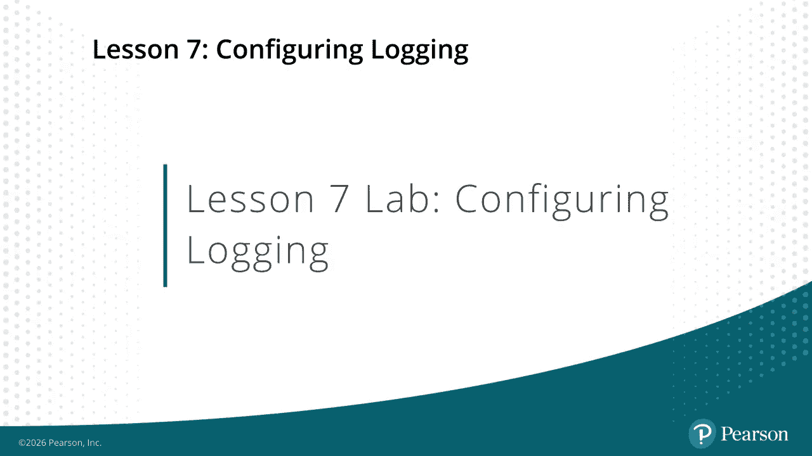
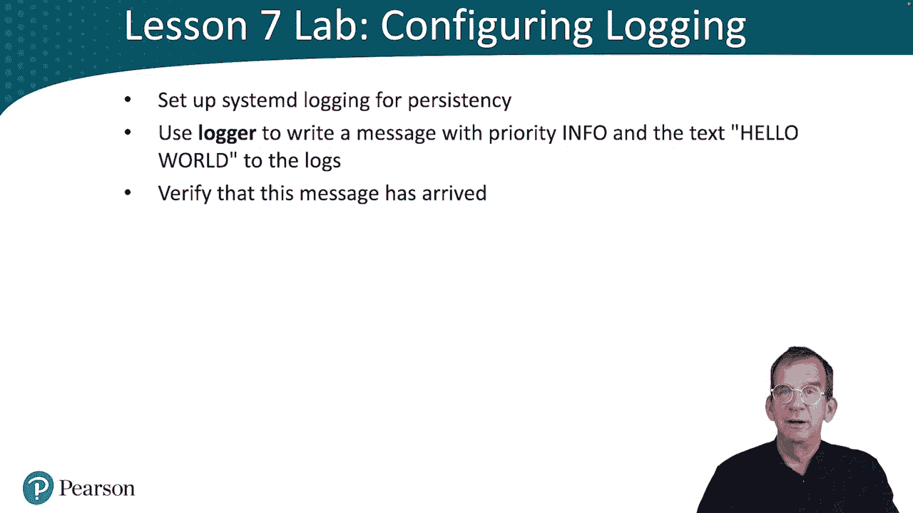

🐧 CompTIA Linux+ V8：Lesson 7 Lab：Configuring Logging 📋

谢谢大家。在本节课中，我们将学习如何在 Linux 系统中配置日志功能。具体来说，我们会先确保系统日志可以持久化保存，不会因为重启而丢失；然后学习使用 logger 命令向系统日志中写入一条优先级为 info 的测试消息，消息内容是 hello world；最后验证这条消息是否真的已经到达日志文件中。这节课适合初学者，我们会用大白话把每一步都讲清楚，尽量把概念说得直白一些，让大家即使没有太多 Linux 基础也能跟上。

---

首先，我们来看看如何设置系统日志的持久化。

以下是确保系统日志重启后依然保留的操作步骤：

- 检查 systemd-journald 服务是否正在运行，这是 Linux 系统记录日志的核心服务。
- 创建持久化日志目录，通常是 /var/log/journal，这样日志会写到硬盘上而不是只存在内存里。
- 重启 systemd-journald 服务，让配置生效。


核心概念可以用下面的命令来表示：

```bash
sudo mkdir -p /var/log/journal
sudo systemctl restart systemd-journald
```



简单来说，持久化就是让日志“落地”到硬盘，哪怕电脑重新启动，之前的日志记录还在，方便我们之后排查问题。

---

设置好日志持久化之后，接下来我们要尝试向日志中写入一条测试消息。

以下是使用 logger 命令发送 info 级别日志的方法：

- 打开终端，输入 logger 命令，指定优先级为 info。
- 在命令中写入文本 hello world，这就是我们要记录的测试内容。
- 执行命令后，这条消息就会被发送到系统日志中。

核心命令如下：

```bash
logger -p info "hello world"
```

这里的 -p info 表示消息的优先级是 informational，也就是普通信息，不是错误也不是警告。执行完这条命令，系统就会把 "hello world" 记录下来。

---

写入消息之后，最后一步是验证这条消息是否真的到达了日志。

以下是验证日志是否成功写入的方法：

- 使用 journalctl 命令查看最近的日志条目。
- 或者查看具体的日志文件，比如 /var/log/messages 或 /var/log/syslog，具体取决于你的发行版。
- 在输出中查找包含 hello world 的那一行，如果能找到，就说明消息已经成功到达日志。

验证可以用下面的命令来完成：

```bash
journalctl -n 20 | grep "hello world"
```



如果屏幕上显示了包含 hello world 的日志行，就说明我们的配置和 logger 命令都工作正常了。

---

本节课中我们一起学习了如何配置 Linux 系统日志的持久化，确保日志不会因重启而丢失；也学习了如何使用 logger 命令以 info 优先级向日志写入 hello world 测试消息，并通过 journalctl 验证消息是否成功到达。希望这些内容能帮助你初步掌握 Linux 日志配置的基本方法。
