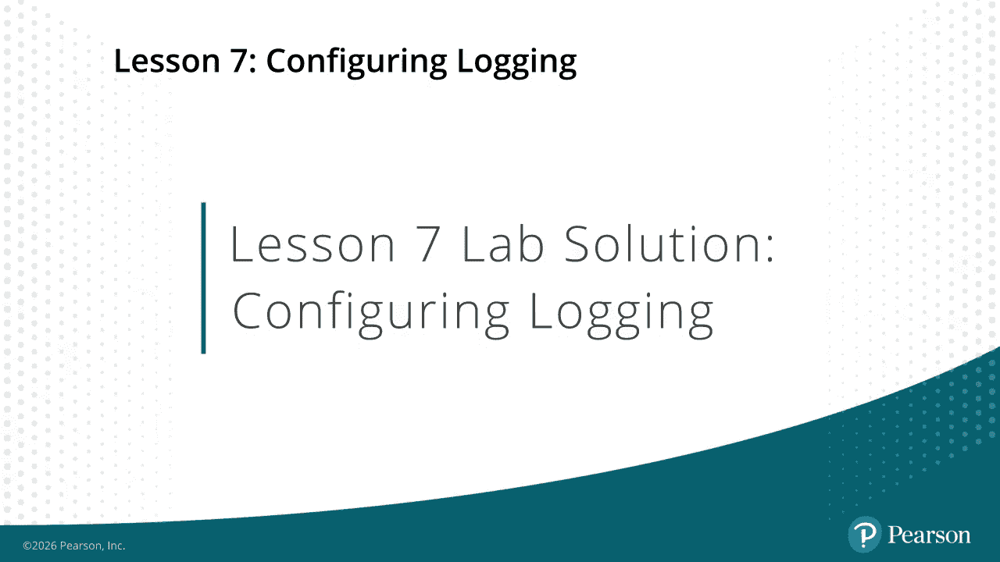
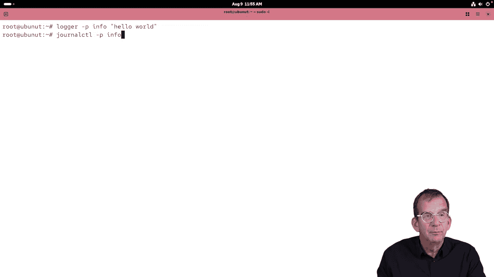

# CompTIA Linux+ V8：Lesson 7：配置日志实验解答 📋


在本节课中，我们将一起学习如何在 Linux 系统中配置和管理日志。本节内容围绕一个具体的实验演示展开，教你怎么检查系统日志服务的当前状态，如何确认日志目录是否已经存在，以及怎么使用命令行工具手动写入一条测试日志。无论你是刚接触 Linux 的新手，还是正在准备 CompTIA Linux+ 认证考试的学员，这节课都会用最直白的方式把日志配置的关键步骤讲清楚，让你掌握排查系统问题的基本技能。



## 第一步：选择操作系统并检查 journald 配置

本节实验我们选择在 Ubuntu 系统上进行演示，因为之前的 CentOS 机器已经正确安装好了相关组件，不需要再做重复操作。首先我们需要查看系统日志守护进程的详细配置情况，确认 journald 目前的存储策略是否符合预期，这样才能保证后续的日志记录工作正常进行。

在 Ubuntu 系统中，journald 的主要配置文件位于 /etc/systemd/journald.conf。打开这个文件后，我们要找到的关键选项就是 storage 设置，它的当前值为 auto。这个配置意味着系统会自动决定日志的存储方式，不需要我们手动干预，检查完这一项之后，基础配置确认就算完成了。

以下是该配置文件中的关键设置：

```
storage = auto
```

这行配置决定了 journald 是否将日志写入持久化存储，auto 表示由系统自动判断，通常已经足够满足大多数常见场景的需求。

## 第二步：确认日志目录是否已经存在

接着我们需要检查系统中是否已经创建好了日志存储目录。在 Linux 中，系统日志通常保存在 /var/log/journal 路径下，我们要确认这个文件夹是否已经存在，以免重复创建或者权限出错导致后续无法写入日志。

使用 ls -l 命令查看 /var/log/journal 目录的详细信息，可以发现该目录在 Ubuntu 机器上已经存在，并且已经包含了一致性日志数据。这说明系统的日志基础设施已经就绪，不需要额外初始化，可以直接进入下一步。

以下是检查命令：

```
ls -l /var/log/journal
```

通过这条命令，我们可以直接看到目录的权限、所有者以及创建时间，从而判断日志系统是否正常运行，确保后续操作有据可依。

## 第三步：对比不同发行版的日志一致性机制

这时候你可能会问，为什么我们要特意检查这一项？这是因为在 Red Hat 系列发行版中，日志一致性通常是通过 rsyslog 服务来保证的。为了确保 Ubuntu 上也有同样的机制，我们需要检查是否安装了 rsyslog。经检查，Ubuntu 系统中同样安装了 rsyslog，这意味着两套日志系统同时存在，属于一种重复但可选的配置方式。

不同的 Linux 发行版可以根据自己的需求做出不同的选择，比如有的侧重于 journald，有的则同时启用 rsyslog，这种灵活性正是 Linux 发行版的特点之一。理解这一点有助于你在以后的工作中更好地适应不同的服务器环境，不会因为发行版不同而感到困惑。

## 第四步：使用 logger 命令写入测试日志

接下来我们要完成的核心操作是使用 logger 工具向系统日志中写入一条测试信息。我们需要指定日志的优先级为 info，并写入文本内容 Hello World，以此验证日志系统是否能够正常接收用户自定义的消息。

初次尝试时可能会出现参数错误，比如把 -p 和 = 混淆，导致日志虽然写入了但格式不对。修正后的命令应该如下所示：

```
logger -p info "Hello, World"
```

这条命令的作用非常直白：使用 logger 工具，将日志优先级设为 info，日志内容为 Hello World，然后提交给系统日志服务进行记录。

## 第五步：使用 journalctl 查看刚刚写入的日志

写入测试日志之后，我们需要验证这条记录是否真正进入了系统日志。这里使用 journalctl 工具来查看日志，并加上 -b 参数表示只显示本次启动以来的日志，同时加上 -p info 表示过滤出优先级为 info 的消息，这样可以更精确地定位到我们刚刚写入的内容。

执行命令后，屏幕上会显示大量日志条目，其中就包含我们刚才手动写入的那条 Hello World 消息。这证明 logger 命令已经成功工作，日志系统也能正常记录用户自定义的信息，整个配置流程至此验证完毕。

以下是查看命令：

```
journalctl -b -p info
```



通过这个命令，你可以快速定位到所有优先级为 info 的启动日志，并在其中找到自己的测试记录，从而完成整个日志配置的闭环验证。

## 本节课总结

在本节课中，我们一起学习了如何在 Ubuntu 系统上配置和验证日志服务。首先检查了 /etc/systemd/journald.conf 中的 storage = auto 设置，确认 journald 的自动存储策略已生效；接着使用 ls -l /var/log/journal 验证了日志目录已经存在；然后对比了 Red Hat 与 Ubuntu 在 rsyslog 方面的选择差异；随后使用 logger -p info "Hello, World" 向日志写入了测试消息；最后用 journalctl -b -p info 查看并确认了该消息已被正确记录。希望这节课能帮助你更好地理解 Linux 日志系统的基本工作原理，并在实际操作中快速上手。

