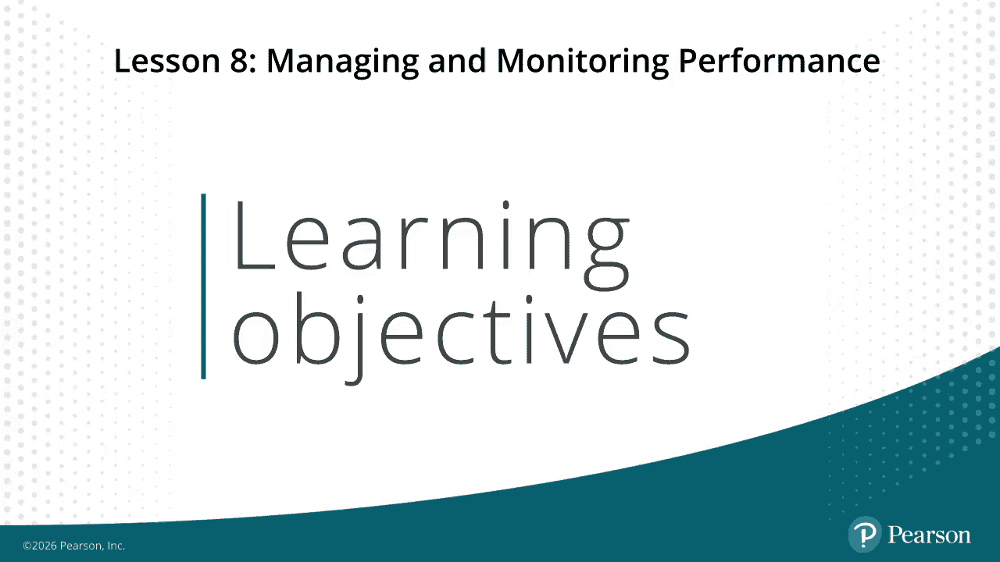

# 📊 CompTIA Linux+ V8：315：系统性能监控学习目标

在本节课中，我们将学习如何监控 Linux 系统的性能。这是一节面向初学者的入门课程，适合刚开始接触 Linux 系统管理的朋友。我们会一步步介绍几个常用的性能监控工具和概念，确保你能明白每个工具显示的信息意味着什么，以及如何在实际工作中使用它们。无论你是准备考取 CompTIA Linux+ 认证，还是只是想了解服务器到底在忙什么，这节课都会给你打下基础。


### 第一节：认识 top 命令

我们先从 top 命令开始。top 是 Linux 系统中最常用的性能监控工具之一，它可以实时显示系统的运行状态，帮助你快速了解当前系统忙不忙，哪些进程在吃资源。

以下是 top 命令主要显示的内容：



- 系统运行时间和当前登录用户数量
- 任务总数，包括运行中、睡眠中、停止和僵尸进程的数量
- CPU 使用率，分为用户空间、系统空间和空闲时间
- 内存使用情况，包括物理内存和交换分区
- 各个进程的详细信息，比如进程 ID、用户、优先级、CPU 占用率和内存占用率

使用 top 命令的方法如下：

```bash
top
```

当你运行 top 命令后，屏幕会不断刷新，显示最新的系统状态数据。你需要重点观察 CPU 使用率和内存使用率这两项指标，它们直接反映了系统当前的负载情况。如果 CPU 长期接近 100%，或者内存几乎被用光，就意味着系统可能遇到了性能瓶颈。


### 第二节：解读内存统计信息

在了解了 top 命令的基本显示内容之后，下一步是学习如何解读内存统计信息。内存是系统性能的关键部分，了解内存使用情况有助于你发现潜在的性能瓶颈，避免系统因为内存不足而变慢甚至崩溃。

你需要关注的内存统计指标包括以下这些：

- 总内存大小，即系统物理内存的总容量
- 已用内存，当前被应用程序和系统占用的内存量
- 空闲内存，当前未被使用的内存量
- 缓存内存，系统用于文件缓存的内存量
- 交换分区使用情况，当物理内存不足时系统使用的磁盘空间

你可以使用 free 命令来查看更详细的内存信息：

```bash
free -m
```

如果交换分区使用率持续很高，通常说明物理内存不足，系统在频繁地进行内存交换，这会拖慢整体运行速度。这时你可能需要考虑增加物理内存，或者优化占用内存过大的应用程序。


### 第三节：Cgroups 与进程优先级

接下来，我们要探索 Cgroups 以及进程优先级与 Cgroups 之间的关系。Cgroups 是 Linux 内核提供的一种机制，用于限制和隔离进程组的资源使用，防止某个进程独占系统资源导致其他进程无法正常运行。

以下是 Cgroups 的核心概念：

- Cgroups 可以控制 CPU 时间片、内存、磁盘 I/O 和网络带宽等资源
- 每个 Cgroup 可以包含多个进程，这些进程共享同一组资源限制
- 进程优先级决定了进程在 CPU 上获得调度的先后顺序
- Cgroups 与进程优先级共同作用，决定了系统资源如何分配给不同的进程组

进程优先级与 nice 值的关系可以用下面的公式表示：

```
实际优先级 = 基础优先级 + nice 值
```

nice 值越大，进程优先级越低，越愿意让出 CPU 资源给其他进程。nice 值越小，进程优先级越高，越容易抢占 CPU 时间。合理设置进程优先级和 Cgroups 限制，可以让重要服务在系统繁忙时依然保持响应。


### 第四节：调整内核参数

学完 Cgroups 之后，下一个环节是关于调整内核参数的内容。内核参数控制着 Linux 内核的底层行为，合理调整这些参数可以优化系统在特定场景下的性能表现，比如提高网络吞吐量或改善文件系统响应速度。

内核参数通常通过 /proc 文件系统或 sysctl 命令进行查看和修改。你需要谨慎操作，因为错误的内核参数设置可能会导致系统不稳定，甚至无法启动。建议在修改前先备份原有配置，并在测试环境中验证效果，再应用到生产服务器上。


### 第五节：使用 SAR 工具

之后，我们将学习如何使用 SAR，也就是系统活动报告工具。SAR 是 Sysstat 软件包的一部分，用于收集、报告和保存系统活动信息，适合用于事后分析系统性能趋势。

SAR 可以监控以下内容：

- CPU 使用率和负载
- 内存和交换分区使用情况
- 磁盘 I/O 活动
- 网络接口流量
- 系统运行队列和负载平均值

使用 SAR 查看 CPU 使用情况的示例命令如下：

```bash
sar -u 1 3
```

这条命令的意思是每秒钟采集一次 CPU 数据，共采集 3 次。SAR 的优势在于它可以保存历史数据，方便你事后分析系统在不同时间段的性能表现，而不是只看当前这一瞬间的状态。


### 第六节：La 及其解决方案

最后，本节课还会介绍 La 以及相关的 La 解决方案。这里的 La 是本课程中涉及的一个特定技术概念，你需要了解它的基本原理和应用场景，才能在遇到相关问题时知道该怎么处理。


La 解决方案通常用于解决特定类型的系统性能问题。在实际操作中，你需要结合前面学习的监控工具，先定位问题所在，再决定是否采用 La 解决方案进行优化。不同的性能问题可能需要不同的解决思路，监控工具只是第一步，找到根本原因才是关键。


## 总结

在本节课中，我们一起学习了如何监控 Linux 系统性能。具体内容包括使用 top 命令查看实时系统状态、解读内存统计信息、理解 Cgroups 与进程优先级的关系、调整内核参数、使用 SAR 工具收集系统活动报告，以及了解 La 及其解决方案。希望这些知识能帮助你建立起系统性能监控的基础认知，为后续深入学习 Linux 系统管理打下坚实基础。
