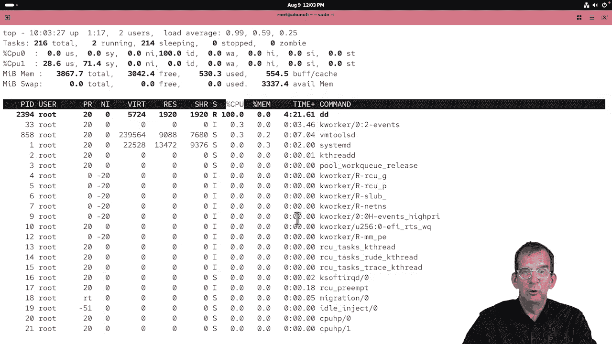

# 🖥️ CompTIA Linux+ V8：316.81：分析 top 输出


在本节课中，我们将学习如何使用 Linux 系统中的 `top` 命令。`top` 是一个内置的性能监控工具，可以帮助你查看 CPU、内存和进程的实时状态。我们会对比 `top` 和 `htop`，了解为什么在大多数系统上优先使用 `top`。随后，我们会通过实际操作解读 `top` 输出中的负载平均值、CPU 时间、内存使用以及进程列表，最后学习如何自定义 `top` 界面并保存配置。

## 1. 为什么选择 top 而不是 htop

上一节我们简单了解了 Linux 性能监控的基本概念，本节中我们来看看 `top` 命令的具体用法。

`top` 是 Linux 系统自带的标准性能仪表盘。几乎每一台 Linux 机器上都默认安装了 `top`，所以无论你登录哪台服务器，都可以直接使用它。相比之下，`htop` 界面更现代，支持颜色显示和更多细节，但它并不是标准工具，大多数系统出厂时不会预装 `htop`。而且 `htop` 本身占用的系统资源更多，如果你已经在排查性能问题，就不希望监控工具本身成为额外的负担。

以下是使用 `top` 而不是 `htop` 的主要原因：

- `top` 是标准 Linux 工具，所有系统都自带，无需额外安装。
- `top` 的系统开销很小，不会干扰你正在诊断的性能问题。
- 在很多生产环境中，安装未经授权的软件是不被允许的，所以你不能指望顾客会帮你装 `htop`。

## 2. 启动 top 并制造一些负载

现在我们知道了 `top` 的优势，接下来我们直接启动它，并给系统制造一点活动，这样界面就不会太安静了。

直接在终端输入 `top` 即可启动。默认情况下，如果系统很空闲，你可能会看到大部分 CPU 处于空闲状态，进程列表也比较稀少。为了让 `top` 显示更有意思的数据，我们可以使用 `dd` 命令在后台制造一个持续的读写任务：

```bash
dd if=/dev/zero of=/dev/null &
```

这条命令的意思是从 `/dev/zero` 读取数据，然后写入到 `/dev/null`，并把这个任务放到后台运行。因为 `dd` 会不停地占用 CPU，所以接下来再运行 `top` 时，至少能看到一个在努力工作的进程。

## 3. 读懂负载平均值（Load Average）

启动 `top` 之后，我们要关注的第一个指标是屏幕顶部的负载平均值。

负载平均值显示的是最近 1 分钟、5 分钟和 15 分钟内，系统中可运行进程的总数。所谓可运行进程，是指当前正在执行，或者正在等待 CPU 服务的进程。需要注意，可运行进程不一定时刻都在占用 CPU，具体取决于你的系统有多少个 CPU。单个 CPU 在同一时刻只能运行一个进程。

例如，假设你的系统有 4 个 CPU，而负载平均值显示为 6，这意味着有 6 个进程在争抢 CPU 时间，系统已经处理不过来了，你需要进一步调查到底是哪些进程在造成压力。

以下是判断负载平均值时需要记住的几点：

- 查看 1 分钟、5 分钟和 15 分钟三个数值，判断负载是暂时波动还是持续升高。
- 将负载平均值与你的 CPU 核心数量进行对比，如果负载持续高于核心数，说明系统负载过重。
- 在做出任何结论之前，先确认你的系统到底有多少个 CPU。

## 4. 确认系统有多少个 CPU

知道负载数值之后，我们还需要知道系统的 CPU 数量，才能判断负载是否正常。

在 `top` 界面中，按下数字键 `1`，可以展开查看每个 CPU 核心的详细使用情况。在示例中，`dd` 进程占用了 100% 的 CPU，而空闲时间大约是 50%。这暗示系统很可能有两个 CPU，因为一个进程跑满一个核心，另一个核心还在空闲。按下 `1` 之后，我们可以直接确认，这台机器确实是双 CPU 系统。

## 5. 分析 CPU 时间的用户空间和系统空间

确认了 CPU 数量之后，接下来我们看 `top` 中 CPUs 那一行的具体含义。

`top` 显示的 CPU 时间被分成了几个部分，其中最重要的两个是用户空间和系统空间。用户空间是指普通用户进程占用的 CPU 时间，系统空间是指内核在处理系统调用、驱动程序和内核任务时占用的 CPU 时间。在大多数情况下，用户空间的活动会更高，因为大多数应用程序都运行在用户空间。但如果你看到系统空间占用异常高，通常说明系统正忙于处理驱动程序或内核相关工作。

在本示例中，`dd` 命令在两个驱动程序之间搬运数据，所以 CPU 时间主要花在系统空间，这完全合理。

以下是 CPU 时间中常见的几个参数：

- `us` 或 `user`：用户空间进程占用的 CPU 时间。
- `sy` 或 `system`：内核空间和驱动程序占用的 CPU 时间。
- `id` 或 `idle`：CPU 什么都没做的空闲时间百分比。
- `wa`：等待磁盘 I/O 的时间。过去机械硬盘很慢时这个值很常见，但现在 SSD 普及之后，几乎看不到 `wa` 了。

我们希望空闲时间尽可能高，因为这意味着 CPU 还有富余的处理能力。

## 6. 查看内存使用情况

CPU 分析完毕之后，我们继续看 `top` 输出中的内存部分。

内存行会显示系统总共有多少内存，当前有多少是空闲的，有多少正在被使用，还有多少被用作缓冲和缓存。在示例中，总内存大约 4GB，其中 3GB 是空闲的，只有 530MB 正在被使用，同时还有大约 554MB 被分配给了缓冲和缓存。

缓冲和缓存是 Linux 系统用来加速文件读写的机制。系统会把最近读取过的文件保留在缓存里，下次再读同一个文件时，可以直接从缓存中提供，而不需要再去访问慢速的磁盘，这样系统会更快。

这里有一个容易混淆的概念：空闲内存和可用内存。缓存不是必须保留的，如果系统需要更多内存，Linux 内核可以随时丢弃不活跃的缓存数据。因此，`available`（可用内存）通常会比 `free`（空闲内存）显示的数值更大，因为操作系统知道哪些缓存可以被安全地回收。

以下是内存行中常见的几个字段：

- `total`：系统物理内存的总容量。
- `free`：当前完全未被使用的内存。
- `used`：当前已被应用程序占用的内存。
- `buff/cache`：被用作缓冲和缓存的内存，可以在需要时回收。
- `available`：应用程序可以实际使用的内存，包含空闲内存和可回收的缓存。

## 7. 对进程列表进行排序

了解了内存之后，我们来看 `top` 下方的进程列表。默认情况下，这个列表是按照 CPU 使用率从高到低排序的，但你可以随时更改排序方式。

按下大于号 `>`，排序字段会向右切换；按下小于号 `<`，排序字段会向左切换。在示例中，讲师先把列表切换到按内存使用率排序，再切换到按虚拟内存排序。需要注意，虚拟内存并不等于进程实际占用的物理内存。如果你想知道一个进程到底在用多少真实内存，应该查看常驻内存（resident memory）。

以下是可以切换的常见排序字段：

- CPU 使用率：查看哪个进程最占用处理器。
- 内存使用率：查看哪个进程最占用内存。
- 虚拟内存：进程申请的全部虚拟地址空间，不等于实际占用。
- 常驻内存：进程目前实际占用的物理内存，更能反映真实内存消耗。



## 8. 自定义 top 界面并保存配置

`top` 不仅是一个只读的监控工具，它还允许你重新排列界面、添加或删除列，甚至直接对进程进行操作。

如果你按下大写字母 `F`，会进入字段选择界面。在这里，你可以使用方向键在不同的显示字段之间移动，按空格键选中你想看到的列，然后按 `Q` 回到主界面。例如，你可以选择显示“上次使用的 CPU”这一列，让 `top` 界面多出一列信息。

如果你希望这些自定义设置在下次启动 `top` 时依然保留，可以按下大写字母 `W`。这会将当前配置写入一个持久化配置文件，通常是 `~/.toprc`。这样当你退出并重新启动 `top` 时，你之前添加的列仍然会出现。

## 9. 总结

本节课中，我们一起学习了如何使用 Linux 标准工具 `top` 分析系统性能。我们对比了 `top` 和 `htop`，明白为什么 `top` 更适合在大多数系统上使用；学会了通过 `dd` 制造负载并启动 `top`；理解了负载平均值的含义以及如何结合 CPU 数量来判断系统压力；解读了用户空间、系统空间和空闲时间等 CPU 指标；搞清楚了内存中的空闲、缓存和可用内存之间的区别；掌握了使用 `>` 和 `<` 对进程列表排序，并了解了虚拟内存与常驻内存的区别；最后，我们还学习了如何按 `F` 自定义显示字段，并按 `W` 将设置保存到 `~/.toprc`。
