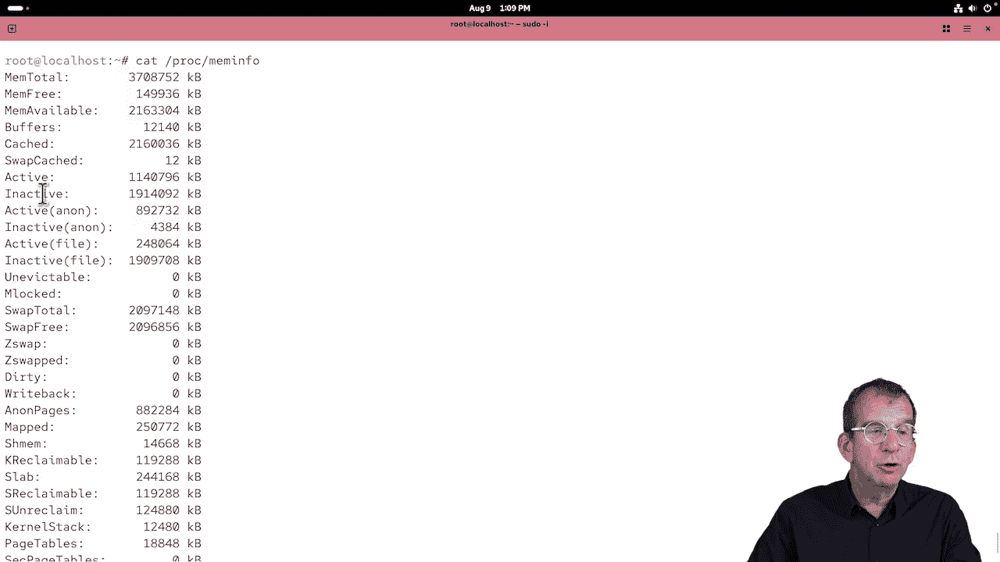
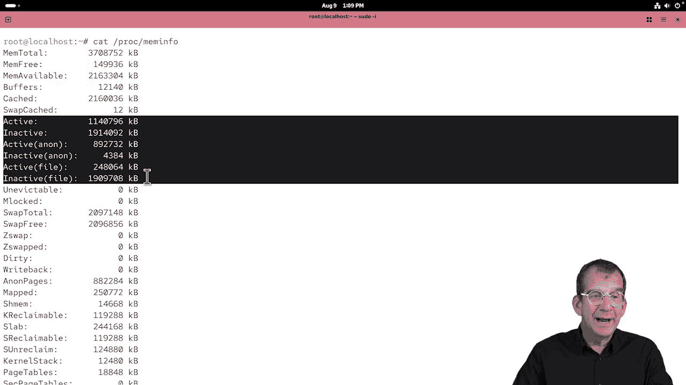
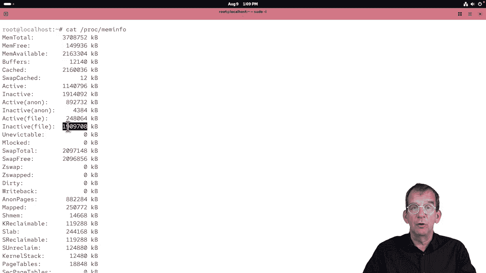

# CompTIA Linux+ V8：17：内存统计信息解读 🧠

在本节课中我们将要学习如何在 Linux 系统中解读内存统计信息。我们会先了解一些基础术语，比如缓存、缓冲区、匿名内存、交换区和虚拟内存。接着我们会看看活跃内存和非活跃内存的区别，以及 Linux 内核如何根据这些状态决定内存页面的去留。最后我们会用几个常用命令，比如 free -m、vmstat 和 /proc/meminfo，来查看实际的内存使用情况。通过这些内容，你将能够判断系统当前的内存压力，并了解什么时候需要关注交换区的使用。

## 一、内存相关术语详解 📚

上一节我们大致介绍了内存监控的目的，本节中我们先来看看几个最基础的内存概念。理解这些术语是分析内存统计信息的前提，否则你很难看懂命令输出里的那些数字代表什么意思。

以下是几个核心内存概念及其含义：

- **缓存 (Cache)**：是用于存储经常访问数据的临时存储区域，目的是提高访问速度。你可以把它理解为电脑里的“快捷取货区”。
  公式表示：`数据访问速度 = 缓存命中率 × 快速访问 + (1 - 缓存命中率) × 慢速访问`
  缓存存在于多个层级，比如磁盘缓存、内存缓存，还有代理服务器上的互联网缓存，它们虽然作用相似，但处于完全不同的层级。

- **缓冲区 (Buffer)**：Linux 缓冲区内存用于临时存储待处理的数据。当你写入一个文件时，数据会先被提交到内存中，然后留在缓冲区里，直到系统决定把这些数据刷新到磁盘上。
  代码表示：`写入文件 → 内存暂存 → 缓冲区等待 → 刷新到磁盘`

- **匿名内存 (Anonymous Memory)**：是由应用程序分配的内存，不直接对应任何文件。

- **交换区 (Swap)**：是磁盘上模拟出来的内存空间，可以用于存放匿名内存。简单说，当物理内存不够用时，系统会把部分内存内容写到磁盘的交换区里。

- **虚拟内存 (Virtual Memory)**：由 CPU 架构决定的另一块地址空间，它和交换区没有任何关系。虚拟内存是程序申请内存的逻辑视图，而交换区只是物理实现的一种后备方案。

- **预留内存与驻留内存**：每个 Linux 应用程序都想要分配一定数量的内存，这叫做预留。预留不代表内存已经被使用，而只是说这块内存被该应用程序占用，其他程序不能动。从虚拟内存中实际获得并正在使用的那部分，叫做驻留内存。
  公式表示：`实际使用内存 = 驻留内存 (Resident Memory)`

了解完这些基础术语后，我们接着来看看 Linux 内核用来判断内存页面去留的两个关键状态。内核需要知道哪些内存最近被用过，哪些没有，这样它才能在内存紧张时做出正确的决策。

## 二、活跃内存与非活跃内存 🔄

本节中我们来看看 Linux 内核用来判断内存页面去留的两个关键状态。内核需要知道哪些内存最近被用过，哪些没有，这样它才能在内存紧张时做出正确的决策。

以下是两种内存状态的具体说明：

- **活跃内存 (Active Memory)**：指最近被使用过的内存。内核会优先保留这些页面，因为它们大概率还会被再次访问。

- **非活跃内存 (Inactive Memory)**：指最近没有被使用过的内存。这些内存页面是内核首先考虑回收或移出的对象。

当系统内存短缺时，内核的处理优先级如下：
公式表示：`内存回收优先级 = 非活跃缓存页面 > 非活跃匿名页面（移至交换区） > 活跃匿名页面（最后手段，性能下降严重）`

具体来说，非活跃的缓存内存可以直接被丢弃，因为需要时可以重新从磁盘读取。非活跃的匿名内存则有资格被移到交换区。如果内存短缺情况非常严重，甚至连活跃的匿名内存也可能被移到交换区，但这非常糟糕，因为系统会花大量时间在内存和交换区之间搬运数据，反而让系统变得更慢。

现在我们已经知道了内核是如何思考内存回收的，接下来我们来看看在实际操作中，应该用哪些命令来查看这些内存统计数据。

## 三、常用内存监控命令 🛠️

监控内存的第一步是知道用什么工具。下面介绍三种由浅入深的查看方式，帮助你从宏观到微观掌握内存状况。

以下是三种常用的内存监控命令：

1. `free -m`：适合快速获取整体概览。它会显示内存总量、已用量和空闲量，以 MB 为单位。
2. `vmstat`：提供更详细的内存使用信息。你可以指定采样间隔和次数，观察内存随时间的变化。
   示例代码：`vmstat 2 5`
   这里的 2 表示每 2 秒采样一次，5 表示总共采样 5 次。
3. `cat /proc/meminfo`：这是最终详情的来源。Linux 内核在这里存储了关于内存的所有信息，输出内容非常丰富，适合深度排查。

有了这些命令的认识之后，我们来看看实际运行后的输出到底该怎么读，以及各项数字代表什么。

## 四、命令输出解读与实战分析 🔍

本节中我们通过实际的命令输出，来拆解内存统计信息的含义，重点关注 `free -m`、`vmstat` 和 `/proc/meminfo` 三种情况。

以下是具体的输出项及其解读：

- `free -m` 输出：你会看到总内存、已用内存和空闲内存。如果你在 已用 和 空闲 之间发现有差额，那差额通常就是缓存和缓冲区占用的空间。
  公式表示：`总内存 = 缓存 + 缓冲区 + 共享内存 + 空闲内存 + 已用内存`

- 可用内存 (Available)：这个参数比单纯的空闲内存更有参考价值。它不仅包括当前空闲的内存，还包括那些可以立即清理的非活跃缓存内存，这些空间随时可以让给更急需内存的进程。

- 交换区使用情况：如果系统内存充足，交换区可能根本不会被使用。Linux 内核也不会急着把非活跃的匿名内存移到交换区，除非实在没办法。

- `vmstat` 中的 `si` 和 `so`：分别表示 Swap In（交换入）和 Swap Out（交换出）。如果交换区正在被频繁使用，这里会显示较高的活动值。持续的高 `si`/`so` 通常是内存不足的危险信号。

- `/proc/meminfo` 中的关键项：最值得关注的是 `Active` 和 `Inactive` 内存。
  - 活跃内存：是真正需要被使用、需要保留在物理内存里的部分。
  - 非活跃内存：可能正在做其他事情，或者暂时不用，内核可以在必要时回收。

在示例系统中，大约有 2 GB 的非活跃内存，这也能解释为什么在 `free -m` 的输出里看起来可用内存比较充裕。

至此，我们已经把内存的基本术语、内核的回收逻辑以及常用的监控命令都走了一遍，最后来总结一下本节课的核心内容。

## 五、总结 📝

本节课中我们一起学习了如何解读 Linux 的内存统计信息。我们首先梳理了缓存、缓冲区、匿名内存、交换区、虚拟内存以及预留内存和驻留内存的概念，弄清楚了它们各自的作用和区别。接着我们了解了活跃内存和非活跃内存的定义，以及 Linux 内核如何依据这两个状态决定哪些内存页面可以回收或移至交换区。最后我们学习了使用 `free -m`、`vmstat` 和 `/proc/meminfo` 三种工具来查看内存概览、详细变化和底层参数，并重点解读了可用内存、交换区活动以及 Active/Inactive 内存的含义。希望这些内容能帮助你更好地判断系统的内存压力，并在日常运维中快速定位内存相关问题。

