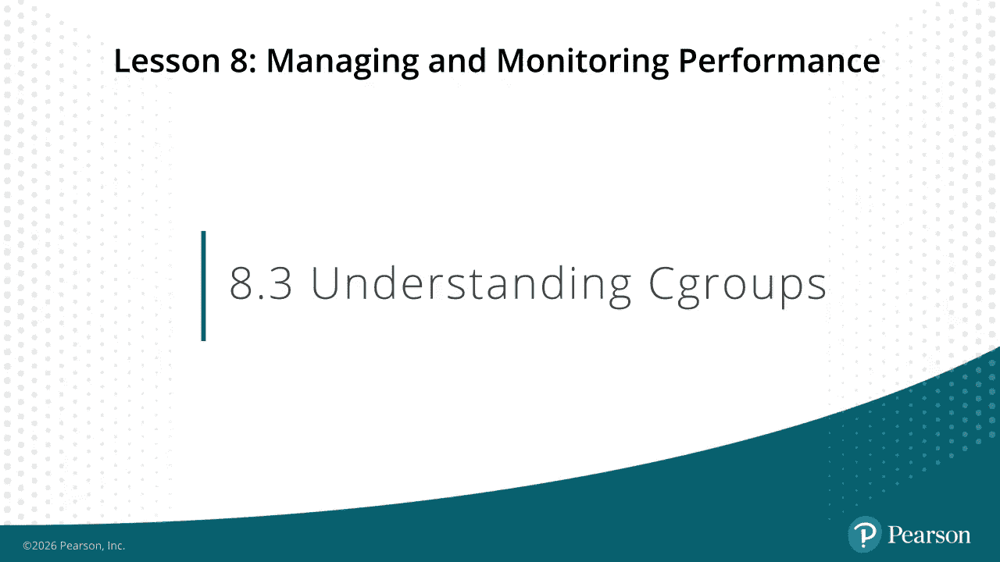
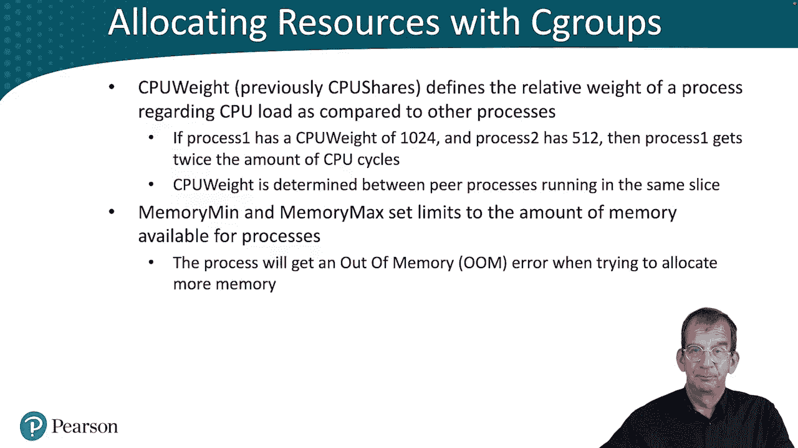
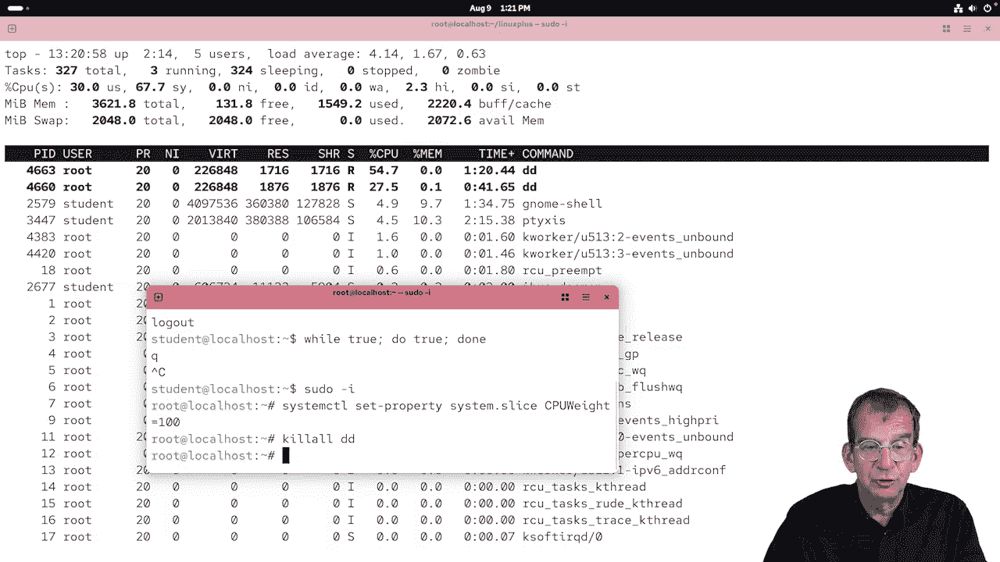

Oreilly CompTIA Linux+ V8：318.83：理解 Cgroups ⚙️

在本节课中我们将要学习 Linux 中的 Cgroups 技术。Cgroups 是操作系统用来控制资源分配的核心机制，它和 systemd 紧密集成在一起。我们会先解释什么是 Cgroups，为什么日常运维中需要它，接着看看 Slice 是怎么划分系统资源的，然后重点讲解 CPU Weight 和内存限制这两个关键参数，最后通过一个实际的压力测试演示，看看怎么在真实系统里配置和调整这些参数。

Cgroups 是 Linux 系统里负责管理资源分配的主要系统，目前已经集成进 systemd 了。简单说，Cgroups 的作用就是决定每个进程能够使用多少 CPU、内存等硬件资源。有了 Cgroups，我们可以限制进程最多能使用多少资源。如果没有 Cgroups，万一某个程序出现内存泄漏，它可能会把系统里所有可用内存都占光，导致其他程序无法运行。通过 Cgroups，你可以直接对程序说，你不能拥有超过半个 GB 的内存，一旦达到这个半个 GB 的内存限制，程序就会被停止。在 Linux 系统中，Cgroups 是通过 systemd 来管理的。

在 Cgroups 的配置结构里，组织的最高层级叫做 Slice。Slice 可以理解为操作系统中专门用来做资源分配的一个大区块。默认情况下，系统里常见的有三种 Slice。以下是常见的 Slice 类型：

- system slice，专门用于运行特权进程。
- machine slice，用于运行虚拟机和容器。
- user slice，用于运行非特权进程。

默认情况下，所有这些 Slice 都有权获得相等的系统资源。在一个 Slice 内部，资源会被进一步划分，每个服务都与其他服务处于平等地位，所有服务都有权获得相等的系统资源份额。

了解了 Slice 怎么划分大区块之后，接下来我们看看在一个 Slice 内部，具体怎么决定哪个进程能多拿点资源。这就要用到 CPU Weight 这个概念了。CPU Weight 是一个之前叫做 CPU Shares 的参数，用来定义一个进程相对于所有进程的 CPU 负载的相对权重。默认情况下，所有进程的 CPU Weight 都一样，但是你可以改变它，这正是我们接下来要演示的内容。你可以用下面的公式来理解：

进程 A 获得的 CPU 周期 / 进程 B 获得的 CPU 周期 = 进程 A 的 CPU Weight / 进程 B 的 CPU Weight

举个例子，如果进程 1 的 CPU Weight 是 1024，而进程 2 的 CPU Weight 是 512，那么进程 1 就能获得两倍的 CPU 周期。需要注意的是，CPU Weight 只在同一个 Slice 里面的进程之间生效。也就是说，如果用户空间 Slice 的 CPU Weight 是 20000，而系统空间 Slice 的 CPU Weight 只有 1000，这并不代表用户空间进程会获得 20 倍的资源，这个比较关系只能在同一个 Slice 内部确定。

除了 CPU，内存也是 Cgroups 能够管控的重要资源。接下来我们看看怎么给内存设限。内存限制主要通过 memory min 和 memory max 这两个参数来实现，它们允许你设置进程能够使用的内存范围。当进程尝试分配超出限制的内存时，系统会报 out of memory 错误，也就是常说的 OOM 错误。这很好理解，内核的意思就是，嘿，我没有剩余内存了，给不了你。

理论部分讲完了，下面我们进入实际操作，看看怎么在真实系统里管理 Cgroups。首先，我们要把系统模拟成单 CPU 环境。执行 ls cpu 命令，输出内容比较多，建议通过 less 来查看。你会发现当前是双 CPU 系统。我们想禁用其中一个，可以向伪文件系统写入参数，具体操作是向 /sys/devices/system/cpu/cpu1/online 写入 0。再次运行 ls cpu 就能看到有一个 CPU 处于离线状态。

接下来我们要获取课程配套的代码仓库，所以可能需要先安装 Git 客户端。安装好之后，使用以下命令克隆仓库：

git clone https://github.com/sonofavert/linuxplus

进入 linuxplus 目录后，你会找到 stress1 和 stress2 两个 systemd 单元文件。这两个文件里运行的是 dd 命令，dd 会把 CPU 跑满。我们分别设置一个 CPU Weight 为 100，另一个为 200，然后观察差异。为了让 systemd 识别这些服务，需要把文件复制到 /etc/systemd/system 目录，然后执行：

systemctl daemon-reload

接着启动两个服务：

systemctl start stress1
systemctl start stress2

然后打开 top 命令观察。你会发现一个 dd 进程获得的 CPU 时间大约是另一个的两倍，这就是 CPU Weight 起作用了。

单 Slice 内部的对比我们看过了，那如果把非特权用户放进去，情况又会怎样呢？接下来我们打开一个小的 shell 窗口来看看。这个 shell 窗口是以非特权用户身份运行的。你会看到某个进程 CPU 占用率接近 50%。为什么会这样呢？从 Slice 的角度来看，user slice 和 system slice 是平等的，拥有相同的资源权利。dd 进程运行在 system slice 里面，所以 system slice 内部哪怕把 CPU Weight 设成了 200，在 user slice 这一层级也是不起作用的。

如果你想改变这种情况，可以修改 system slice 的设置。执行以下命令：

systemctl set-property system.slice CPUWeight=800

然后再执行一次：

systemctl daemon-reload

这时你会发现，system slice 获得的 CPU 资源大约是 user slice 的 8 倍，这也就限制了 user slice 里进程的表现。你可能也注意到，系统变得非常慢，因为我正在用的这个命令运行在 user slice 里面，慢到几乎无法接受。为了恢复正常，我把设置改回 100，然后结束所有 dd 进程，这次演示就到此为止了。

本节课中我们一起学习了 Cgroups 的基本概念，了解了 system slice、machine slice 和 user slice 的作用，掌握了 CPU Weight 如何决定进程在同一 Slice 内的资源份额，也学习了如何通过 memory min 和 memory max 限制内存，最后通过 dd 压力测试和 systemctl 命令完成了实际的 Cgroups 管理演示。
