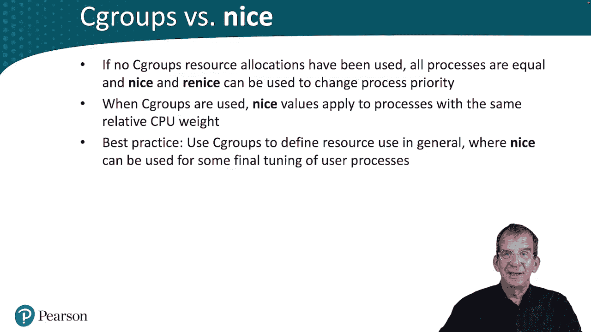
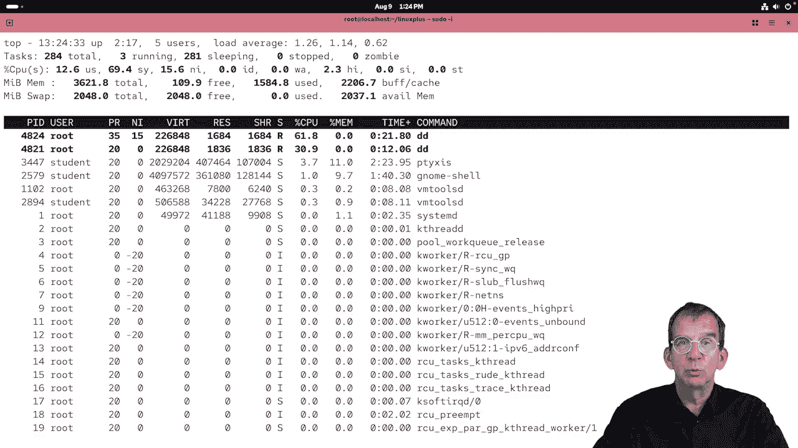

# CompTIA Linux+ V8：第4部分：管理进程优先级和Cgroups🐧

在本节课中，我们将要学习Linux系统中的进程优先级以及控制组（Cgroups）的相关知识。我们会先回顾之前学过的nice命令，然后解释当系统启用Cgroups之后，进程优先级的行为会发生什么变化。最后，我们会通过一个实际的演示来观察nice值和Cgroups共同作用时的现象，帮助你理解在生产环境中应该如何正确分配系统资源。这些内容对理解Linux性能调优非常重要，尤其是在多个应用程序同时运行的服务器环境下。

## 📊 进程优先级的基本概念

上一节我们介绍了一些系统监控的基础知识，本节中我们来看看Linux是如何决定每个进程能分到多少CPU时间的。在Linux系统中，每个运行的进程都会被分配一个优先级。你可以把优先级理解为进程“抢占CPU资源”的权重，数值越小代表优先级越高，数值越大代表优先级越低。CPU调度器会依据这个优先级来决定哪个进程先运行，哪个进程稍后再运行。

如果系统中没有启用Cgroups，也没有进行专门的资源分配配置，那么所有进程在默认情况下被视为平等的。这种平等关系由优先级参数来体现。此时，管理员可以使用`nice`命令或者`renice`命令来修改某个进程的优先级，从而影响它获得CPU时间的多少。`nice`命令用于在启动新进程时设置优先级，而`renice`命令用于修改已经运行的进程的优先级。

核心概念可以用下面的公式来描述：

优先级 = 静态优先级 + nice值

当nice值增大时，进程的优先级会降低，CPU分配给它的时间片会相应减少；当nice值减小时，进程的优先级会提升，能够获得更多的CPU资源。这是一个简单但非常有效的机制，用于在没有复杂资源控制的系统中粗略调整进程之间的竞争关系。

## ⚙️ Cgroups对进程优先级的影响

刚才我们讲解了nice命令可以修改进程优先级，本节中我们来看看Cgroups的引入会如何改变这一机制。Cgroups是Linux内核提供的一种资源控制功能，它允许管理员将进程划分为不同的组，并为每个组设置CPU、内存等资源的使用上限。

当系统中启用了Cgroups并进行了资源分配配置之后，情况就会变得复杂一些。Cgroups允许管理员按照组的方式限制CPU、内存等资源的使用量。在这种情况下，nice值只适用于拥有相同相对CPU权重的进程。换句话说，Cgroups定义的资源限制会优先于nice值所设定的优先级。这意味着，如果两个进程被放在不同的Cgroup中，或者它们的CPU权重不同，那么单纯修改nice值可能无法改变它们实际占用的CPU比例。

以下是nice值和Cgroups之间关系的具体说明：

- 如果两个进程属于同一个Cgroup且拥有相同的CPU权重，那么nice值才会在它们之间起作用。
- 如果两个进程属于不同的Cgroup，或者它们的CPU权重不同，那么修改nice值通常不会改变实际的CPU使用比例。
- Cgroups定义的是整体的资源使用策略，而nice值只是在同一组内部进行微调的手段。

## 💡 最佳实践建议

前面我们讲解了nice值和Cgroups的相互作用，本节中我们来看看在实际工作中应该如何选择。在生产环境中，系统管理员需要在简便性和精确控制之间做出权衡。

根据最佳实践，如果你的系统中已经在使用Cgroups来管理资源，那么建议不要过度依赖nice值。你应该直接使用Cgroups来定义各个应用或服务的资源使用上限，而不是去逐个调整进程的nice值。这样做的好处是资源控制更加统一，也更容易审计和维护。

nice值只有一种比较合适的使用场景：当某个普通用户启动了一个占用资源较大的任务，并且希望降低这个任务的优先级，以免影响其他用户或系统服务时，可以使用nice或renice命令来降低该任务的优先级。除此之外，大多数资源控制应该交给Cgroups来处理，因为Cgroups能够提供更粒度、更可预测的资源隔离效果。

以下是总结的使用原则：

- 优先使用Cgroups定义资源配额。
- 只有在需要为单个用户的重型任务降低优先级时，才使用nice值。
- 不要在已启用Cgroups的系统中混合使用大量的nice值调整，以免造成难以排查的性能问题。

## 🖥️ 演示：nice值在Cgroups环境下的实际表现

刚才我们讨论了理论知识，本节中我们来看看在真实系统中会发生什么。理论分析固然重要，但实际操作中的现象往往能更直观地说明问题。

为了演示这个问题，我将保持`top`命令窗口一直运行，然后重新启动之前课程中讲解过的两个压力测试服务单元，分别是`stress1`和`stress2`。你会看到这两个进程在`top`输出中出现，并且开始占用CPU资源。接下来，我将使用`top`的交互界面，按下`r`键来重新设置某个进程的优先级。假设我们选择PID为4824的进程，将其nice值设置为15。这意味着我们正在刻意降低这个进程的优先级，希望它占用更少的CPU资源。

按照常规认知，修改nice值之后，我们应该能够观察到CPU使用率、优先级数值（PRI）以及nice值（NI）发生变化。然而，在启用了Cgroups的系统中，你会发现一个有趣的现象：虽然`top`显示PRI和nice值已经发生了变化，但是该进程实际的CPU使用率却没有任何变化。这种现象看起来像是命令没有生效，但实际上是Cgroups的限制起了作用。

以下是观察到的关键现象：

- PRI数值发生了变化，表示优先级参数被修改。
- nice值也变成了我们设置的15。
- 但是CPU使用率百分比保持不变。

这就是因为Cgroups的资源限制优先级更高，它覆盖了nice值的作用。当你在启用了Cgroups的系统中使用nice命令时，必须牢记这一点，否则可能会误以为优先级调整已经生效，从而做出错误的性能调优决策。

## 📝 总结

本节课中我们一起学习了进程优先级的基础知识，理解了nice命令和renice命令的作用方式，并重点探讨了Cgroups对nice值的影响。我们了解到，在未启用Cgroups的系统中，所有进程默认平等，nice值可以直接改变进程优先级；而在启用了Cgroups的系统中，nice值仅在相同CPU权重的进程之间有效，大多数情况下应当优先使用Cgroups来定义资源使用。最后通过演示也验证了，在Cgroups环境下修改nice值可能不会改变实际的CPU使用率。希望这些内容能帮助你在实际工作中更好地管理Linux系统的进程资源。

