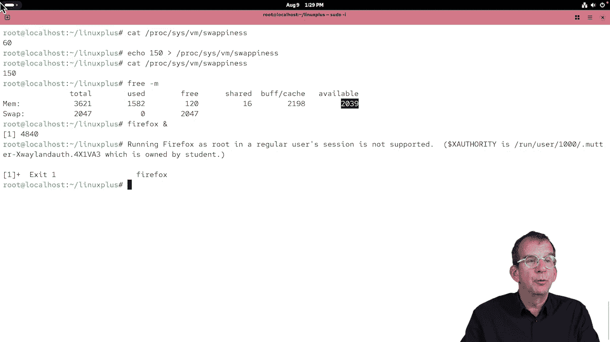
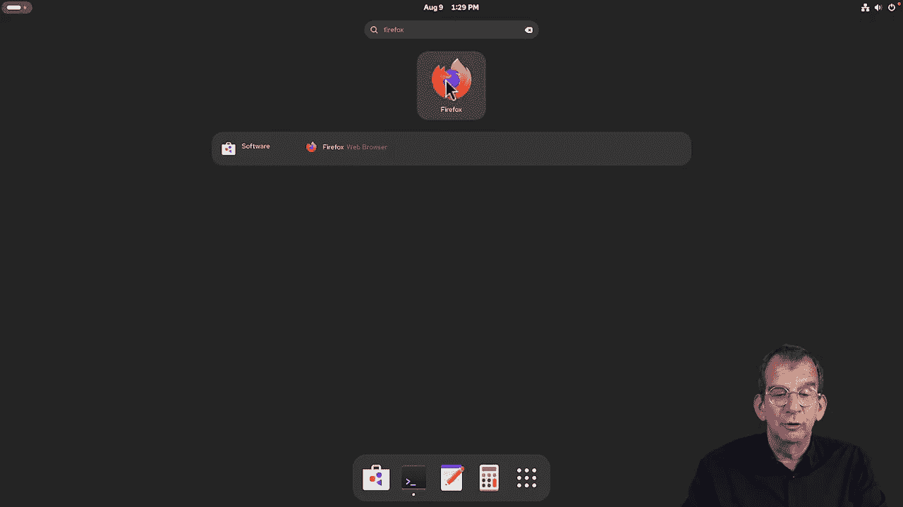
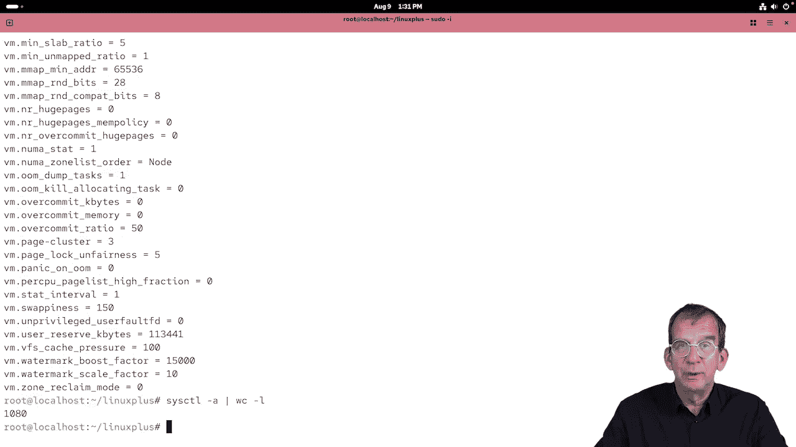

🐧 CompTIA Linux+ V8：第20节：调优内核参数

在本节课中，我们将一起学习如何调优 Linux 内核参数。内核是操作系统的核心部分，负责管理内存、进程和硬件资源。通过调整内核参数，系统管理员可以根据实际使用场景优化系统性能，让服务器或桌面系统运行得更高效。本节内容适合初学者，我们会用大白话解释每一个概念，并演示具体的操作步骤，帮助你快速上手。

## 什么是内核参数调优

进入正题之前，我们先来了解内核调优的基本原理。其实，内核调优的总体工作方式并不复杂。Linux 内核内置了大量可以调整的设置，这些设置可以通过 proc 接口进行修改。proc 接口是一个特殊的伪文件系统，它把内核内部的配置项以文件的形式呈现出来，这样我们就可以像读写普通文件一样来查看和更改内核行为。

## 了解 proc 接口

本节中我们来看看 proc 接口的具体作用。关于 proc 接口的更多细节，建议查阅 man proc 手册页面。因为可修改的参数数量非常庞大，根本不可能全部记住，所以在实际操作时，通常只需要关注当前任务相关的参数即可，不必试图一次性掌握所有内容。

## 实时修改内核参数

接下来，我们来看看如何直接修改内核设置。如果你想更改某个设置，最直接的方法就是把新值写入到对应的 Proc 文件中，修改会立即生效。这种做法非常适合用来验证自己是否走在正确的轨道上，比如在改动某个特定参数后，立刻观察系统反应。

```bash
echo 新值 > /proc/sys/对应/参数
```

## 示例：swappiness 参数

为了让你更直观地理解，本节中我们来看看 swappiness 参数这个具体例子。swappiness 参数告诉内核在内存不足时应该采取什么策略。它的取值范围是 0 到 200，数值越接近 0，表示内核会优先回收活跃缓存，尽量避免使用交换空间；数值越接近 200，表示内核会倾向于把不活跃的内存页面移到交换分区，从而腾出更多物理内存。例如，写入 30 是一种比较保守的设置，适合大多数一般工作负载。

```bash
/proc/sys/vm/swappiness
取值范围：0 ~ 200
```

## 使用 sysctl 工具

在完成参数写入并验证有效之后，我们还需要了解 sysctl 工具。那么 sysctl 到底是什么呢？sysctl 是一个用于简便管理 proc 参数的接口工具。建议先执行 sysctl -a，这样可以查看系统上当前所有可用于调优的设置。需要注意的是，显示出来的具体设置内容，会根据系统上安装的软件和硬件情况有所不同。

```bash
sysctl -a
```

## 参数名与 proc 路径的对应关系

接下来，我们来看看 sysctl 输出的参数名称到底代表什么。sysctl -a 输出中显示的每一项其实都是文件名，这些文件名相对于 /proc/sys 目录，只不过把目录和文件之间的斜杠分隔符替换成了点号。所以，/proc/sys/vm/swappiness 在 sysctl -a 中就会显示为 vm.swappiness。

```text
/proc/sys/vm/swappiness 等价于 vm.swappiness
```

## 使设置持久化

如果你希望重启后设置依然有效，就需要让参数持久化。你可以将参数写入 /etc/sysctl.conf 文件，或者在 /etc/sysctl.d/ 目录中创建一个 drop-in 文件。例如，写入 vm.swappiness = 60，文件名可以任意，只要以 .conf 结尾即可，系统会自动读取。激活更改的方法有两种，一种是重启系统，另一种是使用 sysctl -p 读取配置文件。

```bash
vm.swappiness = 60
文件路径：/etc/sysctl.d/任意名称.conf
```





## 实际操作演示

现在，让我们进入实际演示环节。首先，使用 cat 命令查看 /proc/sys/vm/swappiness 当前的值，默认通常是 60。接着，执行 echo 150 > /proc/sys/vm/swappiness 来修改这个值。之所以要用 echo 写入，是因为 proc 是一个伪文件系统，不是真实的磁盘文件系统，所以读写规则与普通文件不同。

```bash
cat /proc/sys/vm/swappiness
echo 150 > /proc/sys/vm/swappiness
```

修改完成后，我们可以用 cat 再次查看确认新值已经生效，接下来就可以开始测试了。比如，可以使用 free -m 命令查看交换分区的使用情况。在内存仍然充足的情况下，即使把 swappiness 调高，你可能仍然会发现系统几乎没有使用交换空间，这很正常，因为系统还有大约 2GB 可用内存，优先使用物理内存是合理的。如果想观察交换行为，可以尝试启动 Firefox 等占用内存较大的程序，不过这里演示中因为权限问题未能成功启动，后来改用图形界面启动，但结果显示交换依然没有被使用，系统继续依赖可用内存。

```bash
free -m
```

 proc 设置的特点就在于此，修改参数后，你可能会觉得自己走错了路，因为现象不明显，但唯一的验证方法就是实际测试。我会忽略刚才的测试结果，假设这就是我想要的最终设置。接下来，我会在 /etc/sysctl.d/ 目录下创建一个名为 swappiness.conf 的文件，把 vm.swappiness = 150 写入其中。使用参数名加上 .conf 后缀是个不错的命名约定，当然这只是建议，你也可以根据自己的习惯选择其他文件名。

## sysctl -a 概览

最后，我们来看看 sysctl -a 的输出概览。实际上，因为我已经手动设置了参数，所以不一定非要执行 sysctl -p 来生效。不过 sysctl -a 非常有用，它能让你一眼看到系统上所有不同的可调参数。在这台系统上总共有 1080 个参数，数量通常会在 1000 个左右。可调参数如此之多，以至于利用这些参数优化系统本身就是一门独立的艺术，而本视频就不再进一步探讨这门艺术了。

```bash
sysctl -a
```

## 总结



在本节课中，我们一起学习了如何调优 Linux 内核参数。我们了解了 proc 接口的基本原理，学习了如何使用 echo 实时修改参数，重点介绍了 swappiness 参数的含义和取值范围，掌握了 sysctl 工具的使用方法，并学会了如何通过配置文件让设置持久化生效。希望这些内容能帮助你初步入门内核参数调优，在实际工作中根据需要进行合理调整。

