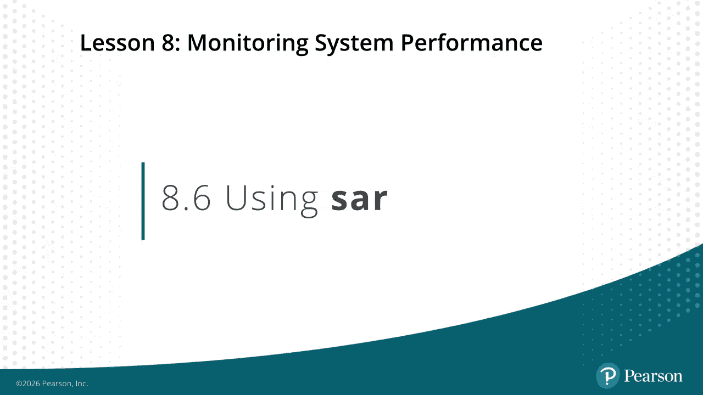
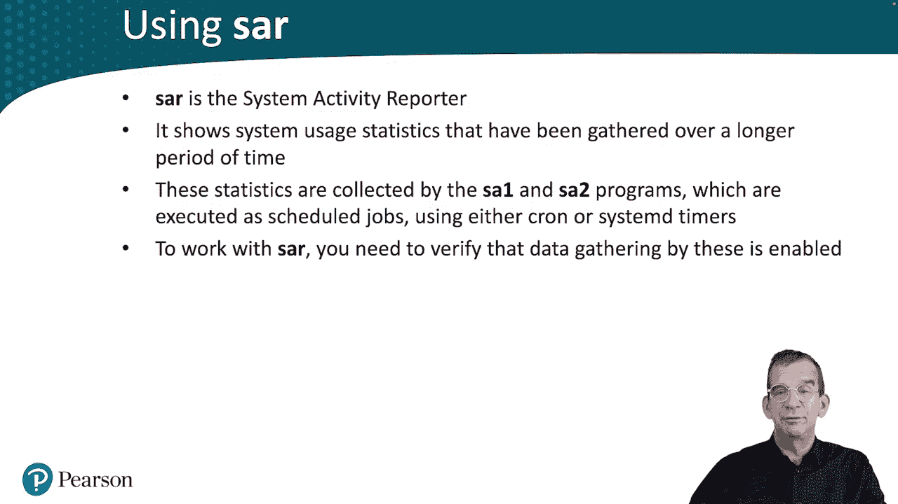
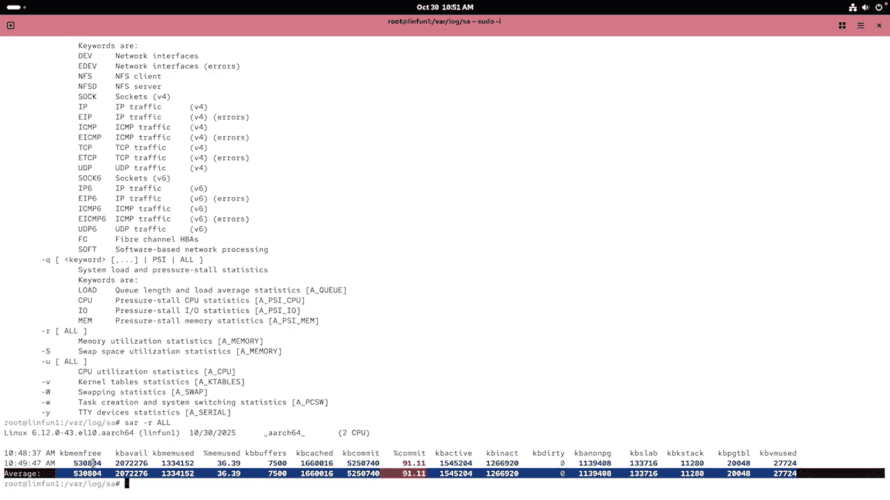

📊 CompTIA Linux+ V8：321：使用 sar 查看系统活动报告

在本节课中，我们将学习如何使用 sar 工具查看系统活动报告。你将了解 sar 和 top 命令的区别，学习如何安装和配置系统状态统计软件包，掌握如何启用数据采集定时任务，最后学会使用 sar 命令查询 CPU、内存、网络和存储设备的长期使用趋势。

什么是 sar 及其作用

sar 的全称是 System Activity Reporter，中文意思是系统活动报告工具。它的主要作用是展示经过较长时间采集后的系统使用统计信息。相比之下，top 命令只能显示当前时刻的系统状态，最多只能给你最近 1、5 和 15 分钟的平均负载数值。如果你需要了解服务器在过去几天甚至几周内的资源使用情况，top 就无法满足需求，而 sar 正好可以填补这个空白。

sar 能够收集关于系统几乎所有方面的信息，并为你提供计算机资源利用率的长期趋势。这意味着你不仅能看到当前的 CPU 使用率，还能回顾过去某段时间内的内存、网络和磁盘使用情况。

数据采集的工作原理

这些统计信息并不是凭空产生的，而是由 sa1 和 sa2 两个程序负责采集的。这两个程序会作为计划任务定期运行，具体可以通过 cron 或者 systemd 定时器来触发。如果你想使用 sar，首先需要确认这些工具的数据采集功能已经被启用，否则 sar 将无法为你提供任何有意义的报告。

以下是 sar 与 top 的主要区别对比：

- 数据时间范围：top 显示当前和最近几分钟的平均值，sar 显示长期历史数据
- 采集方式：top 实时读取内核信息，sar 依赖后台程序定期写入日志
- 适用场景：top 适合排查当前卡顿，sar 适合分析周期性性能问题

安装 sysstat 软件包

要开始使用 sar，首先需要在系统上安装相应的软件包。在 SUSE 系统中，你可以使用 zypper 命令来完成安装，具体命令如下：

sudo zypper install sysstat

安装完成后，你还不能立刻看到完整的 sar 报告，因为安装软件包本身并不会自动生成历史数据。你还需要确保后台的数据采集服务已经就绪，否则 sar 执行时会提示找不到日志文件。

检查系统定时器

在使用 sar 之前，我们需要确认系统中是否存在负责数据采集的 systemd 定时器。你可以使用以下命令列出所有 systemd 定时任务：

systemctl list-unit-files --type=timer

执行该命令后，你应该能在输出结果中看到名为 sysstat-collect.timer 的条目，并且它的状态显示为 enabled。虽然定时器已经启用，但它属于计划任务，这意味着你需要等待一段时间才能等到下一次自动触发。如果你不想等待，也可以手动触发与之关联的服务。

手动运行数据采集

为了让 sar 尽快生成数据文件，我们可以手动运行负责数据采集的服务。由于该操作需要管理员权限，请使用 sudo 来执行：

sudo systemctl start sysstat-collect.service

手动运行完成后，建议再等待一分钟，然后再次运行同样的命令。之所以要运行两次，是因为第一次运行主要会在日志目录中创建文件头信息，而真正的采集数据通常是在第二次运行后才被写入的。

接下来我们来检查数据是否已经生成。在 Linux 系统中，sar 的日志文件默认保存在 /var/log/sa 目录下，文件名通常以当前日期命名。例如，如果今天是 30 号，那么生成的文件就会是 sa30。你可以使用以下命令查看该目录：

ls -l /var/log/sa/

在输出中，你应该能找到名为 sa30 的文件，其体积大约为 4 KB 左右。这只是数据采集的开始，随着时间推移，文件体积会逐渐增大，记录的内容也会更加丰富。

使用 sar 查看系统报告

现在数据已经准备就绪，你可以使用 sar 命令来查看详细的系统使用情况。最常见的用法之一是加上 -a 选项，命令如下：

sar -a

执行 sar -a 后，你将看到包括 CPU 利用率、网络接口利用率、存储设备利用率在内的大量信息。如果你只想查看内存利用率统计，可以尝试使用 -r 选项：

sar -r

关于 sar 支持的所有选项，你可以通过帮助命令来查询：

sar --help

每一项系统利用率指标都可以通过 sar 来查询。当多组数据被采集后，sar 会以清晰的列表形式展示结果，并且你可以直接看到平均值。平均利用率的计算公式如下：

平均利用率 = 所有采样点的利用率总和 / 采样点总数

不过需要注意的是，仅基于一次数据采集得出的平均值参考价值不大。sar 真正强大的地方在于它能揭示长期趋势。例如，如果你怀疑服务器每天晚上 2 点会出现性能高峰，sar 将能够帮你验证这一猜测。这正是 sar 变得极其有用的原因。

总结

本节课中我们一起学习了什么是 sar，以及它与 top 命令的区别。我们介绍了数据采集由 sa1 和 sa2 程序通过定时任务完成的原理，演示了如何安装 sysstat 软件包，如何检查 systemd 定时器，如何手动触发数据采集服务，以及如何查看生成的 sa30 日志文件。最后，我们学习了使用 sar -a、sar -r 和 sar --help 来查询系统资源利用率，并理解了 sar 在分析长期性能趋势方面的独特价值。
