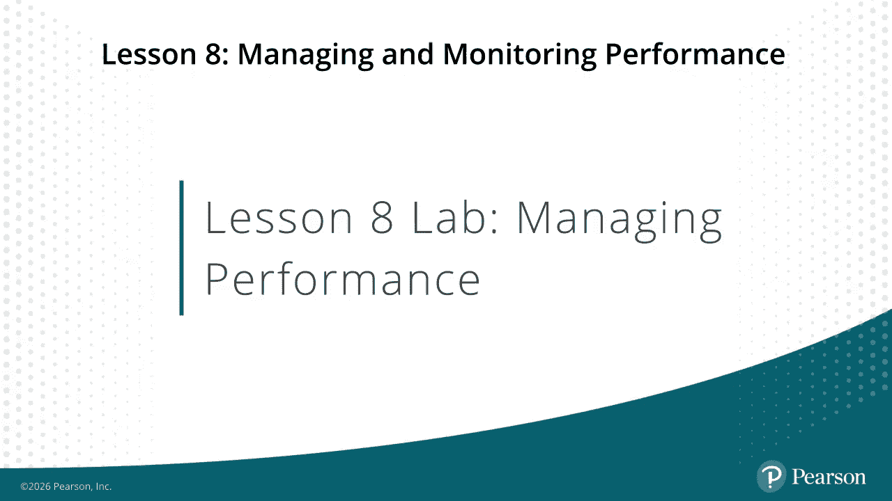
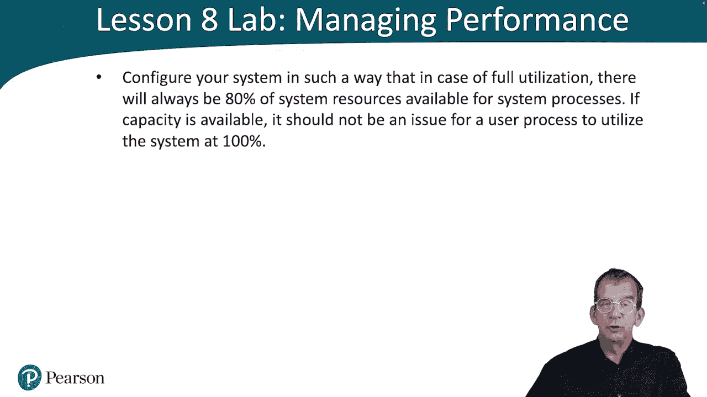

# ⚙️ CompTIA Linux+ V8：第08章：系统性能管理实验

在本节课中，我们将一起学习如何在 Linux 系统中进行性能管理实验，重点是配置系统资源的分配策略，使系统在繁忙和空闲两种状态下都能表现得合理。这节课适合刚接触 Linux 性能调优的初学者，内容不涉及过于复杂的命令，主要讲解资源保留和弹性使用的基本思路。

---

## 实验概述

好了，现在是实验时间了。在这次实验中，你将配置你的系统，使其在资源使用达到饱和状态时，依然能够保障核心服务的正常运行。具体来说，实验的目标是让系统在任何高负载场景下，都为系统自身的进程预留固定比例的资源，同时在系统负载较低时，不限制普通用户进程对资源的使用。


这句话包含三层含义。第一，这是一个动手实验，你需要亲自操作系统配置。第二，你要配置的是系统在“全负载”情况下的行为。第三，配置完成后，系统进程在资源紧张时必须始终能分到 80% 的资源，而用户进程在资源有空闲时可以使用系统的 100% 资源，不会受到不必要的限制。

---



## 核心概念

上一节我们介绍了系统性能监控的基本方法，本节中我们来看看如何通过配置来管理资源分配。以下是本次实验需要掌握的核心原则。

- 系统满载时，必须为系统进程保留 80% 的系统资源，确保内核服务、后台任务和管理工具不会因资源耗尽而失效。
- 当系统有空闲容量时，用户进程可以使用系统的 100% 资源，不会受到不必要的限制。

用简单的公式来表示，假设系统总资源为 100%：

```
系统进程保留资源 = 总资源 × 80%
用户进程可用资源（满载时） = 总资源 - 系统进程保留资源
用户进程可用资源（有空闲时） = 总资源 × 100%
```

这里的“系统资源”可以理解为 CPU 时间、内存或 I/O 带宽等计算机硬件能力。系统进程是指运行在后台、维护操作系统正常运行的进程，比如系统日志服务、网络管理服务等；用户进程则是你或其他普通用户启动的程序，比如文本编辑器、浏览器或自定义脚本。

---

## 配置思路

在实际操作前，我们需要先理清配置的逻辑顺序。以下是实验中需要遵循的思路。

首先，确定系统当前的总资源容量，包括 CPU 核心数、内存大小和磁盘 I/O 能力。
其次，为系统进程设置资源下限或保留比例，确保即使在全负载情况下，这 80% 的资源始终可用。
最后，检查用户进程在系统空闲时是否能够无阻碍地占用剩余甚至全部资源，避免出现人为设置的不必要上限。

这个思路听起来可能有点抽象，但你可以把它想象成一家餐厅的厨房管理：厨房总共只有 100 名厨师，其中 80 名必须随时留给店里的后勤工作（比如洗碗、备菜、清理），剩下的 20 名可以接顾客的单子；但如果现在没有顾客，那 80 名后勤厨师空出来的时候，也可以临时帮忙做菜，只要不影响后勤工作即可。

---

## 实验目标总结

在开始动手配置之前，请再次确认你要达成的目标。以下是本次实验的预期结果。

- 当系统资源使用率达到 100% 时，系统进程依然能够获得 80% 的资源。
- 当系统有闲置资源时，用户进程不会被限制，可以使用高达 100% 的系统资源。



---

## 结语

本节课中我们一起学习了系统性能管理实验的基本目标和配置思路。我们了解到，在资源满载时需要为系统进程保留 80% 资源，而在资源充足时用户进程可以使用系统的 100% 资源。希望这些内容能帮助你更好地理解 Linux 系统是如何平衡系统进程与用户进程之间资源竞争的。

