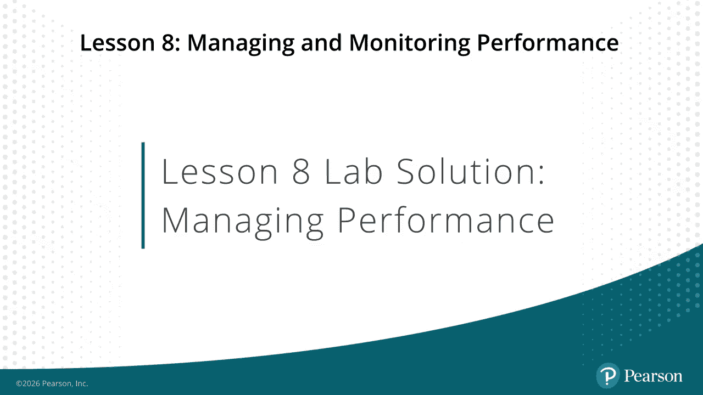
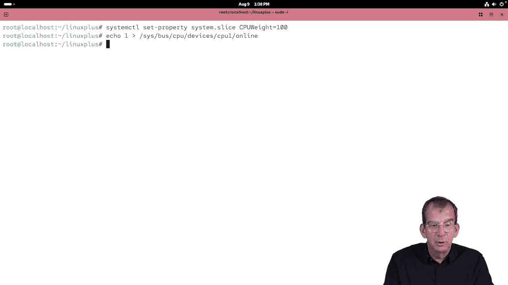

# 🖥️ CompTIA Linux+：Lesson 8：实验解答：管理系统性能



在本节课中，我们将一起学习如何在Linux系统中管理进程性能，重点掌握systemd slice的CPU权重设置，如何启动测试服务，使用top命令观察资源占用，最后学会把系统恢复到最初状态。这节课专门为初学者准备，会用大白话把每一步都讲清楚，不会留下任何难懂的地方。

## 📊 第一步：计算并设置system slice的默认CPU权重

首先，我们要处理最基础的问题，就是搞清楚系统slice的默认CPU权重是多少。在systemd中，每个slice都有一个默认的CPU权重值，这个值决定了服务在竞争CPU时的优先级。对于大多数系统来说，这个默认值就是100，而且这个规则不仅适用于slice，也适用于运行在上面的各种服务。如果我们想让system slice的优先级变成默认值的四倍，那么就需要手动调整它的CPU.Weight属性。这时候就需要用到systemctl set-property命令，把system.slice的CPU.Weight设置为400，因为100乘以4正好等于400。这样系统级服务在抢CPU的时候，就能分到更多的调度资源，性能表现也会相应提升。

以下是具体的操作命令：

```bash
systemctl set-property system.slice CPU.Weight=400
```

这条命令的意思是，把system.slice这个系统切片的CPU权重直接改成400，让它比普通服务更有优先权。核心计算可以用下面这个简单公式表示：

CPU.Weight = 默认权重 × 倍数 = 100 × 4 = 400

## ▶️ 第二步：启动测试服务并观察资源占用

设置完权重之后，下一步就是启动一个测试用的服务，看看配置是否生效。这里要特别注意，必须把测试任务以systemd单元的方式启动，只有这样才能保证它确实运行在system slice里面，而不是其他地方。如果直接在终端里跑命令，进程可能会被放到用户slice，那就失去实验意义了。接下来我们启动stress1.service，然后用dd命令和一个简单的脚本来制造一点负载，好让我们有东西可以观察。

以下是启动测试服务和制造负载的命令：

```bash
systemctl start stress1.service
dd if=/dev/zero of=/dev/null
while true; do true; done
```

这里的dd命令会持续读取零设备并写入空设备，产生一定的系统开销；而while true; do true; done是一个非常简单的循环脚本，它本身不会产生太多开销，主要用来和dd做对比。一切准备好之后，我们就可以使用top命令来查看当前的资源占用情况了。

使用top命令观察：

```bash
top
```

在top的输出中，我们会看到dd进程大约占用了80%的CPU资源，而那个简单的循环脚本大约占用了20%。这个结果说明，CPU权重设置已经起作用，系统正在按照我们配置的比例分配资源。

## 🔍 第三步：认识root进程的实际运行位置

这时候我们用top观察，会发现一个很有意思的现象。实验中有一个以root身份运行的shell进程，但实际上它运行在user slice里面，并不在system slice里面。很多初学者会下意识地认为，root权限的进程应该都跑在system slice，但事实并非如此。系统slice主要是给系统级服务使用的，就算是root用户打开的普通终端 shell，也会被放到用户slice中运行。这点很重要，理解了它才能避免在排查性能问题时走弯路。

## 🧹 第四步：清理现场并恢复系统默认状态

实验做完了，不能就这么离开，必须把环境还原回去，否则会对后续操作造成干扰。我们需要把之前启动的进程全部结束，并把修改过的权重改回默认值，同时让之前关闭的CPU重新上线，使系统恢复成双CPU状态。

以下是需要执行的恢复步骤：

- 首先，杀死dd进程，停止它持续产生的负载。
- 接着，在top中找到并杀死刚才启动的那个循环脚本进程，它的PID可能是47或者57。
- 如果普通杀掉的方法没用，进程总是自动回来，那是因为while true; do true; done是一个无限循环，脚本会不断重启，需要确认进程已经彻底消失。
- 最后，不要忘记把CPU.Weight设回默认值100，并让CPU1重新上线。

以下是恢复默认权重和上线CPU的命令：

```bash
systemctl set-property system.slice CPU.Weight=100
echo 1 > /sys/devices/system/cpu/cpu1/online
```

第一条命令把权重改回100，第二条命令让CPU1重新上线，这样系统就又变成了两个CPU可用的状态，实验环境也就完全恢复原样了。

## 📝 本节课总结



本节课中我们一起学习了system.slice的CPU权重设置方法，如何用systemd单元启动测试服务，使用top命令查看进程资源占用，以及root shell进程实际上运行在user slice而不是system slice这一关键点。最后我们还学会了杀掉多余进程、恢复默认CPU权重和重新上线CPU，把系统带回最初状态。希望通过这节课，你对Linux性能管理有了更直白的认识。

