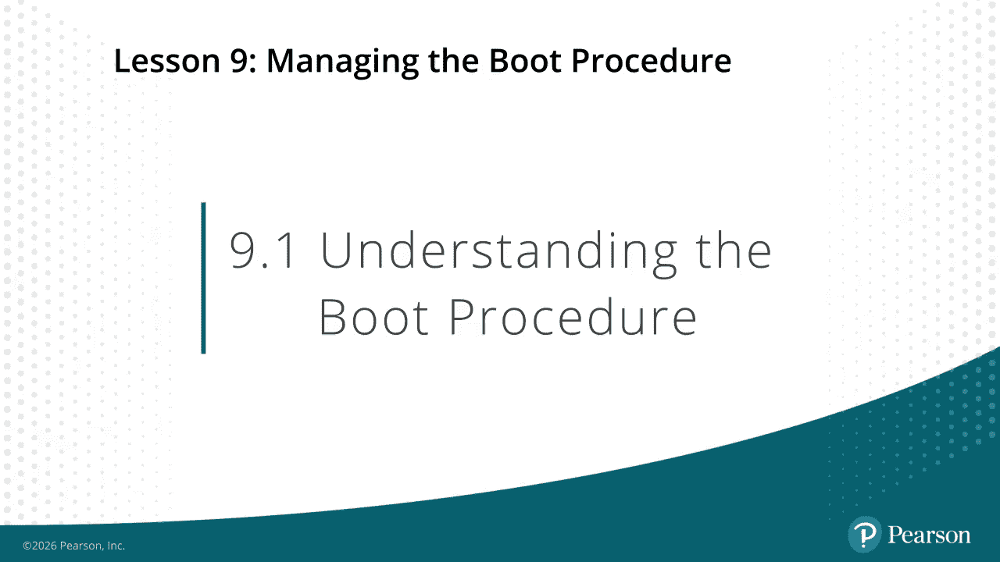
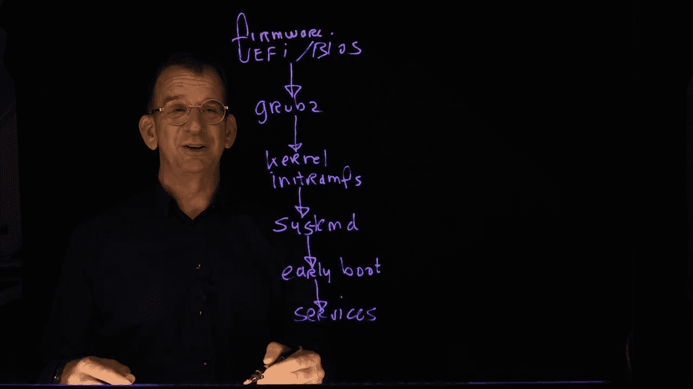

# 🐧 Linux启动流程：01：理解Linux引导过程

在本节课中我们将要学习Linux系统启动的完整过程。本节课会把电脑按下电源键到最终能够登录系统之间发生的所有事情，用大白话讲清楚。我们会从固件开始，一步步看到引导加载程序、内核、系统管理器，直到用户登录 shell 的整个链条。如果你是初学者，不用担心，所有概念都会用简单的语言解释，并且会保留每一步的含义，方便你跟上思路。

接下来我们先来看看启动过程的最起点，也就是固件部分。



## 启动的起点：固件

启动过程的第一步是固件。固件简单来说，就是写在电脑硬件里面的软件，它控制硬件的最基本工作，而且不需要操作系统也能运行。当你按下电源键时，电脑不是直接跑 Linux，而是先跑固件。固件负责检查硬件是否正常，比如内存和硬盘是否能正常工作，然后把控制权交给下一阶段。

从固件之后，你会进入到两种固件接口之一，也就是 UEFI 或者 BIOS。这两者都是固件提供的接口，用来初始化硬件并决定从哪里启动系统。对于 Linux 来说，真正有趣的部分就从这里开始，因为接下来才会涉及到操作系统本身的加载。

以下是固件阶段的关键点：

- 固件是运行在硬件上的底层软件
- 电脑上电后先执行固件代码
- 固件提供 UEFI 或 BIOS 接口供后续使用
- 固件完成自检后，准备加载引导程序

## 引导加载程序加载内核

固件完成工作之后，接下来 Linux 启动流程中最关键的一步是从硬盘上加载引导加载程序。在这里，引导加载程序通常指的是 GRUB2，也就是 Grand Unified Boot Loader 版本 2。GRUB2 的任务是把内核从硬盘读取到内存中，并准备启动它。

内核加载完成后，不会单独运行，而是会连同初始 RAM 文件系统一起加载。初始 RAM 文件系统是一个临时的小型文件系统，内核用它来加载启动所需的驱动程序和模块，这样才能真正访问硬盘上的根文件系统。

核心流程可以用这个简单的伪代码表示：

```text
固件 -> UEFI/BIOS -> GRUB2 -> 内核 + initramfs
```

以下是这一阶段涉及的主要组件：

- 固件：硬件层面的启动程序
- UEFI/BIOS：固件提供的标准接口
- GRUB2：加载内核的引导加载程序
- 内核：操作系统的核心部分
- initramfs：初始 RAM 文件系统，提供早期驱动支持

## 从 PID 1 到 systemd

内核和 initramfs 加载好之后，内核会启动第一个进程，也就是 PID 1。PID 1 是系统中所有进程的祖先，它的职责是启动系统管理器。在现代 Linux 发行版中，这个系统管理器通常是 systemd。

systemd 是一个管理一切的守护进程，它负责启动服务、挂载文件系统、处理日志，以及管理系统状态。没有 systemd，系统就无法正常运行各种后台程序。

核心关系可以简写为：

```text
内核加载 PID 1 -> PID 1 启动 systemd -> systemd 管理系统所有服务
```

以下是 systemd 承担的主要职责：

- 作为系统的第一个进程 PID 1
- 启动和管理系统服务
- 处理设备和挂载点
- 协调系统进入不同运行状态

## 早期启动与用户登录

systemd 接管系统之后，启动过程会分为两个明显的阶段。第一个阶段叫早期启动，也就是 early boot。早期启动的目的是准备系统运行所需的最基本环境，包括加载必要的驱动、挂载关键文件系统、启动最核心的服务。

早期启动完成之后，系统会进入第二个阶段，也就是加载各种服务单元和目标单元。这里所说的 surfaces，实际上是指系统服务和目标。当这些服务加载完毕之后，系统会启动 shell。shell 是用户和系统交互的接口，用户就是在 shell 里面输入用户名和密码完成登录的。

以下是启动后期阶段的步骤：

- 早期启动完成基础环境准备
- 加载系统服务和目标单元
- 启动 shell 等待用户输入
- 用户在 shell 中完成登录



## 总结

本节课中我们一起学习了Linux引导过程的完整流程。我们从固件开始，了解了 UEFI 或 BIOS 如何提供启动接口，接着看到了 GRUB2 如何从磁盘加载内核，内核又如何借助 initramfs 加载 PID 1，最后由 systemd 接管系统并引导到早期启动和服务加载阶段，最终用户在 shell 中登录系统。希望这些内容能帮助你建立对 Linux 启动流程的直观认识。
