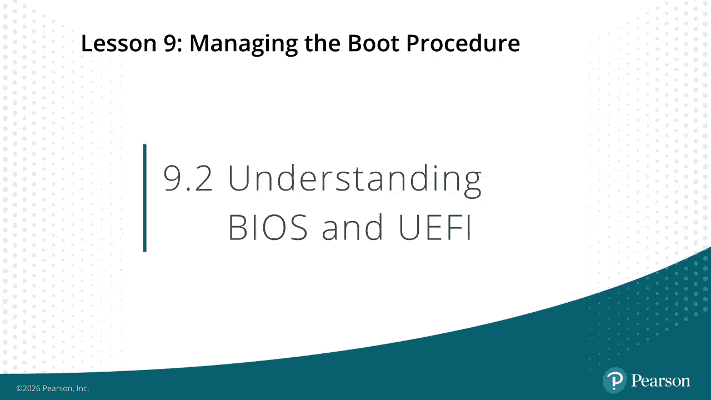
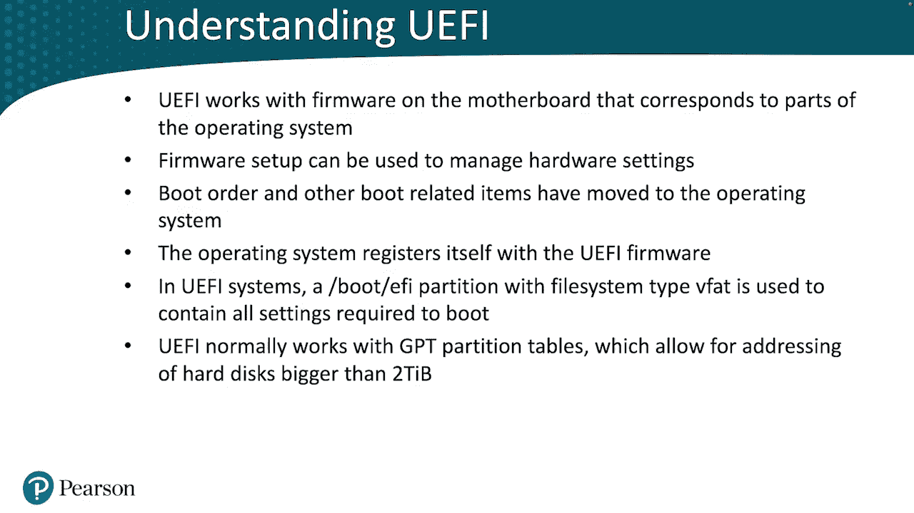

CompTIA Linux+ V8：326.92：理解BIOS和UEFI 🖥️


在本节课中我们将要学习BIOS和UEFI是什么，它们有什么区别，以及计算机在按下电源键之后到底是如何启动的。这两个概念是理解操作系统安装和引导过程的基础，特别是当你准备安装Linux系统时，需要知道电脑是怎么从硬件层面把系统加载进来的。内容会讲得比较基础，适合完全没有接触过这些术语的新手阅读，不用担心看不懂。


## 什么是BIOS？ 🔧

BIOS是计算机里非常老牌的一套启动标准，它的全称是基本输入输出系统。你可以把它理解为电脑最早期的“启动向导”，它负责在操作系统启动之前，先把各种硬件设备初始化好。这个标准是在1981年发明的，那时候个人计算机才刚刚兴起，所以它陪伴了PC很多年，成为了早期电脑启动的默认方式。

```text
BIOS = Basic Input Output System
BIOS类型 = 传统启动方法
发明年份 = 1981
```


## BIOS的工作原理 ⚙️

在老式BIOS模式下，计算机的硬件设置会被写入到一种叫做CMOS的存储区域里，并且通过BIOS来进行管理。用户通常需要在开机时按下某个特定的设置键，比如Del或者F2，才能进入BIOS设置界面。在这里你可以调整硬件参数，也可以告诉电脑从哪个设备启动，从而完成引导设备的选择。

```text
硬件设置 --> CMOS --> 通过 BIOS 进行管理
进入BIOS方法 = 开机时按特定设置键
```


接下来我们看看BIOS是如何识别启动盘，并确定启动顺序的。

以下是BIOS启动时的几个关键步骤：
- 电脑上电之后，BIOS会先读取CMOS中保存的硬件设置；
- 系统通过BIOS设置界面识别可启动的光盘或硬盘；
- 启动顺序被保存在主引导记录，也就是MBR之中；
- MBR的大小是512字节，存放在系统的主硬盘上；
- BIOS根据MBR中的信息，确定哪个分区是启动分区，然后加载操作系统。

```text
MBR = Master Boot Record
MBR大小 = 512 bytes
MBR位置 = 系统主磁盘
启动分区 = 由 BIOS 根据 MBR 信息指示
```


## 传统的操作系统加载器 📦

在Linux系统里，操作系统加载器负责把内核从硬盘读入内存，让系统真正运行起来。现在的Linux发行版默认使用GRUB2作为加载器，但早些时候还有LILO这种老旧的加载器。关于分区表，传统的MBR只提供了64个字节来保存分区信息，这在今天的大硬盘时代显然已经不够了。

```text
Linux 默认加载器 = GRUB2
旧版加载器示例 = LILO
MBR 分区表可用空间 = 64 bytes
```


BIOS虽然使用了很多年，但它也有明显的局限性，比如对大容量硬盘的支持不够好。于是后来出现了更新的UEFI标准，下面我们来看看UEFI是什么。


## 什么是UEFI？ 🚀

UEFI是比BIOS更新的固件标准，大约在2010年左右开始普及。它直接运行在主板的固件层面，可以理解为BIOS的现代替代品。UEFI不仅能管理硬件设置和启动顺序，还把很多和启动相关的工作交给了操作系统自己处理，启动流程变得更加灵活。

```text
UEFI = Unified Extensible Firmware Interface
UEFI 工作位置 = 主板固件
UEFI 引入年份 = 2010
```


在UEFI系统里，目录结构和分区方式跟BIOS时代不太一样，下面来看具体是怎么变化的。

以下是UEFI系统与BIOS系统在启动设置上的主要区别：
- UEFI系统会固定包含一个名为 /boot/efi 的目录；
- 这是操作系统标准规定的目录，所有操作系统都必须存在；
- 该目录用于保存启动操作系统所需的固件设置；
- 操作系统本身也必须向UEFI固件注册，才能完成启动；
- 除了上面的目录，UEFI系统还会划出一个挂载点为 /boot/EFI 的分区。

```text
UEFI 标准目录 = /boot/efi
UEFI 引导分区 = /boot/EFI
分区文件系统类型 = VFAT
操作系统必要动作 = 向 UEFI 固件注册
```


最后说说分区表，因为UEFI和传统BIOS在这方面差别很大，直接影响你能用多大的硬盘。


## UEFI与GPT分区表 💾

UEFI通常和GPT分区表搭配使用。GPT是一种新的分区表标准，它最大的好处就是能够识别和使用容量超过2TB的大硬盘，而旧的MBR分区表做不到这一点。所以如果你现在买的是大容量硬盘，并且主板支持UEFI，基本上都会用GPT分区表来组织数据。

```text
UEFI 通常搭配 = GPT 分区表
GPT 支持的磁盘容量 > 2 TB
MBR 支持的磁盘容量 <= 2 TB
```


下一节视频我们会继续讲，怎么在Linux里面操作UEFI相关的内容，敬请期待。





## 总结 📝


本节课中我们一起学习了BIOS和UEFI的基本概念。我们知道了BIOS是1981年的老标准，依靠CMOS保存硬件设置，用MBR作为启动记录，在Linux上默认引导加载器是GRUB2，旧版还有LILO，而且MBR只能提供64个字节保存分区表。接着我们学习了UEFI，它是2010年引入的现代固件标准，运行在主板固件层面，使用 /boot/efi 和 /boot/EFI 分区，文件系统类型是VFAT，操作系统必须向UEFI固件注册，并且通常配合GPT分区表来支持大于2TB的硬盘。希望这些内容能帮你建立起对电脑启动流程的直观认识。

