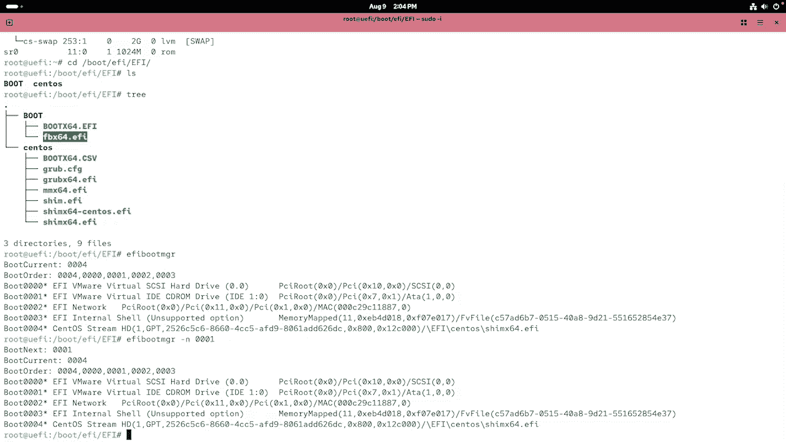

# CompTIA Linux+ V8：327.93：管理和访问UEFI 🖥️

在本节课中，我们将一起学习如何在Linux操作系统里管理和访问UEFI固件。你会了解EF Boot Manager工具的作用，学会如何查看当前的启动条目，掌握如何指定下一次启动进入哪个条目，还会看到EFI分区内部的文件结构，最后了解在无法进入操作系统时，如何通过按键进入启动菜单。

---

在Linux系统中，有一个专门的工具叫做EF Boot Manager，也就是efibootmgr。这个工具的作用是让你直接在操作系统里面管理UEFI启动目标，而不需要每次都重启电脑然后去BIOS界面里找。简单来说，它把UEFI的启动设置带到了Linux命令行里，方便系统管理员进行配置和排查。

以下是EF Boot Manager的核心功能描述：

```bash
efibootmgr
```

运行上面这条命令，系统会列出当前所有的UEFI启动条目，并用星号标记当前处于活动状态的那个条目。如果你想查看更详细的信息，可以使用下面的命令：

```bash
efibootmgr -V
```

这里的-V参数会显示更多细节，帮助你确认每个启动条目对应的设备和路径。

---

查看完启动条目之后，你可能想在下一次重启时改变启动顺序，或者临时启动到某个特定的条目。这时候可以使用efibootmgr的-n选项，它的作用是强制系统在下一次启动时进入你指定的启动条目，而不需要修改永久的启动顺序。

假设你通过前面的命令识别出了某个启动条目，比如编号是0001，那么你可以使用下面的命令来设置下一次启动的目标：

```bash
efibootmgr -n0001
```

执行完这个命令后，系统会记录“下次启动进入0001”这个设置。当你重启电脑时，主板就会按照这个设置去加载对应的操作系统或启动镜像。

---

除了使用命令行工具，你还可以直接查看EFI分区里的文件结构，以便了解系统是如何组织启动信息的。通常我们会先使用lsblk命令列出所有的块设备，找到挂载在/boot/efi目录下的EFI系统分区，比如/dev/sda1。

以下是查看块设备的命令示例：

```bash
lsblk
```

在这个分区里面，你会看到一个名为EFI的子目录，进一步进入之后可以找到具体的操作系统目录，例如centos目录。这些目录中存放的就是UEFI启动所需要的配置文件和引导程序，所有的启动信息都以文件的形式清晰地保存在这里。

---

如果你无法进入操作系统，或者想要手动选择启动设备，那么按键进入启动菜单是一个非常实用的备选方案。大多数计算机在启动过程中，按下某些特定的键就可以打开启动管理器菜单，从而覆盖操作系统里的启动设置。



常见的启动热键包括以下几个：

- Escape
- F2
- F10
- F12

具体哪个键有效取决于你的主板品牌。当你按下正确的键并且保持按住时，屏幕上会出现启动管理器菜单，你可以从中选择要启动的设备或条目。这种方法属于一种硬件层面的覆盖，不依赖于操作系统是否正常运行。

---

在实际操作中，你可以先使用efibootmgr命令指定下一次启动的条目，然后重启电脑。重启的过程中按下Escape键，你就会进入启动管理器菜单。这时候你可以选择等待系统按照刚才设置的条目启动，也可以在合适的时机按下对应的按键，手动进入你想要的启动目标。如果你不打算从光盘或其他介质启动，也可以使用efibootmgr来管理UEFI启动菜单中所有可用的镜像。

---


本节课中，我们一起学习了在Linux中管理和访问UEFI的方法。我们介绍了EF Boot Manager工具及其常用参数，学习了如何查看当前启动条目和设置下一次启动目标，探索了EFI分区内部的文件结构，还了解了在无法进入系统时如何通过按键进入启动菜单。希望这些内容能帮助你更好地掌握UEFI启动管理的基础知识。
