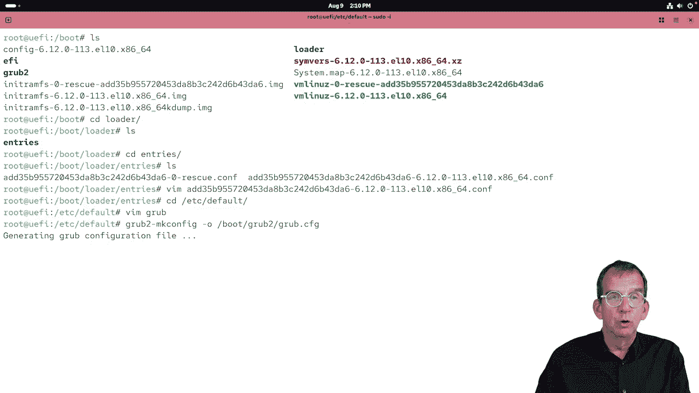

🐧 CompTIA Linux+ V8：28：管理 GRUB2 配置

在本节课中我们将要学习如何管理 GRUB2 配置。GRUB2 是 Linux 系统启动时的核心引导程序，它负责把内核和初始内存盘加载到内存中，决定计算机启动哪个操作系统或哪个内核版本。不管你使用的是 Red Hat 系发行版还是 Ubuntu 系发行版，GRUB2 的基本工作方式都差不多，只是具体的配置文件位置和细节会有一些区别。搞清楚这些内容对运维人员来说非常重要，因为一旦启动配置出错，系统可能就无法正常开机了。

GRUB2 的核心作用可以用下面这个简单的公式来描述：

GRUB2 = 加载内核 + 加载初始 RAM 磁盘 (initrd/initramfs)

在这个公式里，GRUB2 充当启动引导者的角色，把操作系统从硬盘读出来，交给内核去接管后续的运行。如果 GRUB2 无法正常工作，计算机就不知道应该启动哪个内核文件，也就无法进入桌面或命令行界面。

下面是关于 GRUB2 配置文件的说明。

GRUB2 的配置主要依赖一个输入文件，这个文件通常位于 `/etc/default/grub`。除了这个主配置文件之外，还有一些额外的配置设置存放在 `/etc/grub.d/` 目录中。这两个位置共同决定了系统启动时的行为，你可以把它们看作是 GRUB2 的“设置开关”。

从输入文件生成最终的启动配置文件，需要使用以下命令：

```bash
grub-mkconfig -o /boot/grub2/grub.cfg
```

这条命令的作用是把 `/etc/default/grub` 和 `/etc/grub.d/` 中的所有修改，汇总合并到最终的启动配置文件 `/boot/grub2/grub.cfg` 里。简单来说，就是把你在输入文件里做的改动，写入到 GRUB2 实际读取的配置文件中，确保改动能够持久生效。

现在我们来看看具体的操作流程。

一切的起点都在 `/etc/default/grub` 这个文件。在这个文件中，你可以找到 `GRUB_CMDLINE_LINUX` 这一行，里面包含了传递给内核的不同启动选项。不过现在还有一个比较特殊的设置，叫做 `GRUB_ENABLE_BLSCFG=true`。当这个选项被启用后，你就不再需要在 `/etc/default/grub` 的那一行里直接写启动参数了，而需要把相关设置写到别的地方。

接下来我们要进入 `/boot` 目录查看。在 `/boot` 目录下，你会找到系统启动所需的所有内容，其中包括 GRUB2 的配置目录和加载程序目录。这些目录里存放着启动菜单的各个条目，每个条目对应着启动菜单中你能看到的不同启动选项。

以下是 `/boot` 目录中与启动相关的重要内容：

- GRUB2 配置目录
- 引导加载程序目录
- 各个启动菜单条目

以前我们修改启动配置时，直接编辑 `/etc/default/grub` 文件就可以了，但这种做法比较笼统。如果你的系统有多个启动条目，想要指定其中某一个特定的条目，直接改 `/etc/default/grub` 就不够精确了。这时候 `GRUB_ENABLE_BLSCFG=true` 这个选项就派上用场了，它让我们可以针对具体的启动条目进行更细致的配置。

在实际操作中，你需要先找到和当前系统配置对应的那个启动条目。比如在我的系统里，对应的条目可能是类似 `6.6` 这样的内核版本条目。如果你想做一些改动，比如想要去掉 `rhgb` 和 `quiet` 这两个启动参数，就需要进入该条目的选项行，在选项行的末尾把 `rhgb` 和 `quiet` 删掉。

这里有一点非常重要，需要特别注意。

在 `GRUB_ENABLE_BLSCFG` 没有启用之前，修改启动选项很简单，你直接在 `GRUB_CMDLINE_LINUX` 这一行里删掉不需要的参数就行了。但是现在既然启用了 `GRUB_ENABLE_BLSCFG=true`，那种旧方法就不再管用了，直接改那一行不会生效。

现在仍然有效的方法是使用下面这条命令：

```bash
grub-mkconfig -o /boot/grub2/grub.cfg
```



这条命令会把选项写入配置文件，并且确保你的修改被持久化保存。这样一来，当你重启系统时，应该就能看到修改后的效果了。

重启系统时，你会在屏幕左上角看到几秒钟的光标闪烁。这就是我们修改后的效果：以前会显示一个图形化的启动画面，把启动消息都遮挡住了；现在图形画面不再显示，你能直接看到系统启动时的各种消息，知道系统到底在做什么。


本节课中我们一起学习了 GRUB2 配置的管理方法。我们了解了 GRUB2 用于加载内核和初始内存盘，学习了 `/etc/default/grub` 和 `/etc/grub.d/` 这两个配置位置，掌握了使用 `grub-mkconfig -o /boot/grub2/grub.cfg` 生成配置文件的命令，还了解了 `GRUB_ENABLE_BLSCFG=true` 对多启动条目配置的影响，以及如何通过编辑选项行去掉 `rhgb` 和 `quiet` 参数，最后通过重启验证了图形启动画面被隐藏后能直接看到启动消息的效果。

