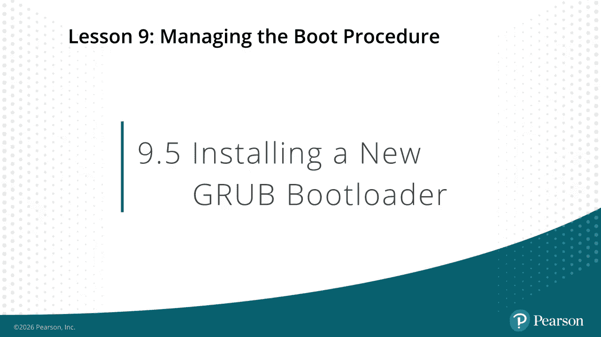
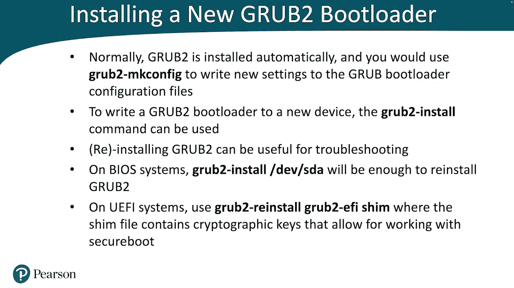

CompTIA Linux+：第329章：安装新的GRUB引导程序 🛠️


本节课我们要学习在Linux系统中如何安装或者重装GRUB引导程序，特别是在系统出现故障无法启动的时候进行修复。我们会分别介绍BIOS系统和UEFI系统的操作方法，还会说明怎么生成引导配置文件，以及UEFI安全启动涉及的加密密钥问题。所有内容都会用大白话讲解，方便初学者理解和上手。




什么时候需要重装GRUB


在日常使用Linux系统时，绝大多数用户都不需要手动去处理引导程序，因为操作系统在安装的时候通常已经自动把GRUB 2装好了，你平时根本不用去担心这件事情。不过在某些故障排除的场景下，比如系统突然无法启动，或者引导配置被错误修改导致开机失败，你就可能需要重新安装GRUB引导程序才能让电脑重新启动起来。安装或者重装GRUB 2确实是解决引导类问题的常用手段之一。


以下是几种比较典型的需要重装GRUB的情况：
- 系统无法正常引导进入操作系统
- 更换了存储设备或者调整了磁盘分区
- 引导配置文件损坏导致启动失败


GRUB 2的日常配置更新


上一节我们介绍了什么时候需要重装GRUB，本节中我们来看看日常如何更新引导配置。如果你只是修改了一些GRUB的设置，比如更改默认启动项或者启动超时时间，通常不需要把整个引导程序全部重装一遍，只需要把新的设置写入到GRUB的配置文件里就可以了。这时候最常用的命令就是生成新的grub.cfg文件，让系统在下次启动时按照新设置来引导。


核心命令如下：
```bash
grub2-mkconfig -o /boot/grub2/grub.cfg
```


这条命令的作用是读取GRUB的配置脚本，然后生成一个新的引导配置文件。执行完之后，你修改过的启动选项就会被保存下来，系统重启后就能按照新配置正常加载了。


将GRUB 2安装到全新设备


了解了如何更新配置之后，本节我们来看看如何把GRUB 2写入到一块全新的磁盘或者设备上。有时候你可能装了一块新硬盘，或者想要把系统迁移到另一块磁盘，这时候就需要把GRUB 2安装到目标设备上，否则电脑开机就不知道从哪里去加载操作系统了。


核心命令如下：
```bash
grub2-install /dev/sda
```


这里的`/dev/sda`代表你要安装引导程序的目标磁盘，你需要根据实际情况确认自己的存储设备名称，千万不要选错盘，否则可能会把引导程序装到错误的设备上。


BIOS系统上的重装步骤


在具体的操作步骤上，BIOS系统和UEFI系统是不一样的，本节我们先看看传统BIOS系统怎么操作。如果你的电脑使用的是老式BIOS固件，重装GRUB 2的过程相对简单，你只需要运行安装命令，指定正确的主磁盘设备即可。不过在执行之前，请务必确认你的主磁盘到底是哪个设备名，因为很多新机器已经不再使用传统的`/dev/sda`，可能是NVMe固态硬盘，设备名通常类似`/dev/nvme0n1`。


核心命令如下：
```bash
grub2-install /dev/sda
```


如果你的主盘是NVMe固态硬盘，命令应该改成这样：
```bash
grub2-install /dev/nvme0n1
```


执行完这个命令之后，GRUB 2就会被写入到磁盘的引导扇区，系统应该就可以重新启动了。你一定要先验证自己的存储设备，确保选中的是主磁盘，而不是数据盘或者U盘。


UEFI系统上的重装步骤


BIOS系统的情况比较直接，但如果是UEFI系统，事情就会复杂一点，本节我们来看看UEFI下的特殊处理。UEFI系统除了要安装引导程序文件之外，还涉及安全启动（Secure Boot）的问题。安全启动要求系统固件信任某些加密密钥，否则引导程序会被拒绝运行。所以在UEFI系统上重装GRUB的时候，你还需要把相关的密钥文件一起重装，最常用的就是shim文件，它里面包含了允许安全启动工作所需的加密密钥。


核心命令如下：
```bash
grub2-reinstall grub2-efi-shim
```


这个命令会重新安装GRUB的EFI引导组件，同时处理shim文件里的密钥，确保安全启动功能能够正常工作。如果你跳过了这一步，即使GRUB本身装好了，系统可能依然无法启动，因为固件不信任这个引导程序。


验证系统能否启动


完成了引导程序的安装或重装之后，最后一步就是确认系统真的可以正常启动了，本节来看看怎么验证。当你在BIOS或者UEFI系统上把GRUB 2重新装好，并且处理好了所有需要的密钥和配置文件之后，之前因为引导损坏而无法启动的系统，理论上应该就能重新开机进入桌面了。如果重启后还是进不去系统，那可能意味着引导程序安装的位置不对，或者磁盘设备名搞错了，这时候需要回头检查前面的步骤。




本节课我们一起学习了在Linux系统中安装或重装GRUB引导程序的方法，包括BIOS和UEFI两种平台的操作区别，如何使用grub2-mkconfig更新配置，如何用grub2-install把引导程序写入新设备，以及UEFI下如何处理安全启动相关的shim密钥。希望这些内容能帮助你在系统无法启动时快速排查并修复引导问题。
