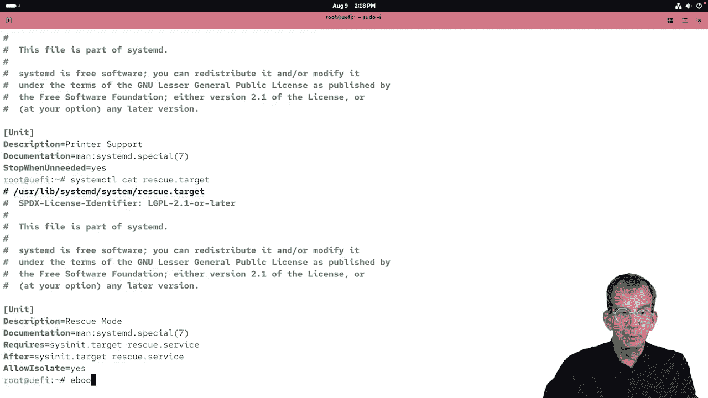
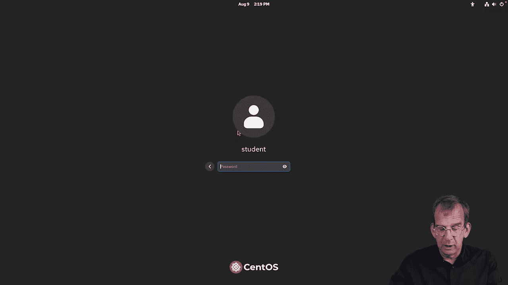

# CompTIA Linux+ V8：30：进入非默认目标启动 🐧

## 概述

在本节课中，我们将学习如何启动到非默认目标。在进行系统故障排除时，有时候必须进入非默认目标才能修复问题。你将了解 systemd 目标的基本含义，学会判断哪个目标可以被隔离启动，并掌握通过 GRUB 引导菜单和 systemctl 命令切换目标的方法。无论你是刚接触 Linux 的初学者，还是希望复习基础知识的学习者，本节内容都会用大白话把每一个细节讲清楚，让你轻松上手。

## 什么是 systemd 目标

上一节我们介绍了 systemd 的基础知识，本节中我们来看看什么是 systemd 目标。简单来说，systemd 目标就是一组单元文件的集合，用来定义系统在特定运行状态下应该启动哪些服务。

如果一个 systemd 目标不可被隔离，那么它仅仅是一组普通的单元文件：

```
不可被隔离的目标 = 一组单元文件
```

只有当目标单元文件中配置了 `AllowIsolate=yes` 选项时，你才能启动到该目标：

```
AllowIsolate=yes → 可以启动到该目标
```

这个条件非常关键，因为没有它，系统就无法通过常规方式引导进入该目标。

## 常见的 systemd 目标

刚才我们了解了目标的基本定义，本节中我们来看看系统中常用的四个目标。以下是这些常见目标：

- emergency target：紧急模式，提供极小的系统环境
- rescue target：救援模式，用于系统修复和故障排除
- multi-user target：多用户模式，提供命令行界面，适合服务器
- graphical target：图形模式，提供图形桌面环境，适合桌面系统

当然，如果你想要，也没有什么阻止你创建自己的自定义目标。



## 如何进入非默认目标

了解完常见目标后，本节中我们来看看如何实际进入非默认目标。主要有两种方法，以下是具体介绍。

### 方法一：通过 GRUB 引导菜单进入

你可以按 E 键进入 GRUB 引导菜单。进入后，在加载 Linux 的那一行末尾添加 `systemd.unit=目标名称`，然后按 Ctrl+X 启动。这样就可以引导进入非默认目标了。

### 方法二：使用 systemctl 命令设置默认目标

除此之外，你也可以使用 `systemctl set-default` 命令来设置系统的默认目标。这样下次启动时系统就会进入你指定的目标。

## 实际操作演示

刚才我们介绍了两种方法，本节中我们来看看具体的操作步骤。以下是演示流程：

1. 先使用 `systemctl get-default` 查看当前的默认目标。
2. 重启系统。
3. 在出现固件界面后的合适时机按 Esc 键，进入 GRUB 引导菜单。
4. 在菜单中按 E 键编辑引导项。
5. 找到加载 Linux 的那一行，移到行尾。
6. 添加 `systemd.unit=rescue.target`（或其他你想要的目标）。
7. 按 Ctrl+X 使用默认选项启动。

需要注意的是，救援模式和紧急模式都会提示输入 root 密码用于维护。提示通常出现在屏幕底部大约十二行的位置，虽然后面可能还会打印一些其他信息，但系统实际上是在等待你输入 root 密码。如果你没有设置 root 密码，就无法使用这些选项进行故障排除。演示系统中已经设置了 root 密码，因此可以顺利进入 root shell。

进入救援模式后，你可以使用 `systemctl start graphical.target` 从最小目标切换到提供更多功能的目标。这样你就能回到图形界面，重新登录系统。

## 总结




本节课中我们一起学习了如何进入非默认目标。我们了解了 systemd 目标本质上是一组单元文件，只有 `AllowIsolate=yes` 的目标才可以被隔离启动。我们还认识了紧急模式、救援模式、多用户模式和图形模式四个常见目标，并掌握了通过 GRUB 菜单按 E 编辑引导项以及使用 systemctl 命令切换目标的方法。希望这些内容能帮助你在实际工作中更好地进行系统故障排除。

