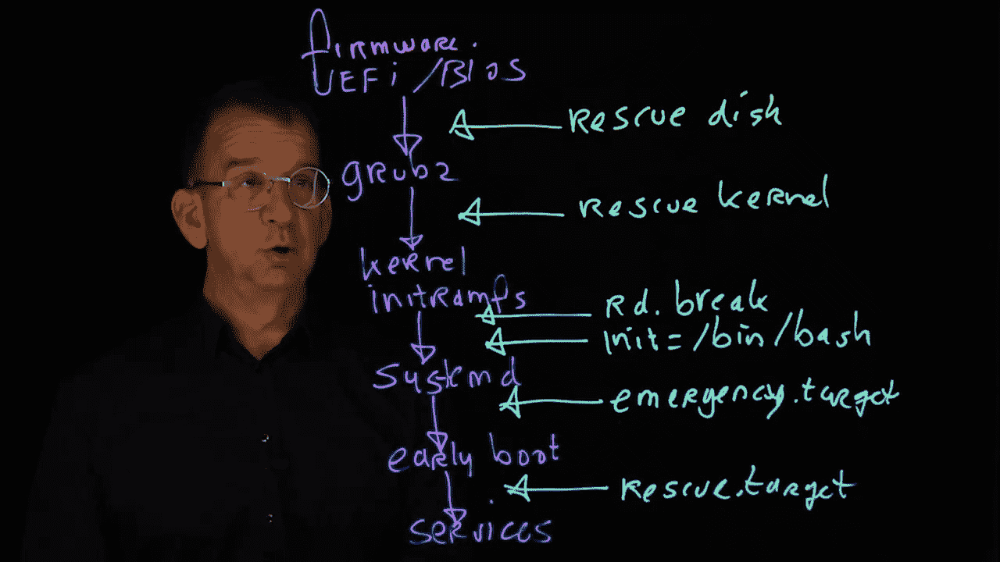
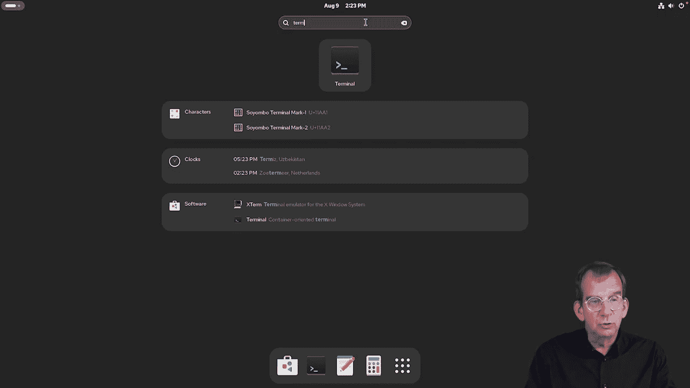
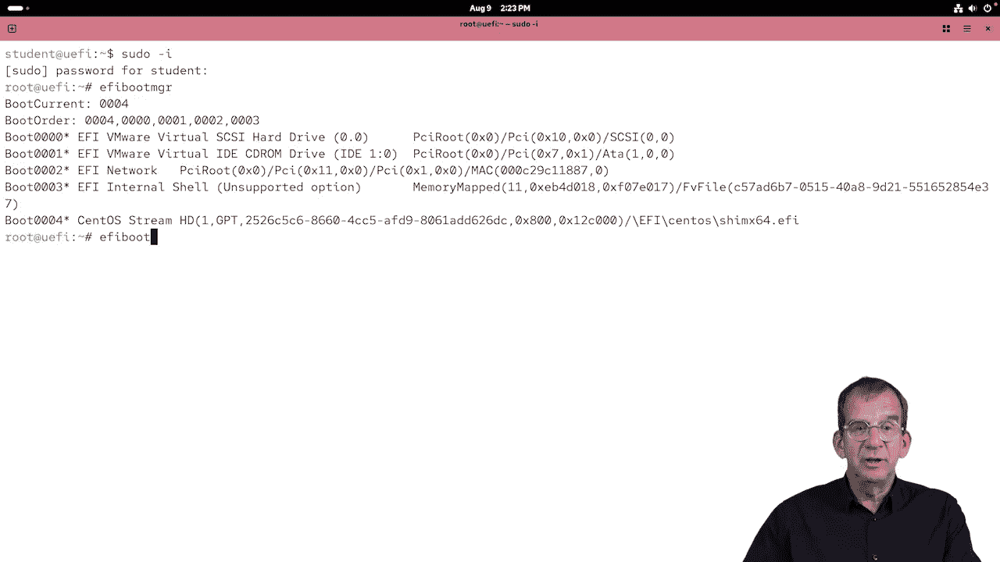
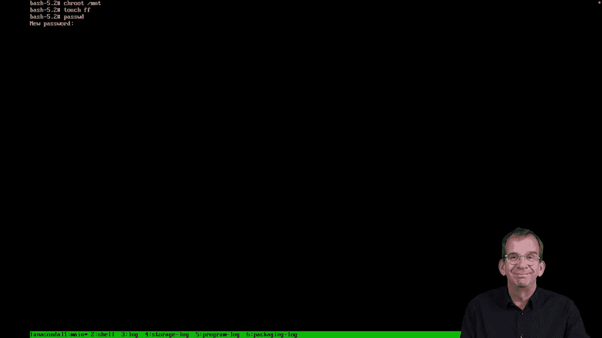

# CompTIA Linux+ V8：第4部分第31节：引导程序故障排除 🖥️

在本节课中，我们将一起学习当Linux系统无法正常启动时该如何处理。你会了解到几种常见的故障排除目标，理解救援盘和救援内核的区别，还会看到在系统完全损坏的情况下，如何通过外部介质进入系统并进行修复。无论是引导加载程序不显示，还是内核加载失败，本节都会给你提供实用的解决思路。


## 当引导出问题时，你可以先尝试的方法

有时候系统启动过程会出错，这时候你首先能做的，就是进入专门的故障排除目标。比如 emergency 目标或者 rescue 目标，这两个目标的作用就像我们刚才看到的那样，能够帮你在系统出问题的时候先进去看看。

除了这些目标，你还可以使用 `init=/bin/bash` 作为替代方案。这个方法的作用是在你甚至还没到达 systemd 之前就直接进入系统，非常直接。


如果引导加载程序根本不再显示任何界面，那么这时候就可以使用救援盘了。好消息是，通常情况下任何一张 Linux 安装光盘都可以当作救援盘来使用。接下来，我先给你画一个概览图，说明在什么具体情况下，你应该选择哪一种方式。


## 不能看到 GRUB 时该怎么办

如果你启动电脑后，根本看不到 GRUB 引导界面，那么你只有一个选择，那就是使用救援盘。你需要从外部介质启动，才能获得对自己系统的访问权限。


## 能看到 GRUB 但内核无法加载时该怎么办

如果你能看到 GRUB 菜单，但是你的内核却加载不起来，这时候还有另一个选择，那就是救援内核。救援内核直接在 GRUB 菜单中提供，它是一个备选内核。当你的内核和 initramfs 加载完成后，你就可以直接跳入系统。

在 RHEL 系统中，还有一个 `rd.break` 选项，不过这个选项只适用于 RHEL，所以在通用 Linux 上并不那么强大。你还可以使用启动参数 `init=/bin/bash`。

以下是这些选项作为内核参数时的常见形式：

```text
init=/bin/bash
systemd.unit=emergency.target
systemd.unit=rescue.target
```

这些选项都需要作为内核参数来编辑，其中最通用的一个就是 `init=/bin/bash`。它会跳过 systemd，直接给你一个 bash 命令行，而且你甚至不需要提供 root 密码。不过一旦 systemd 加载完成，情况就会变得复杂一些，这时候你可以使用 `systemd.unit=emergency.target`。这个 emergency 目标会让你在早期引导阶段之前进入系统，此时运行的服务非常少，这样最大程度提高了你重新进入正常运行状态的机会。

在故障排除过程中，通常越是能进入系统的深层部分越好，这就是为什么还有一个 rescue 目标。rescue 目标会把系统一直带到早期引导阶段，然后再加载服务。总而言之，这些就是你不同的故障排除选项，在大多数情况下，使用其中任何一个都能帮你重新进入自己的系统。




## 使用救援盘进行故障排除的实操演示

好了，现在我们来进行实际演示，我会展示如何使用救援盘来完成这个过程。首先我需要把磁盘连接起来，我在虚拟机软件中完成这个操作。你的虚拟化软件会把磁盘呈现出来，通常它会找到你之前用来安装系统的那块磁盘，界面上可能显示为灰色状态。当你选择连接 CD/DVD 时，光盘就应该连接好了。然后你需要确保系统是从这张光盘启动的。

启动进入特定环境的方式有多种。我打算使用 `efibootmgr -i` 来查看 EFI 引导管理器，它会显示出所有可用的启动选项，而我想要从选项编号 1 启动，所以使用命令：

```bash
efibootmgr -n 0001
```

执行完之后，我重新启动系统。你可以看到，我现在是从救援盘启动的。




## 如果无法使用 EFI 引导管理器该怎么办



使用 EFI 引导管理器的替代方法，是在启动的时候按下 esc 键，时间要掌握得恰到好处。说实话，你之所以要去用救援盘，很可能是因为你已经无法进入一个完全正常运行的环境了。这时候你需要在启动过程中按下 esc，或者 F2、F10、F12，具体按哪个键取决于你使用的硬件。

对于救援盘来说，我们需要的选项是故障排除。在故障排除界面里，你选择一个 rescue 系统。当然，如果是 CentOS 或 Ubuntu，当然还有 RHEL 和其他发行版提供的救援盘，都有类似的解决方案。其思路是：你从安装光盘加载操作系统，然后在从安装光盘启动的同时，尝试去访问你的硬盘。

有些发行版要求你完成完全手动的过程，需要自己去寻找各种信息；而有些发行版则会让你简单很多。现在，我想用一种通用的方式向你展示，如何从救援盘访问你的硬盘。至于后续的其他故障排除步骤，我们就不深入了，先确保能重新访问硬盘就行。


## 从救援盘访问硬盘的具体步骤

这里，CentOS 会告诉你它正在做什么，它试图找到安装内容，并挂载到 `/mnt/sysroot` 目录下。我不想使用这个选项，我想选择第 3 个选项，因为不是所有发行版都能提供像这样友好的选项。第 3 个选项会让你进入一个 shell，然后你可以尝试去查找自己的硬件。

我使用的是 `lsblk`，它会显示块设备。这是个好消息，我可以看到我的 sda1、sda2 和 sda3。

现在我要使用 `vgscan`，这个命令是 LVM 卷组扫描工具，它会尝试在系统中查找 LVM 信息。当我再次使用 `lsblk` 时，我仍然看到同样的内容，但当我使用 `vgs` 时，我能看到我的卷组；当我使用 `lvs` 时，我能看到我的逻辑卷。这样一来，我的根逻辑卷就找到了。

让我们尝试挂载它，使用命令：

```bash
mount /dev/cs/root /mnt
```

这是一个临时挂载。但系统可能会提示它不了解 `/dev/cs/root` 这个块设备。如果我们回到 `lsblk` 查看，这也说得通，因为 `lsblk` 也显示不出来。如果你执行 `ls /dev/cs`，会显示没有这样的路径；同样的，`ls /dev/mapper` 也不会显示任何 LVM 信息。

接下来我们需要做的，就是使用 `lvchange`。为了搞清楚怎么用，可以先查看帮助信息：

```bash
lvchange --help
```

在帮助里，你会看到非常多的选项，但我要找的是 `-a`，`-a` 表示激活，后面跟一个 `y`，还需要一个卷组名称。所以我要执行的命令是：

```bash
lvchange -ay cs
```

现在我再次使用 `lsblk`，你会看到 LVM 逻辑卷出现了。因为先执行了 `vgscan`，接着又执行了 `lvchange 卷组名 -ay`，现在我的卷组已经可用了，我应该能够挂载 `/dev/cs/root` 到 `/mnt` 了。

现在我已经进入了 `/mnt` 目录，从这里我可以继续工作，尝试恢复系统。


## 让其他文件系统可用，并使用 chroot 进入系统

既然我们已经在这里了，那就把下一步也完成吧。下一步就是让其他文件系统也可用。我的问题是，`/mnt` 下的 proc 文件系统是空的，sys 文件系统也是空的，dev 文件系统也是空的，但救援系统里其实是有这些文件系统的。

问题在于，这些文件系统是在启动时自动创建的，我需要确保救援系统上的这些文件系统，也能出现在我恢复的系统中。为了做到这一点，我使用 `mount -o bind`，也就是绑定挂载。绑定挂载的作用，就是可以把一个目录连接到另一个目录。

我分别对 proc、dev 和 sys 执行绑定挂载：

```bash
mount -o bind /proc /mnt/proc
mount -o bind /dev /mnt/dev
mount -o bind /sys /mnt/sys
```

现在我们更进一步了，接下来我要使用 `chroot /mnt`，这会把我带到我正常操作系统的根目录下。我甚至可以写入数据，这意味着我可以执行各种故障排除命令。

让我们试一个常见的故障排除命令，来重置 root 用户的密码，看看行不行：

```bash
passwd root
```

结果是有效的，这正是我关心的唯一事情。


## 结束演示并重启系统

关于使用救援盘进行救援的演示就到这里了。最后一步，使用 `exit` 退出 chroot 环境，然后使用 `reboot` 重启，回到你的正常操作系统中。


## 本节总结



在本节课中，我们一起学习了引导程序故障排除的相关内容。我们了解了当看不到 GRUB 时应该使用救援盘，当能看到 GRUB 但内核无法加载时可以使用救援内核或 `init=/bin/bash`，还学习了 `emergency.target` 和 `rescue.target` 这两个 systemd 目标的作用。最后，我们通过实操演示掌握了如何使用救援盘访问硬盘、使用 LVM 命令激活卷组、使用绑定挂载让关键文件系统可用，以及如何使用 `chroot` 进入系统进行修复。希望这些内容能帮助你在实际工作中更好地处理 Linux 启动故障。
