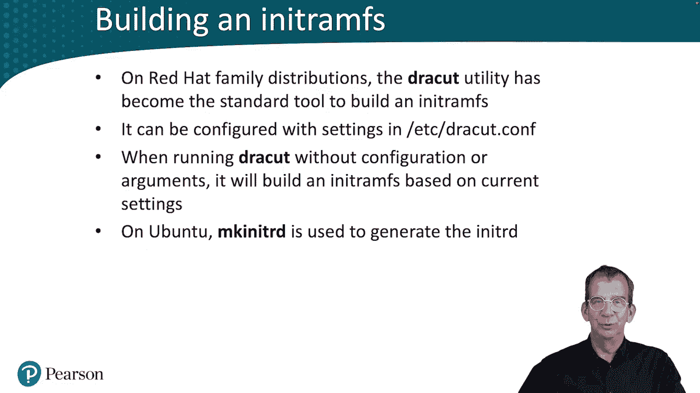
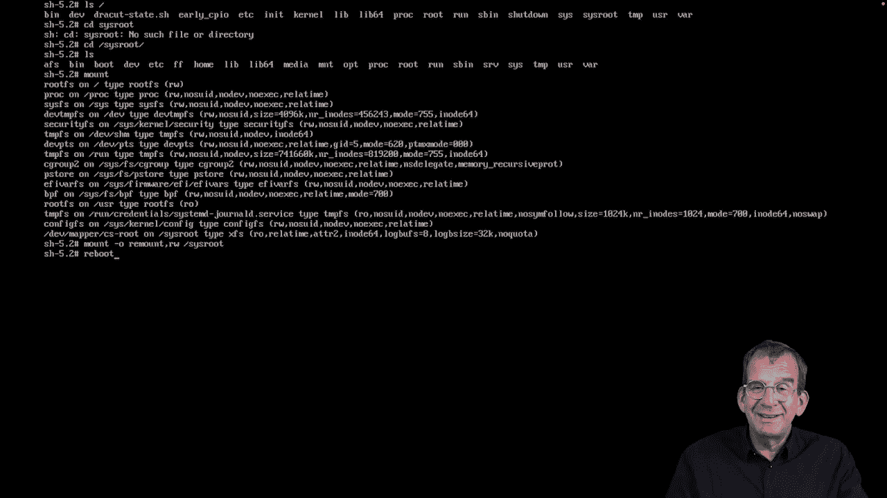

📦 CompTIA Linux+ V8：332.98：管理 Initramfs 🛠️

在本节课中我们将要学习 Linux 启动过程中一个非常重要的组件，即 Initramfs，也常被人称为 InitRD。我们会聊聊它的主要作用，它是怎么自动生成的，里面装了什么，以及在不同发行版上该如何重建它。最后还会演示如何通过特殊的引导参数直接进入 Initramfs 环境，方便做系统故障排查。

什么是 Initramfs：

Initramfs 的主要目的是为内核提供那些挂载根文件系统所必须的模块。当你安装系统的时候，安装程序会自动为你生成 Initramfs。安装过程会检测当前机器上所有存在的硬件，然后根据这些硬件生成对应的 Initramfs，这样系统启动时就能顺利找到并挂载根文件系统了。

以下是 Initramfs 的主要作用：
- 提供挂载根文件系统所需的内核模块。
- 在安装系统时由安装程序自动生成。
- 包含系统启动初期必须使用的目录结构。

用简单的公式来描述，Initramfs 就是内核模块加上必要目录，专门用于在引导阶段挂载根文件系统：

`Initramfs = 内核模块 + 必要目录，用于挂载根文件系统`

了解完 Initramfs 是做什么的之后，我们来看看它实际上是怎么组织的。

Initramfs 的组成与 CPIO 归档：

Initramfs 由一组目录构成，这些目录是创建根文件系统所需要的，最终会被打包成一个 CPIO 归档文件。CPIO 是一种非常古老的备份打包方式，虽然现在不常见，但你偶尔还会遇到它，而且它至今仍然被用作 Initramfs 的格式。这个 CPIO 归档会在引导时被内核读取。

以下是 CPIO 归档的几个特点：
- CPIO 是一种非常古老的备份打包方式。
- 它在引导时被内核读取。
- 如今偶尔还会遇到，有时依然被用作 Initramfs 的格式。

用代码形式表示，CPIO 归档就是 Initramfs 目录的打包格式：

`cpio 归档 = Initramfs 目录的打包格式`

有了这些文件之后，你可能会问，是不是所有系统都离不开 Initramfs 呢？

为什么几乎总是需要 Initramfs：

理论上，如果所有挂载根文件系统所需的模块都已经直接编译进内核，那么引导时就可以不需要 Initramfs。但实际上这种情况几乎从不发生，绝大多数系统启动时都依赖 Initramfs 来完成这个工作。除了最基本的挂载根文件系统，Initramfs 还能提供额外的功能，让系统能够从非默认存储设备启动，比如使用 LVM、加密的根文件系统，或者基于网络的根文件系统。

用公式表示这种极端情况：

`若所有挂载根文件系统的模块都已编译进内核 → 可不使用 Initramfs 引导（实际极少发生）`

除了最基本的挂载根文件系统，Initramfs 还能干些别的事情。

Initramfs 的额外功能：

如果你以后想让系统支持从 LVM、加密根文件系统或网络根文件系统启动，Initramfs 就可以提供这些额外的功能支持。也就是说，一旦你决定重新配置系统来使用这些非默认的存储方式，就需要知道如何重新生成 Initramfs，否则系统可能无法正常引导。

以下是 Initramfs 可以支持的非默认存储场景：
- LVM 存储。
- 加密的根文件系统。
- 基于网络的根文件系统。

用代码形式表示这些支持：

`Initramfs 支持 → LVM / 加密根 / 网络根`

如果你以后想让系统支持这些功能，就得知道怎么重新生成 Initramfs。

如何重建 Initramfs：

在 Red Hat 系列发行版中，Dracut 已经成为构建 Initramfs 的标准工具。你可以在 `/etc/dracut.conf` 文件中对它进行配置。当你不带任何配置参数运行 Dracut 时，它会根据当前的系统设置来构建 Initramfs。所以，在你添加了新硬件并且希望把对应的驱动放进 Initramfs 里之前，首先要确保这些硬件驱动已经存在，然后再运行 Dracut。

以下是在 Red Hat 系列系统上重建 Initramfs 的步骤：
- 确保所需的硬件驱动程序已经存在。
- 使用 Dracut 工具进行构建。
- Dracut 的配置文件位于 `/etc/dracut.conf`。
- 不带参数运行 `dracut` 时，它会根据当前设置构建 Initramfs。

对应的核心命令如下：

`dracut`

在 Ubuntu 上，情况略有不同，你可以使用 `mkinitrd` 命令，它是 Ubuntu 生成 Initramfs 的替代工具。

`mkinitrd`

重建 Initramfs 是日常维护的一部分，而有时候我们需要直接进入它来排查故障。

使用 rd.break 进入 Initramfs 故障排除：

在 Red Hat 系统上，你可以使用 `rd.break` 引导参数直接引导进入 Initramfs，这对故障排除非常有帮助。需要注意的是，这是 Red Hat 特有的选项，在 Ubuntu 上不会起作用。

以下是使用 `rd.break` 的具体操作步骤：
- 进入 GRUB 引导菜单。
- 按下 `E` 打开编辑器界面。
- 在加载 Linux 的那一行末尾输入 `rd.break`。
- 使用 `Ctrl + X` 继续引导。

对应的引导参数如下：

`rd.break`

进入系统之后，你会发现自己处于一个紧急模式的 Shell 里，这时候需要输入 root 密码才能进入。进入之后，如果你执行 `mount` 命令，可以看到第一行显示根文件系统位于 `/`，类型是 `rootfs`，那实际上就是当前的 Initramfs。此时执行 `ls /` 看到的目录都来自 Initramfs 环境，这个环境非常适合用来做故障排查。

不过要注意，这个时候根文件系统是只读的，挂载选项里会有 `RO` 字样。如果你想对普通操作系统里的文件做修改，就需要先把它重新挂载为可读写状态，这样才能访问到普通操作系统里的所有文件。

以下是重新挂载根文件系统为可读写的命令：
- `mount -o remount,rw /sysroot`

对应的命令如下：

`mount -o remount,rw /sysroot`

总结：

本节课中我们一起学习了 Initramfs 的基本概念、它的作用和组成、CPIO 归档格式、在 Red Hat 和 Ubuntu 上如何重建 Initramfs，以及如何使用 `rd.break` 参数进入 Initramfs 进行故障排除。希望这些内容能帮助你更好地理解 Linux 启动过程。
