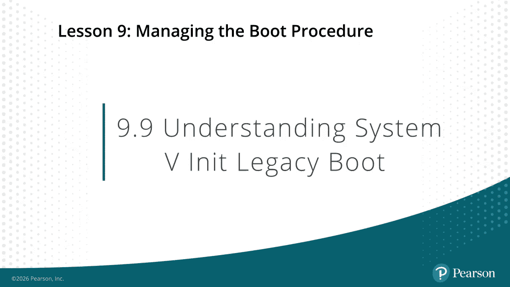
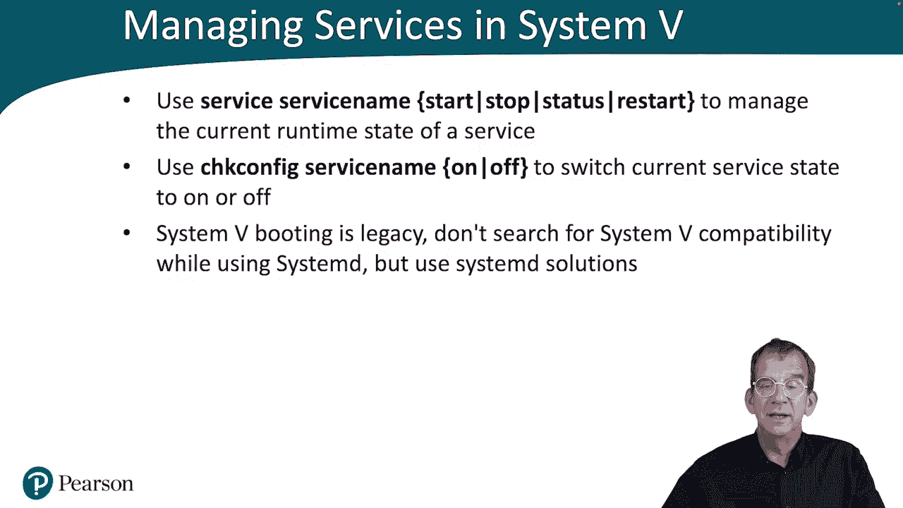

# CompTIA Linux+：04：理解 System V Init 传统引导机制 🖥️


在本节课中，我们将一起学习 System V Init 传统引导机制。这部分内容主要讲在 systemd 成为标准之前，Linux 系统是如何启动的。虽然现在大多数发行版都已改用 systemd，但了解旧的 System V 引导流程，对你在排查老旧系统问题时依然非常有帮助，也能让你更完整地了解 Linux 初始化系统的演进过程。


System V Init，也就是大家常说的 System 5 引导，是 systemd 出现之前主流的 Linux 初始化方式。这个名称来源于早期的 System V Unix 发行版，那些系统最早采用了这种引导方式。在过去十多年里，systemd 已经成为了绝大多数 Linux 发行版的标准初始化系统。所以现在你很难再找到大量还在使用 System V 的机器，不过在某些老旧设备或特殊场景下，它依然可能出现，掌握相关知识不会有坏处。


接下来我们来看看 System V 引导的核心组件。在 System V 模式下，内核加载完成后会启动第一个进程，也就是进程号为 1 的进程。这个进程由 `/sbin/init` 文件提供，它负责启动系统中所有其他的服务和进程，是整个引导过程的总负责人。

```
/sbin/init  # PID 1，System V 的初始化进程，由内核加载并负责启动其他一切
```


有了初始化进程之后，系统还需要知道自己应该启动到什么状态。在 System V 中，这个状态被称为“运行级别”。运行级别用数字表示，每个数字对应一种不同的系统工作模式，比如是否启动图形界面、是否允许多个用户同时登录，亦或是仅用于系统维护等。

```
运行级别 3 = 多用户模式，无图形界面
运行级别 5 = 多用户模式，带图形界面
```


默认进入哪个运行级别，是由一个配置文件决定的。这个文件位于 `/etc/inittab`，系统启动时会读取它，确定应该默认进入哪个运行级别，从而让系统开机后直接处于预期的工作状态。


如果你想临时改变当前的运行级别，不需要重新修改配置文件，可以直接使用 `init` 或 `telinit` 命令。比如你当前在图形界面（运行级别 5），想切换到多用户命令行模式（运行级别 3），就可以执行 `init 3`，系统会立即切换到对应状态。

```
init 3    # 从图形界面切换到多用户命令行模式
telinit 3 # 同上，telinit 也是用来通知 init 改变当前运行级别
```


除了在系统运行中切换，你也可以在系统启动的时候直接指定运行级别。方法是在内核引导参数行的末尾加上运行级别的数字，这样系统启动后就会直接进入你指定的那个级别，而不需要事先修改配置文件。


System V 时期管理系统服务主要靠 `service` 命令。你可以用它来启动、停止、查看状态或重启某个服务。使用格式是 `service` 加上服务名，再加上操作类型，从而对该服务执行相应的操作。

```
service <服务名> start   # 启动服务
service <服务名> stop    # 停止服务
service <服务名> status  # 查看服务状态
service <服务名> restart # 重启服务
```


如果你想让某个服务在系统启动时自动开启，或者永久禁用它，那就需要用到 `chkconfig` 命令。比如执行 `chkconfig <服务名> on`，就能确保该服务在下次 System V 引导时自动启动；执行 `off` 则表示开机不启动。

```
chkconfig <服务名> on   # 设置服务开机自动启动
chkconfig <服务名> off  # 设置服务开机不启动
```


现在我们已经使用 systemd 很多年了，System V 引导属于老旧的遗留技术。因此在使用 systemd 的系统上，你不应该再去寻找 System V 的兼容选项，而应该直接使用 systemd 提供的解决方案。当然，极少数情况下你可能会遇到连 `systemctl` 命令都找不到的发行版，这时候可以临时用 `service` 命令代替，但这种情况非常罕见，日常中几乎用不到。




本节课中我们一起学习了 System V Init 传统引导机制的基本概念，包括 PID 1 的 `/sbin/init`、运行级别的划分、`/etc/inittab` 配置文件、通过 `init` 或 `telinit` 切换运行级别，以及使用 `service` 和 `chkconfig` 管理系统服务。虽然现在大多数系统已迁移到 systemd，但掌握这些旧知识能帮你更好地理解 Linux 引导的演进，也能在遇到老旧系统时派上用场。

